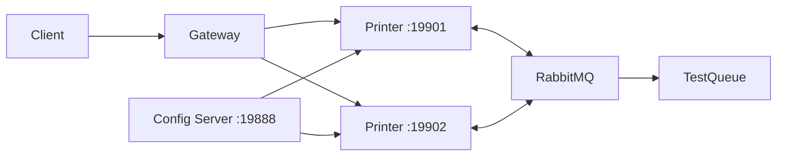
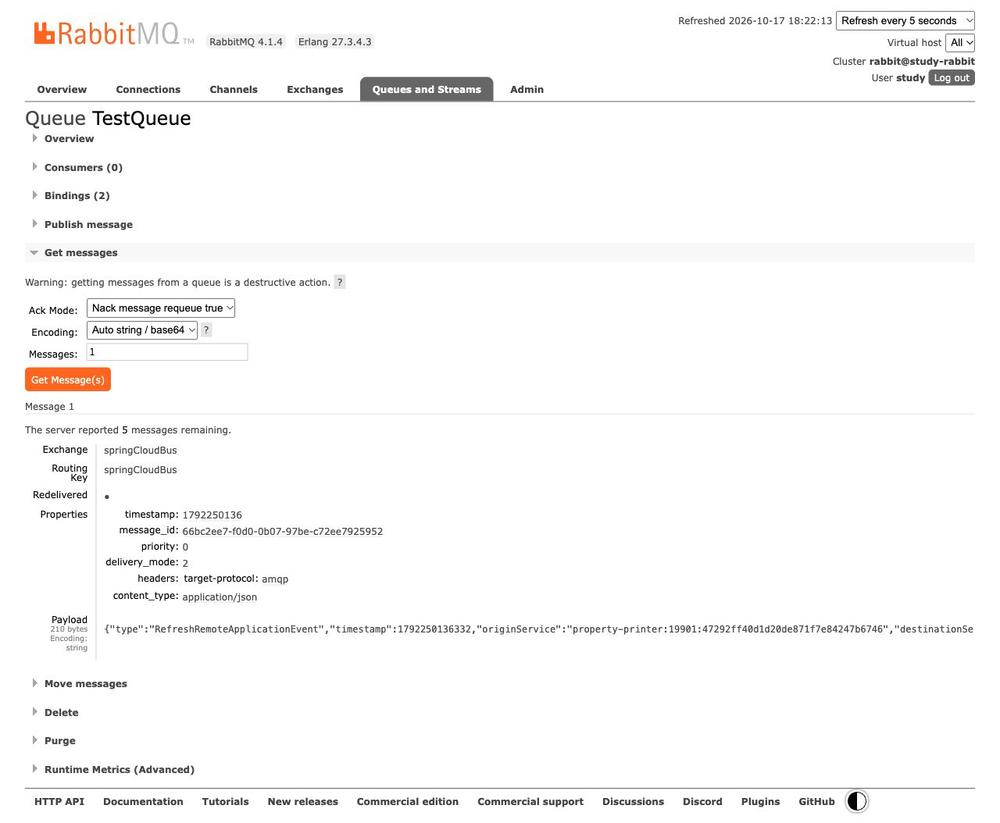

# Spring Cloud: конфигурация, Gateway и Bus

Собрал три приложения: Config Server, `property-printer` и реактивный Gateway. Две реплики принтера получают `text-to-print` с сервера конфигурации, а Gateway распределяет запросы между ними. Через RabbitMQ обе реплики обновляют значение без перезапуска и получают команду остановки.

Java 21, Spring Boot 3.5.8, Spring Cloud 2025.0.0 / Bus 4.3.0, RabbitMQ 4.1.4. Версии библиотек согласованы Cloud BOM; образ брокера закреплён digest.



## Запуск и проверка

Из этой директории:

```bash
python3 init.py
../../sprint02/file-transformer-gradle-plugin/gradlew --no-daemon --console=plain bootJar
docker compose -p java-sprint09-config up -d --wait --wait-timeout 150
python3 verify.py
```

Нужны JDK 21, Docker Compose и Python 3. Проверка сама запускает четыре JVM и завершает только свои процессы. До запуска убеждается, что порты свободны. RabbitMQ остаётся доступным для просмотра результатов на [127.0.0.1:19473](http://127.0.0.1:19473); пользователь `study`, пароль в `target/lab.env`.

Для самостоятельного запуска загрузите переменные в каждой из четырёх вкладок терминала:

```bash
set -a
source target/lab.env
set +a
```

Затем в отдельных вкладках запустите:

```bash
java -jar config-server/build/libs/config-server.jar
java -jar property-printer/build/libs/property-printer.jar --server.port=19901
java -jar property-printer/build/libs/property-printer.jar --server.port=19902
java -jar gateway/build/libs/gateway.jar
```

Последовательные обращения к `http://127.0.0.1:19800/property-printer/texts` показывают разные Bus ID и одно значение. Измените `target/config-repo/property-printer-default.yml`, затем отправьте:

```bash
curl --fail-with-body -u "operator:$LAB_OPERATOR_PASSWORD" \
  -H 'X-Lab-Operation: bus' -H 'Content-Type: application/json' \
  -X POST http://127.0.0.1:19800/property-printer/actuator/busrefresh
```

Ожидается `204`, после чего обе исходные реплики возвращают новое значение. Файловый native backend читает внешний файл при запросе; перезапуск Config Server для изменения упакованного classpath-ресурса здесь не требуется.

В RabbitMQ очередь `TestQueue` привязана к `springCloudBus` с routing key `#`. В ней доступны настоящие `RefreshRemoteApplicationEvent` с `originService`, `destinationService` и ID. Копия проверенного события сохраняется в `target/refresh-event.json`.

Для остановки обеих реплик замените в команде `busrefresh` на `busshutdown`. Используется штатный endpoint и штатное событие Bus. Закрытие контекста вынесено в отдельный поток: синхронный `ShutdownListener` в Bus 4.3.0 иначе ждёт завершения собственного HTTP/AMQP callback и срывает graceful shutdown. Проверка воспроизводила этот таймаут до исправления; теперь обе JVM завершаются с кодом `0` и завершённым graceful shutdown.



## Что проверено

- Два уникальных Bus ID, реальная балансировка Gateway и начальная конфигурация с Config Server.
- Отказ в административном запросе без аутентификации или обязательного заголовка; `env` через Gateway не открыт.
- После изменения файла реплики сохраняют старое значение до команды Bus; затем обе обновляются, сохраняя исходные ID.
- Отдельная очередь получает настоящее событие обновления; команда остановки завершает обе реплики.

Секреты генерируются в `target/lab.env` с правами `0600`; повторная инициализация их сохраняет. Брокер получает отдельный `target/rabbit.env` только со своим паролем; проверка передаёт каждой JVM только необходимые секреты. Все опубликованные порты привязаны к loopback. HTTP без TLS и общий оператор — ограничение локального стенда; для удалённого запуска нужны TLS и отдельные административные права. Нестандартный заголовок исключает browser form CSRF; CORS не включён. Пароль и заголовок нужны также при прямом обращении к принтерам.

Остановка брокера сохраняет его volume и очередь:

```bash
docker compose -p java-sprint09-config stop
```
