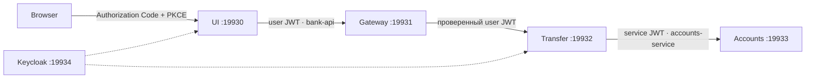
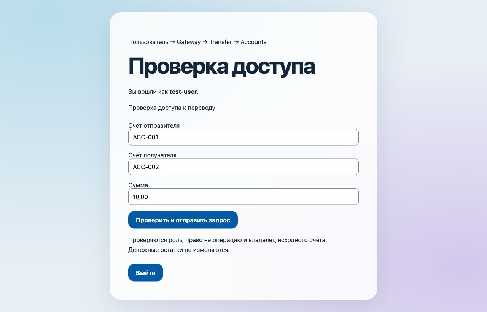
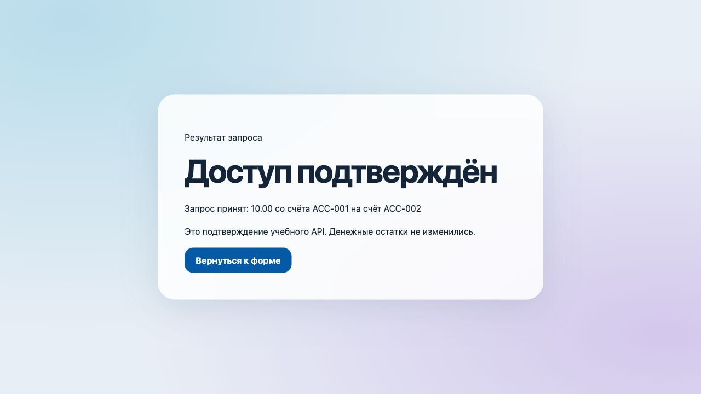

# Четыре сервиса: пользовательский JWT, M2M и контракты

Собрал цепочку `bank-ui → bank-gateway → transfer-service → accounts-service`. Пользователь входит через Keycloak, Gateway проверяет и передаёт его JWT, Transfer проверяет право на операцию и владельца счёта. Для обращения к Accounts используется отдельный Client Credentials token.

Это упражнение по межсервисной безопасности: Accounts возвращает подтверждение запроса, денежные остатки не меняются. Полноценное банковское приложение находится среди проектных работ.

Java 21, Spring Boot 3.5.8, Spring Cloud 2025.0.0, Contract 4.3.0, Keycloak 26.1.3. Четыре исполняемых приложения и библиотека `identity` с единым преобразованием четырёх известных realm roles.



## Границы доступа

| Переход | Проверка |
| --- | --- |
| Browser → UI | OIDC login с PKCE S256, серверная сессия, CSRF для формы и logout |
| UI → Gateway | Подпись JWT, issuer, audience `bank-api`, роль `USER` |
| Gateway → Transfer | Повторная проверка JWT; для POST нужны `USER` и `transfer.write` |
| Transfer → Accounts | Client Credentials, audience `accounts-service`, `SERVICE`, `azp=transfer-service`; для POST дополнительно `accounts.write` |

`TRANSFER_WRITE` преобразуется в `transfer.write`, `ACCOUNTS_WRITE` — в `accounts.write`. Неизвестные роли и некорректная структура claims не дают дополнительных прав. Наличие `SERVICE` у другого клиента само по себе доступа не даёт.

Внешний маршрут `/api/transfers` преобразуется в `/transfers` целевого сервиса. Доступны preview и отправка запроса. `JwtTokenRelayGatewayFilterFactory` берёт токен из проверенного principal, а не из произвольного заголовка. JWT пользователя не используется для Accounts: сервисный клиент имеет собственный principal и кеш авторизации.

В фикстуре `ACC-001` принадлежит `test-user`, `ACC-002` — `other-user`. DTO проверяет формат счёта и положительную десятичную сумму не более чем с двумя знаками. Неизвестный счёт даёт `404`, чужой исходный счёт — `403`, недоступная зависимость — `503`; пустое подтверждение не считается успехом.

## Сборка и проверка

Из этой директории, с JDK 21 и Docker Compose:

```bash
python3 init.py
../../sprint02/file-transformer-gradle-plugin/gradlew --no-daemon --console=plain \
  -Dmaven.repo.local="$PWD/target/maven" bootJar :identity:test :transfer-service:test
docker compose -p java-sprint09-security up -d --wait --wait-timeout 150
python3 verify.py
```

Проверка сама запускает и останавливает четыре JVM. Каждая получает только нужный ей секрет. Сервис Accounts дополнительно останавливается для проверки отказа зависимости. Keycloak остаётся доступен для изучения, его данные сохраняются в volume.

Проверены настоящие Authorization Code exchanges с PKCE, проход всей цепочки из браузерной формы, CSRF и logout, роли пользователя, принадлежность счёта, M2M, отказ чужому клиенту с подходящими ролями, неверная audience и изменённая подпись JWT. Отдельно у того же service account временно снимается `ACCOUNTS_WRITE`: чтение остаётся доступным, запись получает `403`. Роль восстанавливается в `finally`; административный вход используется только для подготовки этой фикстуры.





## Provider и consumer contracts

Контракт `GET /accounts/ACC-001/owner` находится в `accounts-service/src/contractTest/resources/contracts/accounts/`. Provider ожидает `Bearer test-token`, consumer — bearer token по регулярному выражению. Ответ содержит `accountId` и `ownerUsername`.

Spring Cloud Contract генерирует JUnit 5 provider-тест. Он проходит через настоящий MVC controller, in-memory данные и правила доступа; только `JwtDecoder` заменён тестовой фикстурой в `src/contractTest`. Проверка настоящей подписи и получения JWK по HTTP выполняется отдельно в `verify.py` с Keycloak. В исполняемом приложении обхода JWT нет.

```bash
../../sprint02/file-transformer-gradle-plugin/gradlew --no-daemon --console=plain \
  -Dmaven.repo.local="$PWD/target/maven" :accounts-service:publishToMavenLocal
../../sprint02/file-transformer-gradle-plugin/gradlew --no-daemon --console=plain \
  -Dmaven.repo.local="$PWD/target/maven" :transfer-service:test
```

Публикуются обычный JAR Accounts, его `stubs` и зависимость `identity`. Версии зависимостей в публикации разрешены из BOM. Личный `~/.m2` не затрагивается. Stub Runner в режиме `LOCAL` использует точную версию `1.0-SNAPSHOT`; consumer вызывает настоящий `AccountsClient.isOwner`. Задача consumer зависит от публикации, а JAR стабов включён в её inputs, чтобы изменение контракта не оставило старый зелёный результат из кеша.

Всего пять JUnit-проверок: три варианта структуры claims, сгенерированный provider-тест и consumer-тест. Сквозные HTTP-проверки дополняют их проверкой реальной identity и отказов зависимостей.

## Самостоятельный запуск

В каждом терминале прочитайте `target/lab.env` без экспорта всех переменных:

```bash
source target/lab.env
```

Запустите четыре приложения в отдельных терминалах:

```bash
java -jar accounts-service/build/libs/accounts-service.jar
TRANSFER_CLIENT_SECRET="$TRANSFER_CLIENT_SECRET" java -jar transfer-service/build/libs/transfer-service.jar
java -jar bank-gateway/build/libs/bank-gateway.jar
UI_CLIENT_SECRET="$UI_CLIENT_SECRET" java -jar bank-ui/build/libs/bank-ui.jar
```

Откройте [127.0.0.1:19930](http://127.0.0.1:19930). Пользователи `test-user`, `other-user`, `read-user` имеют общий локальный пароль `LAB_USER_PASSWORD` из `target/lab.env`; последний может открыть preview, но не выполнить POST. У Keycloak пользователь `admin`, пароль `KC_BOOTSTRAP_ADMIN_PASSWORD` из того же файла. Значения генерируются с правами `0600`, повторная инициализация их сохраняет.

Файл realm монтируется с обязательным именем `<realm>-realm.json`; client scope `basic` сохраняет `sub` в access token. Импорт при старте не переписывает существующий realm: изменённую конфигурацию уже работающего стенда применяйте через Admin API, сохраняя данные.

Порты привязаны к loopback; HTTP и Keycloak `start-dev` предназначены для локальной работы. Сессии UI хранятся в памяти одной JVM, автоматического OIDC logout у провайдера нет. Подписанный JWT проверяется локально: изменение роли не отзывает уже выданный токен мгновенно; срок жизни access token — пять минут. Ручной запуск останавливается через Ctrl+C в соответствующих терминалах, Keycloak — с сохранением данных:

```bash
docker compose -p java-sprint09-security stop
```
