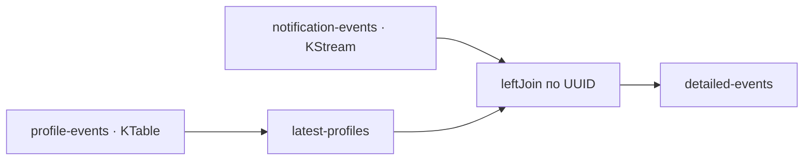
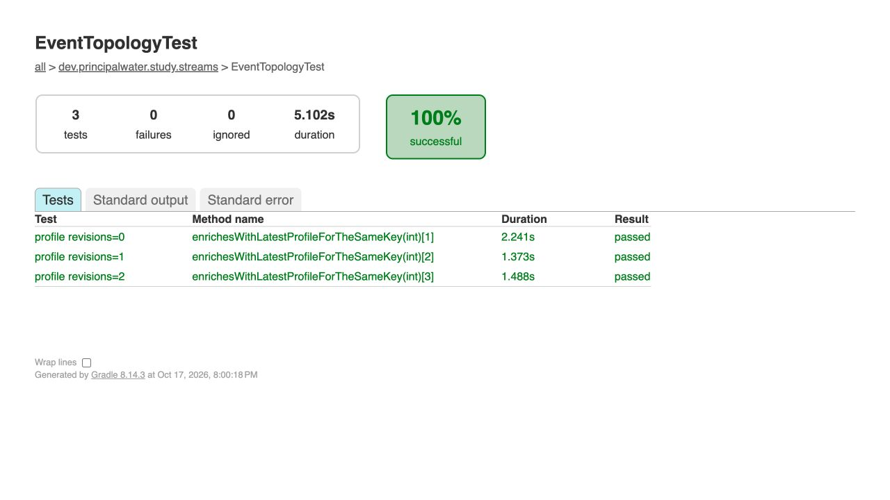

# Kafka Streams: обогащение события профилем

Цель — объединить действие пользователя с последним состоянием его профиля и проверить результат через настоящий встроенный брокер.

Java 21, Spring Boot 3.4.0, Spring Kafka 3.3.0, Kafka Streams/Client 3.8.1 — согласованные версии исходного упражнения. Jackson подключён напрямую: HTTP-сервер для этого потока не нужен.

## 1. Собрать топологию



`EventInfo` содержит тип и описание события, `UserProfile` — имя и регион. `DetailedEvent` объединяет оба объекта. Все сообщения используют UUID-ключ; Serdes заданы явно. KTable хранит последнее значение профиля, а left join сохраняет событие и при отсутствии профиля (`userProfile=null`). Обновление профиля само по себе не отправляет новую нотификацию.

Обработка включена через `@EnableKafkaStreams`; `application-id` и каталог состояния заданы в конфигурации. Для внешнего брокера все три топика должны иметь одинаковое число партиций и совместимое распределение UUID-ключей. В этом упражнении join использует доступное состояние KTable; ожидание будущего профиля или переобогащение старых событий не реализовано.

## 2. Проверить результат

Из этого каталога с JDK 21 в `JAVA_HOME`:

```bash
../../sprint02/file-transformer-gradle-plugin/gradlew --no-daemon --console=plain test bootJar
```

Docker не требуется: `@EmbeddedKafka` поднимает брокер с тремя однопартиционными топиками. Один параметризованный тест в общем Spring-контексте проверяет отсутствие профиля, первое состояние и обновление Калининград → Краснодар. Другой UUID в fixtures проверяет изоляцию пользователей. Результат читается через `KafkaTestUtils` и сравнивается `KafkaMatchers` по ключу и значению.

Подтверждение отправки профиля ещё не означает обновление KTable: перед нотификацией тест ограниченно ждёт ожидаемое значение в materialized store. Позиция результата фиксируется до отправки fixtures: ленивый `seekToEnd` иначе может пропустить уже появившуюся запись. Произвольных пауз и пересоздания контекста между сценариями нет.



Отчёт — `build/reports/tests/test/index.html`. Это проверка реального Kafka-протокола и топологии внутри одного тестового JVM; она не моделирует распределённый отказ нескольких брокеров.

Источники: [Spring Kafka testing](https://docs.spring.io/spring-kafka/reference/3.3/testing.html), [Kafka Streams DSL](https://kafka.apache.org/38/streams/developer-guide/dsl-api/).
