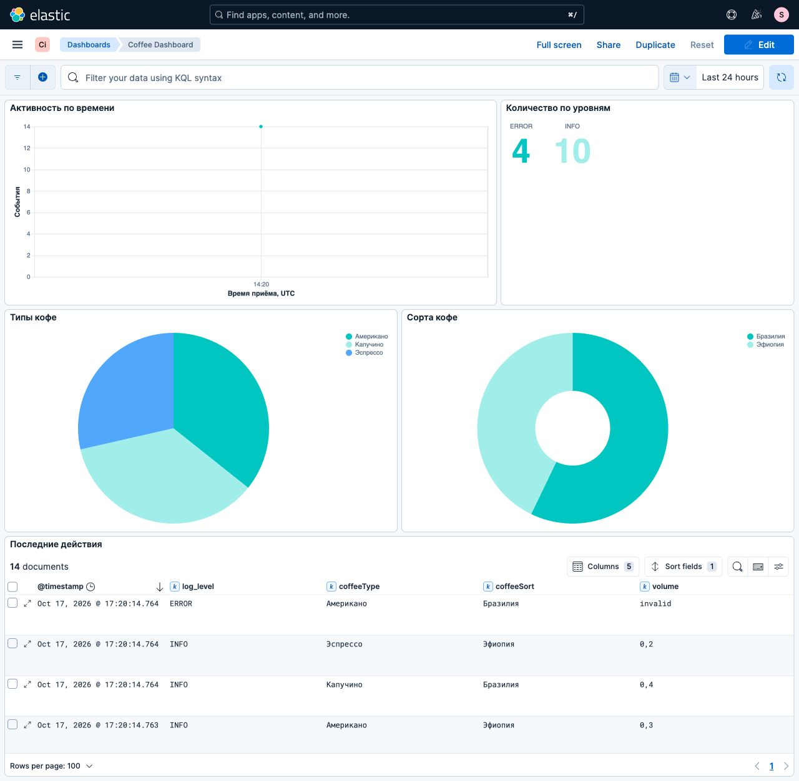
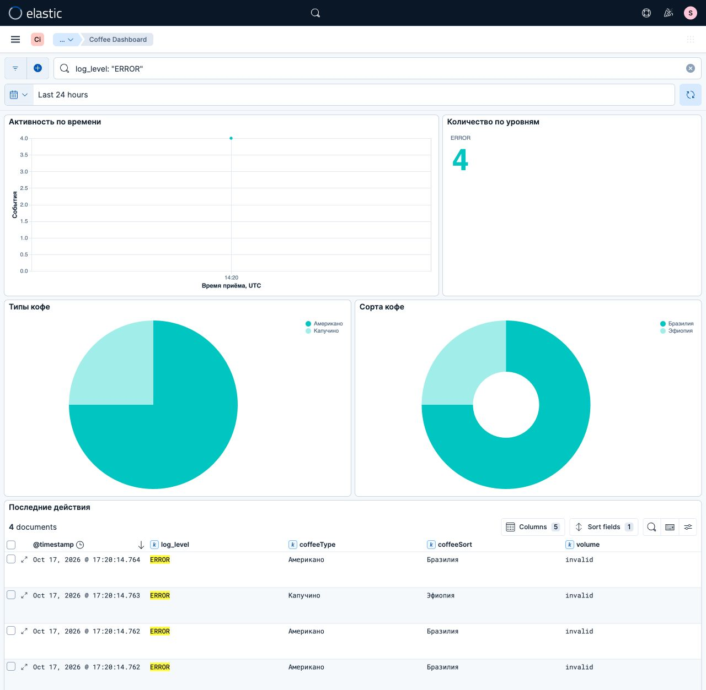

# Кофейные логи: Filebeat, Kafka, Logstash и Kibana

Цель — провести события консольного Java-приложения через обработку логов до поиска и дашборда. Три практикума объединены в один стенд: обработка с выводом в файлы, суточные индексы Elasticsearch и визуализация в Kibana.

## Описание

Java 21, Log4j2 2.25.3, Kafka 4.0.0 и Elastic Stack 9.0.0. Образы закреплены digest. Маршрут один: `Java → coffee.log → Filebeat → coffee-logs → Logstash → файлы / Elasticsearch → Kibana`.

В условии упоминаются Kafka и прямая связка Filebeat–Logstash. Здесь Kafka включена между ними; параллельного источника тех же событий нет. Последний практикум сначала упоминает Kubernetes, но затем требует Docker-команды: стенд повторяет этот вариант через Compose.

## 1. Подготовка и сборка

Команды выполняются из этого каталога. Нужны JDK 21, Python 3 и Docker Compose.

```bash
python3 init.py
../../sprint02/file-transformer-gradle-plugin/gradlew --no-daemon installDist
docker compose -p java-sprint11-coffee -f compose.yml up -d kafka elasticsearch
python3 bootstrap.py
docker compose -p java-sprint11-coffee -f compose.yml exec -T kafka \
  /opt/kafka/bin/kafka-topics.sh --bootstrap-server kafka:9092 \
  --create --if-not-exists --topic coffee-logs --partitions 1 --replication-factor 1
```

`init.py` сохраняет случайные пароли в `target/` с правами 0600 и не заменяет существующие. Elasticsearch проверяет пароль; писатель и читатель имеют разные права. Пользователь `study` настраивает интерфейс Kibana и читает только `coffee-logs-*`; `kibana_system` используется сервером Kibana. Пароль `study` находится в `target/credentials.json`.

Опубликованы только loopback-порты: Elasticsearch `19200`, Kibana `19601`. HTTP внутри локального стенда без TLS, Kafka доступна только контейнерам его сети. Для удалённой эксплуатации нужны TLS, аутентификация Kafka и внешнее управление секретами. Подсеть по умолчанию `10.251.11.32/28` меняется через `COFFEE_NETWORK_SUBNET` при конфликте.

## 2. Обработка в файлы

```bash
docker compose -p java-sprint11-coffee -f compose.yml up -d logstash filebeat
build/install/coffee-logging/bin/coffee-logging
```

Ввод — пара строк: имя, затем объём `0,2`, `0,3` или `0,4`. До конца stdin можно повторять пары. Например:

```text
reader
0,3
reader
0,8
```

Приложение случайно выбирает сорт и напиток. Корректный объём даёт INFO, другой — ERROR с безопасным значением `invalid`, без копирования произвольного ввода. Имена ограничены 1–64 символами `[a-zA-Z0-9_.-]`; нечётное число строк и недопустимое имя завершают приложение с ошибкой.

Logstash отбрасывает `test`, WARN и непарсящиеся записи. INFO направляется в `target/output/coffee-processed.txt`, ERROR — в `coffee-errors.txt`. JSON содержит ровно `time`, `coffeeSort`, `coffeeType`, `volume`, `isNight`. Ночь — от 22:00 включительно до 08:00; `isNight` имеет тип boolean. Исходная строка, имя и служебные копии не выходят из фильтра. Исходный файл и Kafka остаются доступны администратору стенда.

Для короткого файла fingerprint Filebeat 9.0 задан в 64 байта: значение по умолчанию 1024 задерживает чтение маленьких файлов. Изменение fingerprint после начала работы может повторно отправить старые записи.

## 3. Elasticsearch и проверка повторной доставки

```bash
python3 verify.py
```

Проверка сама переключает выходы: сначала файлы, затем Elasticsearch. За один запуск создаёт пять INFO и две ERROR, проверяет ввод, фильтрацию, точный набор полей, типы и границы 07:59/08:00/21:59/22:00. Затем проверяет индексы, mapping, ILM, запрет чтения писателю и записи читателю. Повторный запуск добавляет новую порцию событий; используется отдельный учебный стек, максимум 1000 документов для этой ограниченной проверки.

Индексы `coffee-logs-yyyy.MM.dd` выбираются по UTC-времени обработки. `@timestamp` добавляет ingest pipeline: это время приёма Elasticsearch, поскольку исходный лог содержит только время суток. `time` остаётся keyword. Служебный `log_level` добавляется только для Elasticsearch. Template использует strict mapping, boolean для `isNight`, один primary shard и ноль replicas. Delete-фаза ILM начинается через семь суток от создания индекса; удаление асинхронное. Проверка не сокращает ожидание реального удаления через семь дней и не подменяет его.

Затем проверка читает Kafka новым consumer group и дожидается commit offsets, опустошения PQ и завершения output. ID `topic-partition-offset` сохраняет число документов при повторе той же записи. Это не дедупликация повторно опубликованной бизнес-операции: у неё другой offset. Файловый выход append допускает повторы после сбоя; один брокер и один узел Elasticsearch не обеспечивают HA. Kafka, registry Filebeat, PQ и Elasticsearch используют отдельные volumes.

Для ручного переключения:

```bash
OUTPUT_MODE=elasticsearch docker compose -p java-sprint11-coffee -f compose.yml up -d logstash
```

## 4. Дашборд и перенос

```bash
docker compose -p java-sprint11-coffee -f compose.yml up -d kibana
python3 dashboard.py
```

Откройте [Kibana](http://127.0.0.1:19601) под `study`. Дашборд `Coffee Dashboard` содержит временной график событий, pie по напиткам, donut по сортам, счётчики INFO/ERROR и таблицу последних действий. Ошибки также входят в распределения: панели показывают события, не только успешные заказы.

Четыре графика описаны Vega-Lite, таблица — сохранённый поиск Discover. `Coffee Logs` использует `coffee-logs-*` и `@timestamp`. Фильтры и временной диапазон дашборда применяются к запросам графиков.

`dashboard.py` экспортирует семь объектов с зависимостями в [kibana/coffee-dashboard.ndjson](kibana/coffee-dashboard.ndjson), импортирует их в отдельный Space `Coffee import` и проверяет результат. Kibana может назначить новые ID; обе фактические ссылки записываются в `target/dashboard-links.json`. Формат проверен на 9.0.0; произвольная совместимость между версиями не предполагается.

Дашборд после двух запусков проверки: 10 INFO и 4 ERROR, без имён пользователей.



Фильтр `log_level: "ERROR"` применён ко всем панелям: осталось четыре события.



## 5. Остановка

```bash
docker compose -p java-sprint11-coffee -f compose.yml stop filebeat logstash kibana
docker compose -p java-sprint11-coffee -f compose.yml stop elasticsearch kafka
```

Данные и секреты сохраняются. Не удаляйте registry отдельно от файлов без учёта повторной доставки.

## Источники

- [Log4j2: Pattern Layout](https://logging.apache.org/log4j/2.x/manual/pattern-layout.html)
- [Filebeat filestream](https://www.elastic.co/docs/reference/beats/filebeat/filebeat-input-filestream)
- [Logstash Kafka input](https://www.elastic.co/docs/reference/logstash/plugins/plugins-inputs-kafka)
- [Elasticsearch ILM](https://www.elastic.co/docs/manage-data/lifecycle/index-lifecycle-management)
- [Kibana Vega](https://www.elastic.co/docs/explore-analyze/visualize/custom-visualizations-with-vega)
