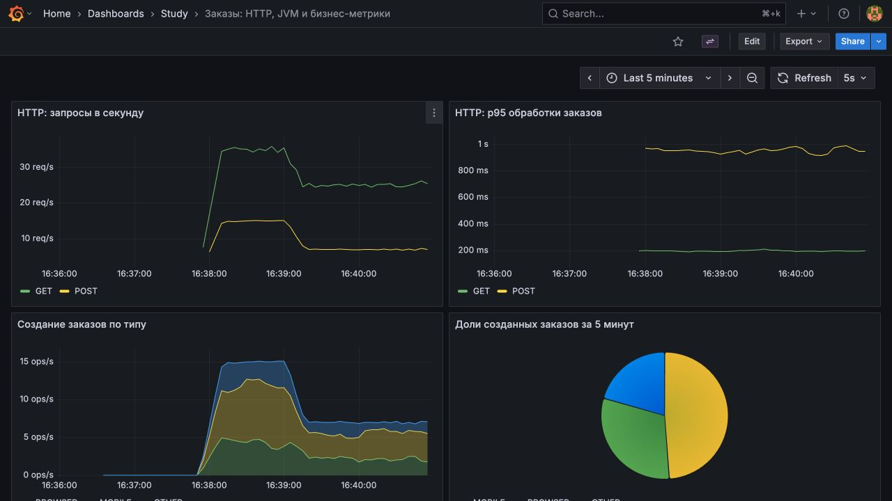
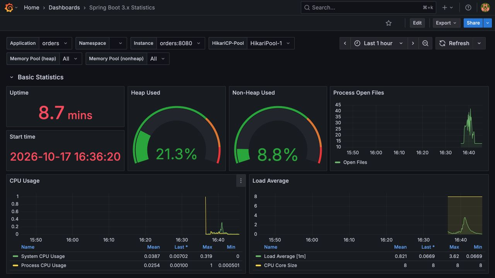
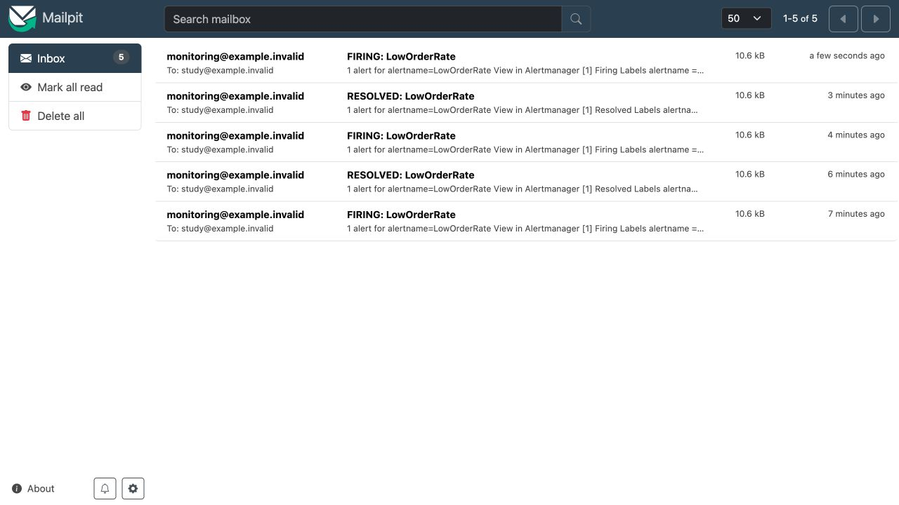

# Мониторинг заказов и доставка алертов

## Цель

Собрать метрики работающего Java-приложения, отобразить HTTP/JVM и создание заказов в Grafana, проверить уведомления при снижении нагрузки и её восстановлении.

## Описание

Spring Boot 3.5.7, Java 21, JPA/H2 и Micrometer работают вместе с Prometheus 3.5.0, Grafana 12.2.0, Alertmanager 0.28.1 и локальным SMTP-приёмником Mailpit. Образы закреплены digest в [Compose](compose.yml).

`POST /orders` создаёт заказ с `username` длиной до 64 символов и типом `BROWSER`, `MOBILE` или `OTHER`; `GET /orders` возвращает заказы по `id`. Некорректный ввод получает `400`. Сохранение занимает случайное время до секунды, чтение — до 200 мс: задержки имитируют работу приложения.

Счётчик `orders_total{type=...}` увеличивается после завершения транзакции репозитория. Теги имеют три фиксированных значения; логин пользователя в метрики не попадает. HTTP-таймер и histogram экспортируются через `/actuator/prometheus`; среди management endpoints также открыт только `health`.

| Адрес на `127.0.0.1` | Назначение |
| --- | --- |
| `19321` | API заказов и Actuator |
| `19090` | Prometheus |
| `19300` | Grafana |
| `19093` | Alertmanager |
| `19325` | Mailpit: полученные уведомления |

## Выполнение

### 1. Сборка и запуск

Из каталога упражнения, с JDK 21:

```bash
python3 init.py
../../sprint02/file-transformer-gradle-plugin/gradlew --no-daemon bootJar
docker compose -p java-sprint11-monitoring up -d --build
```

[Инициализация](init.py) сохраняет случайный пароль Grafana в `target/lab.env` с правами `600`; повторный запуск сохраняет значение. Логин — `study`. Секрет не включён в Git и не выводится скриптом.

Сервисы используют отдельную сеть `10.251.11.16/28`. Если она пересекается с вашей сетью, задайте свободную через `MONITORING_NETWORK_SUBNET`. Порты опубликованы только на loopback. Приложение работает от непривилегированного пользователя с read-only root filesystem; временные файлы находятся в tmpfs.

### 2. Дашборд и источник данных

[Конфигурация Prometheus](prometheus/prometheus.yml) собирает метрики каждые пять секунд. [Datasource](grafana/provisioning/datasources/prometheus.yml) и [собственный дашборд](grafana/dashboards/orders.json) подхватываются автоматически: в Grafana откройте `Dashboards → Study`.

На дашборде показаны RPS, p95, скорость и доли создания заказов, heap и активные соединения Hikari. Для RPS используется `_count`, для p95 — `histogram_quantile` с агрегацией по `le` и HTTP-методу.



Также проверен импорт [Spring Boot 3.x Statistics, ID 19004, revision 1](https://grafana.com/grafana/dashboards/19004-spring-boot-statistics/): скачайте JSON, откройте `Dashboards → New → Import`, загрузите файл и выберите datasource `Prometheus`. Его исходный JSON остаётся локальным; в репозитории находится собственный дашборд.



### 3. Нагрузка и проверка

```bash
python3 load.py --seconds 20 --orders-per-second 15 --reads-per-second 35
python3 verify.py
python3 verify.py --alerts
```

[Генератор](load.py) работает конечное время: 32 потока и максимум 64 ожидающих запроса. Распределение типов задано весами 30/50/20; точные доли короткого случайного прогона могут отличаться. HTTP-генератор вынесен из приложения, чтобы не оставлять постоянно растущую учебную базу и бесконечный пул задач.

Быстрая проверка охватывает API, отклонение некорректных данных, запись JPA, значения счётчиков, histogram, scrape target и настоящий запрос Grafana к Prometheus. Полный сценарий длится около 4,5 минуты:

| Фаза | Создание заказов | Чтение | Результат прогона |
| --- | --- | --- | --- |
| Норма, 70 с | 15/с | 35/с | 1050 созданий, 2450 чтений |
| Снижение, 130 с | 7/с | 25/с | 910 созданий, 3250 чтений |
| Восстановление, 70 с | 15/с | 35/с | 1050 созданий, 2450 чтений |

Прогон 17 октября 2026 года завершился без HTTP-ошибок. Проверка подтвердила новые письма `FIRING: LowOrderRate` и `RESOLVED: LowOrderRate`, а также состояние правила в Prometheus.

### 4. Уведомления

[Правило](prometheus/alerts.yml) срабатывает, когда `sum(rate(orders_total{job="orders"}[1m])) < 10` непрерывно в течение минуты. Prometheus вычисляет условие; [Alertmanager](alertmanager.yml) доставляет уведомление в Mailpit. Адреса `example.invalid` используются только внутри стенда: внешние письма не отправляются.



После остановки генератора скорость снова падает, поэтому новый firing ожидаем. Нулевая скорость не равна отсутствующим метрикам: отдельный алерт недоступности приложения здесь не реализован.

### 5. Остановка

```bash
docker compose -p java-sprint11-monitoring stop
```

Prometheus, Grafana и Alertmanager сохраняют состояние в отдельных томах. Заказы находятся в памяти H2 и исчезают при остановке приложения. Не используйте `down -v`, если нужно сохранить историю мониторинга.

## Ограничения

Это стенд с синтетическими данными: аутентификация API, TLS, HA и производственная нагрузка не проверяются. Выдача всех заказов подходит только для конечного прогона; для долгой работы нужна пагинация. Наблюдаемая задержка специально задана имитацией и не является оценкой производительности JPA или H2.

## Источники

[Micrometer Timer](https://docs.micrometer.io/micrometer/reference/concepts/timers.html), [Prometheus histogram](https://prometheus.io/docs/practices/histograms/), [alerting rules](https://prometheus.io/docs/prometheus/latest/configuration/alerting_rules/), [Alertmanager](https://prometheus.io/docs/alerting/latest/alertmanager/), [Grafana provisioning](https://grafana.com/docs/grafana/latest/administration/provisioning/).
