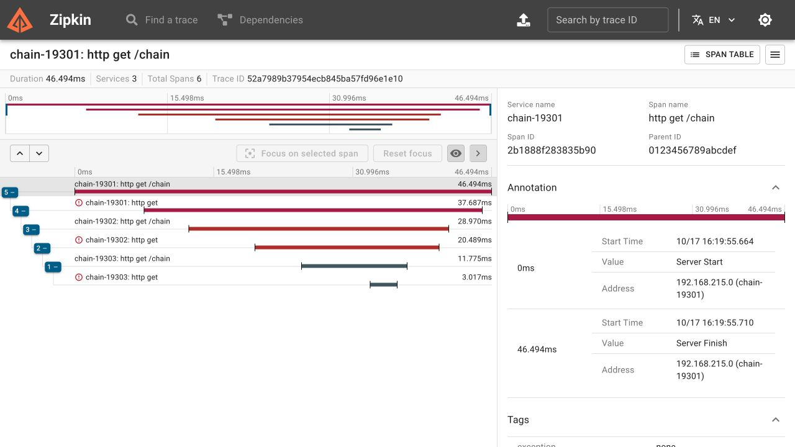

# Распределённая трассировка цепочки HTTP-сервисов

## Цель

Проследить один запрос через три экземпляра Spring Boot, найти исходную сетевую ошибку и проверить, что следующие запросы получают независимый контекст.

## Описание

Java 21, Spring Boot 3.5.7, Micrometer Tracing, Brave и Zipkin 3.5.1. Один JAR запускается на портах `19301`, `19302` и `19303`. Каждый экземпляр вызывает `/chain` на следующем порте; `19304` намеренно не запущен. Все опубликованные порты привязаны к loopback.

```text
SERVER 19301 → CLIENT → SERVER 19302 → CLIENT → SERVER 19303 → CLIENT 19304
```

При недоступном последнем сервисе клиентский span содержит `ResourceAccessException`, а HTTP-ответ каждого работающего сервиса — `500`. Это диагностический сценарий, а не успешная бизнес-операция.

## Выполнение

### 1. Запуск коллектора и сборка

Из каталога упражнения, с выбранным JDK 21:

```bash
docker compose -p java-sprint11-tracing up -d
../../sprint02/file-transformer-gradle-plugin/gradlew --no-daemon bootJar
```

[Compose](compose.yml) фиксирует образ Zipkin digest. Хранилище `mem` удобно для повторяемого стенда; остановка процесса удаляет трейсы. При выборе `STORAGE_TYPE=mysql` без работающей базы веб-интерфейс открывается, но API поиска возвращает `500` и ошибку подключения. Проверено отдельно; для исправления здесь выбран `mem`.

Сеть стенда — `10.251.11.0/28`: явная подсеть позволяет запускать его при исчерпанном автоматическом пуле Docker. Если она занята в вашей сети, задайте свободную через `TRACING_NETWORK_SUBNET`.

### 2. Проверка цепочки

```bash
python3 verify.py
```

[Проверка](verify.py) запускает три процесса из собранного JAR, дожидается readiness и посылает два запроса с разными W3C `traceparent`. Через настоящий API Zipkin проверяет шесть spans на запрос, их parent ID, HTTP-статусы, исходную сетевую ошибку и отсутствие переиспользования span ID между запросами. После проверки Java-процессы завершаются; логи остаются в `build/verification/`.

Результат: все проверки прошли на JDK 21.0.12.1. Билдер `RestClient.Builder` приходит из контекста Boot: вызов `RestClient.create()` обошёл бы instrumentation и разделил один запрос на несколько несвязанных traces. Сетевые connect/read timeout ограничены одной и пятью секундами.

### 3. Анализ в Zipkin

Откройте `http://127.0.0.1:19411/zipkin/`, выполните `Run Query` и выберите trace `/chain` с шестью spans. Скрипт также печатает прямую ссылку на проверенную трассу. Клиентский span последнего экземпляра показывает отказ соединения; родительские spans позволяют пройти обратно до входного запроса.



На снимке настоящая трасса стенда: три сервиса и шесть spans. Показанные `46.494 ms` — длительность одного локального запроса, а не результат нагрузочного теста.

### 4. Остановка

```bash
docker compose -p java-sprint11-tracing stop
```

## Ограничения

Сэмплирование `1.0` выбрано для учебной проверки. Персистентное хранение, TLS, экспорт при перегрузке коллектора, Reactor/executor boundaries и работа под нагрузкой здесь не проверяются. Приложение не выводит все заголовки: в реальной цепочке среди них могут оказаться credentials. Исходная ошибка видна в локальном Zipkin; наружу возвращается фиксированное безопасное сообщение.

## Источники

[Spring Boot 3.5: tracing и инструментированные builders](https://docs.spring.io/spring-boot/3.5/reference/actuator/tracing.html), [W3C Trace Context](https://www.w3.org/TR/trace-context/), [Zipkin API](https://zipkin.io/zipkin-api/).
