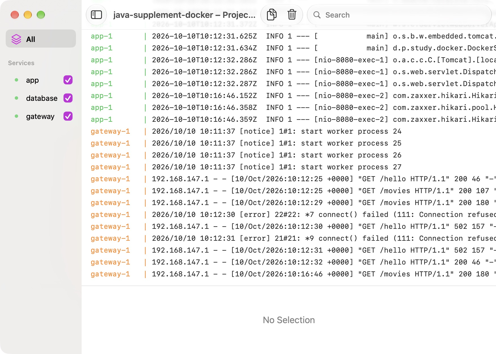

# Docker: Java-приложение, PostgreSQL и Nginx

## Цель

Собрать Java-приложение в образ, связать три сервиса через Docker Compose и проверить сохранность данных после пересоздания контейнера.

## Описание

`GET /hello` возвращает «Добро пожаловать на борт!». `GET /movies` читает фильмы из PostgreSQL через JDBC. Nginx принимает запросы на `127.0.0.1:18380` и передаёт их приложению; приложение и БД доступны внутри сети Compose. Прямой read-only запрос не требует отдельного сервисного слоя.

Использованы Java 21, Spring Boot 3.4.13, PostgreSQL 17.11 и Nginx 1.29.8. Образы закреплены digest и загружаются из официального зеркала `public.ecr.aws/docker/library`. Скелет создан через Spring Initializr и приведён к версии Boot, используемой в других упражнениях. Java 11 из примера Dockerfile заменена совместимым runtime Java 21.

## Выполнение

### 1. Собрал исполняемый JAR

Из корня репозитория, с JDK 21 в `PATH`:

```sh
exercises/sprint01/junit5/mvnw -B --no-transfer-progress -f exercises/supplements/docker/pom.xml package
cd exercises/supplements/docker
python3 init.py
```

`init.py` один раз создаёт `target/lab.env` с локальным паролем и правами `0600`. Повторный запуск сохраняет существующую конфигурацию. Файл исключён из Git и Docker build context.

### 2. Запустил три сервиса

```sh
docker compose -p java-supplement-docker up -d --build --wait --wait-timeout 120
docker compose -p java-supplement-docker ps
curl --fail http://127.0.0.1:18380/hello
curl --fail http://127.0.0.1:18380/movies
```

Сервисы обращаются друг к другу по именам `app` и `database`. PostgreSQL запускается до приложения с проверкой `pg_isready`. SQL из `movies.sql` выполняется при инициализации пустого тома; повторный запуск контейнера не переинициализирует существующую БД.

### 3. Проверил данные и восстановление

```sh
python3 verify.py
```

Проверка выполняет настоящий HTTP/JDBC-путь, добавляет контрольную запись, пересоздаёт контейнер PostgreSQL и проверяет запись через API. Затем выполняет stop/start приложения и ждёт восстановления HTTP-ответа. Она изменяет только стенд `java-supplement-docker`.

Результат: три группы проверок прошли. При stop/start временно возникали `502`, после запуска приложения Nginx снова возвращал `200`.

CI собирает JAR на Java 21, запускает три сервиса и выполняет тот же `verify.py`; контейнеры останавливаются и при ошибке проверки.



### 4. Остановил стенд

```sh
docker compose -p java-supplement-docker down
```

Именованный том сохраняется. `down --volumes` дополнительно удалит его вместе с учебными записями — применяйте только для намеренного сброса этого стенда.

## Ограничения

Это локальная практика HTTP и хранения данных: TLS, нагрузка, backup/restore и публикация образа в Docker Hub не проверялись. `--wait` без healthcheck приложения подтверждает запуск контейнера; готовность HTTP проверяет `verify.py`.

## Источники

- [Dockerfile и build context](https://docs.docker.com/build/concepts/dockerfile/)
- [Сети Compose](https://docs.docker.com/compose/how-tos/networking/)
- [Порядок запуска и healthcheck](https://docs.docker.com/compose/how-tos/startup-order/)
- [Образ PostgreSQL](https://github.com/docker-library/docs/blob/master/postgres/README.md)
