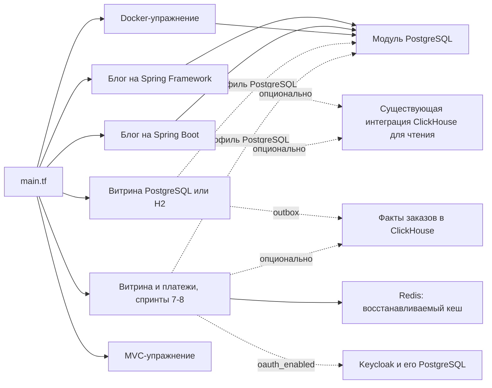

# Модульный деплой Java-приложений

[Репозиторий курса](../README.md) · [Модули](#модули-и-точки-входа) · [Деплой](#план-и-деплой) · [Проверка](#проверка) · [Восстановление](#данные-и-восстановление)

Общий корневой модуль разворачивает Java-приложения отдельными Docker-ресурсами. У каждого стенда свои сеть, контейнеры и постоянные тома. Каталоги принятых проектов, сборочные wrappers, Dockerfile и команды Compose сохраняются.

## Версии и область применения

Проверено с **OpenTofu 1.11.6**, **Docker provider 4.6.0**, Java 21 и OrbStack на macOS. В CI используется та же версия OpenTofu на Linux. HCL рассчитан на ветку 1.11; совместимость с Terraform CLI отдельно не проверялась. Источник провайдера указан явно: `registry.terraform.io/kreuzwerker/docker`. Контрольные суммы для macOS ARM64 и Linux AMD64/ARM64 зафиксированы в lock-файле.

Это локальная учебная инфраструктура. Local backend блокирует state каждого стенда; для совместного рабочего окружения нужен отдельный зашифрованный remote backend с блокировками и контролем доступа. Выберите его до совместного использования state.

## Модули и точки входа

| Селектор | Корневой модуль | Приложение | Фронтенд | Бэкенд | Опциональный ClickHouse |
| --- | --- | --- | --- | --- | --- |
| `sprint03` | `module.sprint03[0]` | [Spring Framework WAR](../projects/sprint03-spring-blog/) | `28083` | `29083` | `28123` |
| `sprint04` | `module.sprint04[0]` | [Spring Boot JAR](../projects/sprint04-spring-boot-blog/) | `28084` | `29084` | `28124` |
| `sprint05-postgresql` | `module.sprint05["sprint05-postgresql"]` | [Витрина с PostgreSQL](../projects/sprint05-storefront/) | `28085` | Та же точка входа | `28125` |
| `sprint05-h2` | `module.sprint05["sprint05-h2"]` | [Витрина с H2](../projects/sprint05-storefront/) | `28086` | Та же точка входа | `28126` |
| `sprint06-postgresql` | `module.sprint06["sprint06-postgresql"]` | [Реактивная витрина с PostgreSQL](../projects/sprint06-reactive-storefront/) | `28087` | Та же точка входа | `28127` |
| `sprint06-h2` | `module.sprint06["sprint06-h2"]` | [Реактивная витрина с H2](../projects/sprint06-reactive-storefront/) | `28088` | Та же точка входа | `28128` |
| `sprint07-postgresql` | `module.sprint07["sprint07-postgresql"]` | [Витрина и платежи с PostgreSQL](../projects/sprint07-rest-service/) | `28089` | Платежи: `29089` | `28129` |
| `sprint07-h2` | `module.sprint07["sprint07-h2"]` | [Витрина и платежи с H2](../projects/sprint07-rest-service/) | `28090` | Платежи: `29090` | `28130` |
| `sprint08-postgresql` | `module.sprint08["sprint08-postgresql"]` | [Защищённые витрина и платежи с PostgreSQL](../projects/sprint08-security/) | `28091` | Платежи: `29091`, Keycloak: `28381` | `28131` |
| `sprint08-h2` | `module.sprint08["sprint08-h2"]` | [Защищённые витрина и платежи с H2](../projects/sprint08-security/) | `28092` | Платежи: `29092`, Keycloak: `28382` | `28132` |
| `docker-exercise` | `module.docker_exercise[0]` | [Docker: маршрутизация и JDBC](../exercises/supplements/docker/) | `28380` | Внутри сети | - |
| `mvc-exercise` | `module.mvc_exercise[0]` | [MVC/JDBC WAR с H2](../exercises/sprint03/spring-mvc-jdbc/) | `28081/spring-web-demo` | Та же точка входа | - |

Для спринта 8 выделены небольшие подсети: `10.251.8.0/27` для PostgreSQL и `10.251.8.32/27` для H2. Они не используют стандартный пул Docker, который может исчерпаться при сохранении остановленных учебных стендов. Если эти адреса заняты локальной маршрутизацией, измените `network_subnet` в вызове модуля перед планированием. У прежних спринтов IPAM-конфигурация сохранена.

Все опубликованные порты привязаны к `127.0.0.1`; порты БД доступны внутри сети своего стенда. Имена начинаются с `java-tofu-<selector>`. Существующие ресурсы Compose и их тома БД не подключаются к управлению OpenTofu.

Два экземпляра модуля [blog](modules/blog/) переиспользуют одинаковую конфигурацию БД, фронтенда и аналитики. Параметр `spring_boot` сохраняет различия проектов: WAR/Tomcat или Executable JAR, имя файла пароля, настройку CORS и endpoint готовности. Модуль [postgres](modules/postgres/) используется блогами, витриной с PostgreSQL и [Docker-упражнением](modules/docker-exercise/); [MVC-упражнение](modules/mvc-exercise/) сохраняет встроенную H2. У хранилища блога отдельный жизненный цикл: отключение аналитики удаляет её контейнеры, но оставляет защищённый том. Пустой том создаётся, даже если аналитика ещё не включалась. [Витрина](modules/storefront/) выбирает профиль PostgreSQL/H2; её ClickHouse получает факты через outbox. Спринт 5 использует JDBC и Tomcat, спринт 6 — native R2DBC и Netty. Параметры `database_protocol`, `database_password_property` и `session_cookie_property` сохраняют различия URL, configtree и сессионных cookies. Defaults совместимы со спринтом 5; оба спринта и каждый вариант БД имеют отдельные namespaces cookies. При H2 отдельный контейнер БД не создаётся, новый процесс получает новый UUID набора данных.

[Модуль REST-витрины](modules/rest-storefront/) спринта 7 управляет двумя Executable JAR, Redis и, при профиле PostgreSQL, двумя независимыми БД. DNS-имена `store-db` и `payments-db`, роли, пароли и тома разделены; оба PostgreSQL доступны только внутри сети стенда. Платежи публикуются на loopback для локальных проверок и требуют служебный токен. Redis использует пользователя `storefront` и внешний ACL-файл; пароль приложения и ACL монтируются read-only. Это восстанавливаемый кеш без RDB/AOF и постоянного тома: финансовые записи хранятся в БД платежей. Доступность Redis, платежей и ClickHouse не определяет порядок запуска витрины; приложение обрабатывает их сбои и восстановление.

Спринт 8 использует тот же модуль с опцией `oauth_enabled`; по умолчанию она `false`, поэтому граф, значения и выходные данные спринта 7 не меняются. Опция заменяет служебный токен автономным Keycloak 26.8.1 (`authorization.tf`):

- Образ собирается из `authorization/Dockerfile` проекта с закреплённым digest Quay и `kc.sh build --db=postgres`; контейнер запускает `kc.sh start --optimized --import-realm`. Quay-образ не подменяется зеркалом Docker Official Images.
- У Keycloak своя PostgreSQL `authorization-db` на модуле [postgres](modules/postgres/): постоянный том с `prevent_destroy`, отдельный пароль и DNS-имя. При профиле H2 БД приложений не создаются, а база авторизации остаётся постоянной.
- Контейнер работает от UID:GID владельца с read-only корнем; записываемы только `tmpfs` `/tmp` (64 МиБ) и `/opt/keycloak/data` (32 МиБ, `1777`). Realm-файл — read-only дочерний bind mount внутри этого `tmpfs`. Лимиты: 768 МиБ RAM, 2 CPU. Готовность проверяет management-порт 9000.
- `authorization_db_password`, `authorization_admin_password` и `oauth_client_secret` монтируются файлами. `start-authorization.sh` читает их и экспортирует переменные только внутри процесса, поэтому окружение контейнера, план и state не содержат значений. Изменение скрипта или realm-файла пересоздаёт контейнер; Keycloak пропускает импорт уже существующего realm, поэтому новый JSON применяется только к новой БД авторизации.

Канонический issuer (`iss` токена) публичный: `http://localhost:<порт Keycloak>/realms/storefront-api`. Запросы токена и JWK идут внутри сети на `authorization:8080`: `PAYMENTS_OAUTH_TOKEN_URI` у витрины, `PAYMENTS_OAUTH_ISSUER` и `PAYMENTS_OAUTH_JWK_SET_URI` у платежей. Витрина получает `oauth_client_secret` как `spring.security.oauth2.client.registration.payments.client-secret`; платежи не получают ни общего Bearer-токена, ни секрета клиента. У H2-платежей нет файлов секретов, поэтому для них не задаётся обязательный `SPRING_CONFIG_IMPORT`.



Остальные упражнения сохраняют описанный в их README запуск через JAR/Maven/Gradle. Для нового проекта с Docker-сервисами добавляются вызов модуля, селектор и проверка настоящего окружения. Переносить исходники или создавать пустые модули под будущие спринты не требуется.

## План и деплой

Нужны OpenTofu и работающий локальный Docker Engine. Для упаковки двух упражнений требуется Java 21; образы блогов собираются их wrappers внутри Docker. На macOS с Java из Homebrew:

```sh
export JAVA_HOME="$(brew --prefix openjdk@21)/libexec/openjdk.jdk/Contents/Home"
export PATH="$JAVA_HOME/bin:$PATH"
tofu version
docker context show

python3 infra/deploy.py sprint04 plan --analytics
python3 infra/deploy.py sprint04 apply --analytics
python3 infra/deploy.py sprint04 status
```

Откройте [блог на Spring Boot](http://127.0.0.1:28084). Для другого стенда выберите его селектор; для базового блога уберите `--analytics`. Реактивная витрина запускается селекторами `sprint06-postgresql` и `sprint06-h2`, когда её исходники доступны в checkout. В PostgreSQL-варианте используется `r2dbc:postgresql://db:5432/storefront` и файл `/run/secrets/spring.r2dbc.password`; H2 создаётся в самом приложении. Значение этой опции должно совпадать при подготовке плана и его применении.

Скрипт определяет локальный Docker socket из активного контекста, инициализирует выбранный backend, выполняет `validate`, сохраняет план и проверяет его безопасность. `apply` применяет именно сохранённый план. Изменение исходников, конфигурации, checkout или параметров деплоя требует нового плана. Исключение спринтов 7 и 8 — корневые `README.md`, `docs/` и `screenshots/`: они не участвуют в образах и runtime mounts; упакованные ресурсы защищены независимо от формата. После успешного применения файл плана удаляется, чтобы исключить случайный повтор.

Для спринтов 7 и 8 `plan` запускает проектный `scripts/package.py`: Gradle проверяет и готовит `build/deployment/storefront.jar` и `payments.jar`. OpenTofu использует общий runtime Dockerfile, передавая путь JAR через `JAR_FILE`. `apply` не пересобирает приложение и отклоняет изменённый JAR. Параметры аналитики при `plan` и `apply` должны совпадать:

```sh
python3 infra/deploy.py sprint07-postgresql plan
python3 infra/deploy.py sprint07-postgresql apply
python3 infra/deploy.py sprint07-postgresql status

python3 infra/deploy.py sprint07-h2 plan --analytics
python3 infra/deploy.py sprint07-h2 apply --analytics

python3 infra/deploy.py sprint08-postgresql plan
python3 infra/deploy.py sprint08-postgresql apply
python3 infra/deploy.py sprint08-h2 plan --analytics
python3 infra/deploy.py sprint08-h2 apply --analytics
```

Спринт 8 дополнительно использует `oauth_client_secret`, `authorization_db_password` и `authorization_admin_password`: их создаёт проектный `scripts/init-secrets.py` вне репозитория. Выбранный каталог исходников должен содержать `authorization/` проекта.

State и планы по умолчанию находятся в `~/.local/state/java-engineering-course/<selector>/`, секреты - в `~/.config/java-engineering-course/tofu/<selector>/`. Другие внешние каталоги задаются через `COURSE_DEPLOY_STATE` и `COURSE_DEPLOY_SECRETS`. Права каталогов - `0700`, файлов паролей и планов - `0600`. Существующие пароли сохраняются. Не используйте один каталог state для разных Docker Engines и не управляйте одним стендом одновременно из разных worktrees.

Путь к CLI задаётся через `TF_CLI`; проверенный runtime - `tofu`. Для штатных команд в инициализированном стенде:

```sh
export TF_DATA_DIR="$HOME/.local/state/java-engineering-course/sprint04/providers"
tofu -chdir=infra output -json deployment
```

## Упаковка Java и готовность сервисов

- `docker_image` собирает существующие Dockerfile через Buildx. Хеши исходников вызывают пересборку затронутого образа; сохраняются преимущества кешей Maven/Gradle и послойного Boot JAR. Изменение Dockerfile не вводит другой формат упаковки Java-приложения.
- WAR/JAR упражнений собираются существующим Maven wrapper перед подготовкой плана. Временные метки архивов фиксированы для воспроизводимости: повторная упаковка неизменённых исходников не вызывает новый деплой.
- Готовность PostgreSQL проверяет `pg_isready`. Блог запускается после готовности БД; Boot readiness учитывает доступность БД. Docker-упражнение проверяет `/movies` через Nginx и Java. Создание контейнера не подтверждает готовность приложения.
- При первом `apply` спринта 7 общий `for_each` barrier ждёт обе PostgreSQL перед созданием JVM. После запуска readiness каждой JVM зависит от её собственной БД; замена одной БД не требует пересоздания JVM. Redis, сервис платежей и ClickHouse не блокируют готовность витрины. В спринте 8 первый `apply` также ждёт БД авторизации и Keycloak; замена Keycloak или его БД не пересоздаёт JVM.
- Java-контейнеры спринтов 3–6 ограничены 512 МиБ RAM; в спринте 7 витрина получает 512 МиБ, платежи — 384 МиБ, обе JVM — одну CPU, каждый PostgreSQL — 256 МиБ и одну CPU. Витрине нужен дополнительный запас: при отказе Redis и чтении из SQL прежний лимит 384 МиБ достигался без OOM. Redis ограничен 128 МиБ и одной CPU, при этом его `maxmemory` — 32 МиБ, политика вытеснения — `allkeys-lfu`. ClickHouse получает 768 МиБ и в спринте 7 одну CPU. В спринте 8 Keycloak получает 768 МиБ и 2 CPU, его PostgreSQL — 256 МиБ и одну CPU. Для ограниченных контейнеров лимит RAM равен общему лимиту RAM+swap. Это бюджеты локального стенда, а не результаты нагрузочного расчёта рабочего окружения. Healthcheck сам по себе не перезапускает нездоровый процесс.
- Boot/Java-процессы без root используют числовые UID:GID владельца на хосте, чтобы читать смонтированные секреты с правами `0600` на Linux. Пароли монтируются только для чтения; Java/entrypoint получают их при запуске. Содержимое секретов не попадает в переменные Terraform, аргументы сборки образа, конфигурацию контейнера и state.
- У платежей PostgreSQL создаёт схему от `payments_owner`, затем отдельную роль `payments_runtime`. Приложение получает только `payments_runtime_password` и запускается с `PAYMENTS_SQL_INIT_MODE=never`; владелец БД и его пароль ему недоступны. Роль может добавлять решения и журнал, но не изменять или удалять их; изменяется только баланс кошелька. Init-wrapper копирует host-owned файл `0600` в приватный `tmpfs` для UID PostgreSQL. Проверка готовности ждёт финальный TCP listener, чтобы исключить временный Unix socket процесса initdb.
- Блоги переиспользуют существующую интеграцию PostgreSQL/ClickHouse с ролью чтения и ограниченными привилегиями. Аналитика опциональна. File secrets - локальный способ передачи пароля, а не шифрование или замена Vault; рабочему окружению нужны внешний secret manager и отдельные настройки TLS/аутентификации.

## Проверка

```sh
tofu fmt -check -recursive infra
python3 -m unittest discover -s infra/tests -v
TF_DATA_DIR="$HOME/.local/state/java-engineering-course/sprint04/providers" tofu -chdir=infra test
python3 infra/verify.py sprint04 --analytics

python3 infra/deploy.py sprint06-postgresql plan --analytics
python3 infra/deploy.py sprint06-postgresql apply --analytics
python3 infra/verify.py sprint06-postgresql --analytics

python3 infra/verify.py sprint07-postgresql
python3 infra/verify.py sprint07-h2 --analytics

python3 infra/verify.py sprint08-postgresql
python3 infra/verify.py sprint08-h2 --analytics
```

Проверка настоящего окружения проходит путь HTTP и native JDBC/R2DBC, создаёт собственную контрольную запись, готовит замену только контейнера БД, применяет сохранённый план и повторно читает эту запись. Затем удаляет свою запись и требует пустого итогового плана. Вариант MVC проверяет настоящий servlet/H2 endpoint и повторный план; сохранность данных H2 после пересоздания процесса не гарантируется.

В спринте 7 проверка по очереди пересоздаёт каждый PostgreSQL-контейнер, сохраняя заказ, баланс и идемпотентный платёж. Контрольная покупка остаётся в истории: неизменяемый финансовый журнал не очищается проверкой. В H2-варианте пересоздаются оба JVM, проверяется отсутствие старого заказа и каталога, возврат счёта к начальному остатку, затем новая покупка. Итоговый план должен быть пустым.

В спринте 8 проверка использует токен клиента из Keycloak. Дополнительно она сверяет issuer discovery с каноническим значением, требует `401` для запросов платежей без токена и с неверным токеном и по очереди пересоздаёт БД авторизации и контейнер Keycloak. Неизменные идентификаторы ключей подписи после каждого шага доказывают, что realm взят из сохранённой БД, а не импортирован заново; платёж с новым токеном проходит. Затем содержимое всех файлов секретов (не короче 16 символов) ищется в state и в конфигурации каждого контейнера стенда.

Локально проверены шесть селекторов спринтов 3–5 и двух упражнений. Для спринта 6 выполнены mock-проверки native R2DBC/H2, password mount и изоляции cookies; они не подтверждают реальную связность Netty/PostgreSQL/ClickHouse. Вариант Boot также переиспользует полный REST smoke-сценарий проекта. CI проверяет форматирование, штатные тесты конфигурации, правила безопасности плана и настоящий деплой Docker-упражнения с пересозданием БД. Проверка `infrastructure` входит в условия `/approve`. У проекта спринта 6 отдельная проверка `sprint06`: Gradle tests/bootJar, готовый JAR с H2, PostgreSQL, доставка и восстановление ClickHouse, затем HTTP-формы в Compose. При отсутствии исходников job пропускается; согласование проверяет marker на точном head PR.

Для спринта 7 локальные mock-тесты проверяют граф двух приложений, независимые БД, H2, mounts, loopback и бюджеты ресурсов; Python-тест отклоняет изменение любого подготовленного JAR или исходников после планирования. Эти проверки не подтверждают работу реального стенда. Отдельный job `sprint07` запускает Gradle, JAR/H2/Redis, PostgreSQL, Redis recovery, ClickHouse и HTTP-сценарий Compose. Наличие проекта определяется по корневому `build.gradle` на проверяемом head; отсутствующий проект означает пропущенный job, существующий требует успешного результата. Завершение проверки останавливает её контейнеры, сохраняя контейнеры, тома и внешние секреты.

Отдельный job `sprint08` повторяет эту последовательность: Gradle `check` с PMD и `bootJar`, JAR с H2/Redis и реальным Keycloak, native PostgreSQL, кеш, ClickHouse и Compose с OAuth-токеном; лимит — 40 минут, Compose ожидает готовность не дольше 300 секунд. Контекст `sprint08` входит в обязательные условия `/approve` по marker `projects/sprint08-security/build.gradle`; до появления проекта в `main` job пропускается. Список обязательных контекстов правил репозитория в GitHub обновляется отдельно от этого PR.

Mock-тесты спринта 8 используют минимальные файлы `tests/fixtures/oauth-project`, потому что исходников проекта в `main` нет: они проверяют граф, безопасность и секреты, но не содержимое реальных Dockerfile и realm. Реальные файлы проекта проходят `plan` и `check_plan` только при локальном checkout спринта 8; запуск Keycloak, JWT и сохранность БД проверяет `verify.py` после `apply`.

## Данные и восстановление

Постоянные тома БД и аналитики защищены через `prevent_destroy`. Полный destroy или смена селектора внутри того же state завершаются отказом вместо удаления данных. Проверка сохранённого плана также отклоняет удаление томов, чужие имена ресурсов, привилегированные контейнеры, публичные привязки портов, переменные окружения с именами `*PASSWORD`, `*SECRET` и `*TOKEN`, любое значение файла секрета (не короче 16 символов) в плане и writable/отслеживаемые Git mounts секретов. Realm, ключи подписи и клиенты Keycloak хранятся в томе `…-authorization-postgres-data`; он защищён так же, как остальные тома БД.

Для намеренного редеплоя сервиса укажите его точный адрес и проверьте план:

```sh
python3 infra/deploy.py sprint04 plan --analytics \
  --replace 'module.sprint04[0].docker_container.backend'
python3 infra/deploy.py sprint04 apply --analytics
```

После проверок и открытия PR остановите явно перечисленные ненужные контейнеры своего стенда: сначала приложения, затем Keycloak, Redis, ClickHouse и PostgreSQL. Сначала убедитесь, что они не нужны параллельной работе. Контейнеры, образы, сеть, секреты, state и тома сохраняются. Для запуска с прежними ID выполните `docker start <точные имена>`: сначала БД и кеш, затем приложения. Docker provider 4.6.0 у остановленных контейнеров может не видеть публикацию портов и предлагать пересоздание; проверяйте новый план после явного запуска. PostgreSQL и ClickHouse сохраняют данные в томах; H2 и кеш Redis сбрасываются. Не используйте общие команды prune.

Перед изменением версии образа БД выгрузите данные и сохраните резервную копию state. Откат приложения выполняется через предыдущую версию исходников и новый проверенный план; сохранённые данные при этом не откатываются. Изменение файла начального пароля не меняет пароль уже созданной роли PostgreSQL.

Окончательное удаление - отдельная операция: сделайте резервную копию данных, проверьте `tofu state list`, отсоедините только точные адреса защищённых томов через `tofu state rm`, затем проверьте штатный `tofu plan -destroy` с тем же backend и параметрами деплоя. Отсоединённые Docker-тома остаются до их явного удаления. Не отсоединяйте тома при обычном редеплое.

## Источники

- [Local backend OpenTofu](https://opentofu.org/docs/language/settings/backends/local/)
- [Сборка образов и Buildx в Docker provider](https://github.com/kreuzwerker/terraform-provider-docker/blob/v4.6.0/docs/resources/image.md)
- [Готовность контейнеров и ожидание healthcheck](https://github.com/kreuzwerker/terraform-provider-docker/blob/v4.6.0/docs/resources/container.md)
- [Импорт realm и каталог `data/import` в Keycloak](https://www.keycloak.org/server/importExport)
- [Контейнерные образы Spring Boot](https://docs.spring.io/spring-boot/3.5/reference/packaging/container-images/index.html)
- [Инициализация PostgreSQL Official Image](https://github.com/docker-library/docs/blob/master/postgres/README.md)
- [Ограничение памяти и вытеснение ключей Redis](https://redis.io/docs/latest/develop/reference/eviction/)
