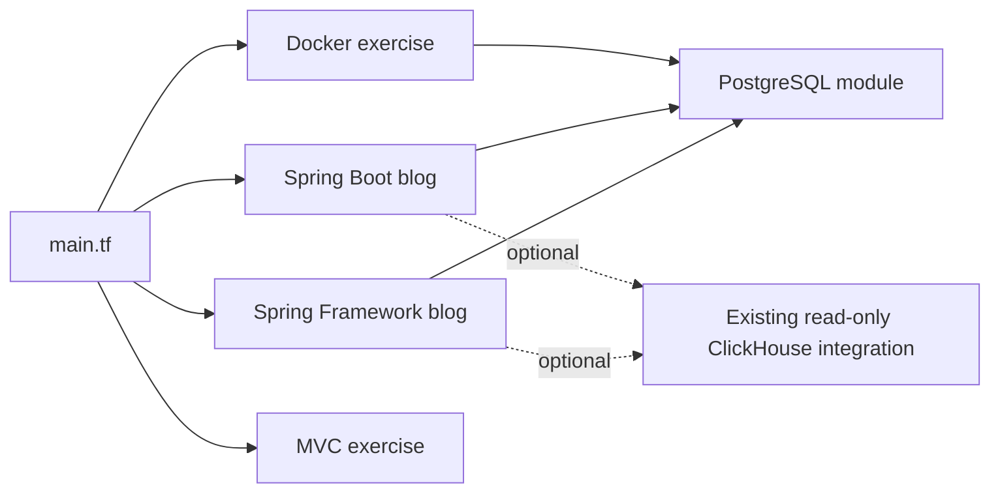

# Modular Java deployments

[Course repository](../README.md) · [Modules](#modules-and-endpoints) · [Deploy](#plan-and-deploy) · [Verify](#verification) · [Recovery](#data-and-recovery)

One root configuration deploys the existing Java applications as separate Docker resources. Each selected stack owns its network, containers and persistent volumes. The accepted project directories, build wrappers, Dockerfiles and Compose commands remain available.

## Runtime and scope

Tested with **OpenTofu 1.11.6**, **Docker provider 4.6.0**, Java 21 and OrbStack on macOS. CI uses the same OpenTofu version on Linux. HCL requires the 1.11 release line; Terraform CLI compatibility is not separately tested. The provider source is explicitly `registry.terraform.io/kreuzwerker/docker`, with checksums for macOS ARM64 and Linux AMD64/ARM64 in the committed lock file.

This is local coursework infrastructure. A local backend locks each stack's state; it is not a shared production backend. For team deployment, select an encrypted remote backend with locking and access control before sharing state.

## Modules and endpoints

| Selector | Root module | Existing application | Frontend | Backend | Optional ClickHouse |
| --- | --- | --- | --- | --- | --- |
| `sprint03` | `module.sprint03[0]` | [Spring Framework WAR](../projects/sprint03-spring-blog/) | `28083` | `29083` | `28123` |
| `sprint04` | `module.sprint04[0]` | [Spring Boot JAR](../projects/sprint04-spring-boot-blog/) | `28084` | `29084` | `28124` |
| `docker-exercise` | `module.docker_exercise[0]` | [Docker routing/JDBC](../exercises/supplements/docker/) | `28380` | Internal | - |
| `mvc-exercise` | `module.mvc_exercise[0]` | [MVC/JDBC WAR with H2](../exercises/sprint03/spring-mvc-jdbc/) | `28081/spring-web-demo` | Same endpoint | - |

All published ports bind to `127.0.0.1`. Database ports remain inside each stack's network. Names start with `java-tofu-<selector>` and do not adopt existing Compose resources or reuse their database volumes.

The two blog module instances share [blog](modules/blog/) because their database, frontend and analytics wiring are the same. The `spring_boot` input retains the real difference: WAR/Tomcat versus executable JAR, password-file contract, CORS property and readiness endpoint. [postgres](modules/postgres/) is reused by the blogs and [Docker exercise](modules/docker-exercise/); the [MVC exercise](modules/mvc-exercise/) keeps its embedded H2. Blog storage has its own lifecycle: disabling analytics removes its containers while retaining its protected volume, including an empty volume when analytics has never been enabled.



Other exercises keep their documented native JAR/Maven/Gradle workflows. A new deployable project adds a module call, a selector and verification for its actual services; it does not require moving source code or adding empty modules for future sprints.

## Plan and deploy

Install OpenTofu and a running local Docker Engine; Java 21 is needed to package the two exercises. Blog images build with their existing wrappers inside Docker. On macOS with Homebrew Java:

```sh
export JAVA_HOME="$(brew --prefix openjdk@21)/libexec/openjdk.jdk/Contents/Home"
export PATH="$JAVA_HOME/bin:$PATH"
tofu version
docker context show

python3 infra/deploy.py sprint04 plan --analytics
python3 infra/deploy.py sprint04 apply --analytics
python3 infra/deploy.py sprint04 status
```

Open [the Boot blog](http://127.0.0.1:28084). Use another selector for a different stack; omit `--analytics` for the base blog. Keep the same analytics option for plan and apply.

The driver detects the local Docker socket from the active context, initializes the selected backend, runs `validate`, saves a plan and checks its safety. `apply` consumes that saved plan. It rejects changed source/configuration, a different checkout or changed deployment inputs; prepare a new plan after any such change. A successful apply consumes the plan so it cannot be replayed accidentally.

State and plans default to `~/.local/state/java-engineering-course/<selector>/`; secrets use `~/.config/java-engineering-course/tofu/<selector>/`. `COURSE_DEPLOY_STATE` and `COURSE_DEPLOY_SECRETS` can select other external roots. Directories use mode `0700`; password and plan files use `0600`. Existing passwords are preserved. Never share these paths between different Docker Engines or manage one stack concurrently from different worktrees.

Select the CLI path with `TF_CLI`; the tested runtime is `tofu`. For native commands against an initialized stack:

```sh
export TF_DATA_DIR="$HOME/.local/state/java-engineering-course/sprint04/providers"
tofu -chdir=infra output -json deployment
```

## Java packaging and readiness

- `docker_image` builds the existing Dockerfiles through Buildx. Source hashes rebuild the affected image; Maven/Gradle build caches and layered Boot JARs remain useful. A Dockerfile change does not introduce another Java packaging format.
- Exercise WAR/JAR artifacts are packaged with the existing Maven wrapper before planning. Archive timestamps are fixed for reproducibility; unchanged source does not redeploy just because packaging ran again.
- PostgreSQL has a real `pg_isready` healthcheck. Blog startup waits for the healthy database; Boot readiness includes its database. The Docker exercise checks `/movies` through Nginx and Java. Container creation alone is not readiness.
- Java containers have a 512 MiB RAM limit with swap disabled; ClickHouse uses 768 MiB. These are local laboratory limits, not production sizing. A healthcheck does not restart an unhealthy process automatically.
- Non-root Boot/Java processes use the host's numeric UID:GID to read mounted `0600` secrets on Linux. Passwords are mounted read-only; Java/entrypoint code reads them at runtime. Secret contents are absent from Terraform variables, image build arguments, container configuration and state.
- The blogs reuse their read-only PostgreSQL/ClickHouse setup and least-privilege reader. Analytics remains optional. Runtime secret files are local delivery, not encryption or a Vault replacement; production needs an external secret manager and deliberate TLS/authentication configuration.

## Verification

```sh
tofu fmt -check -recursive infra
python3 -m unittest discover -s infra/tests -v
TF_DATA_DIR="$HOME/.local/state/java-engineering-course/sprint04/providers" tofu -chdir=infra test
python3 infra/verify.py sprint04 --analytics
```

The live verifier checks HTTP/JDBC, creates its own persistence marker, plans replacement of only the database container, applies that saved plan and reads the same marker afterward. It removes its own record and requires the final plan to be empty. The MVC variant checks its real servlet/H2 endpoint and repeated plan; H2 data has no persistent-volume guarantee.

Local checks cover all four selectors. The Boot path also reuses its existing full REST smoke scenario. CI runs formatting, native configuration tests, deployment-policy tests and a real Docker-exercise deployment with database recreation. The `infrastructure` check is part of `/approve` validation.

## Data and recovery

Persistent database/analytics volumes use `prevent_destroy`. A full destroy or changing a selector inside the same state is rejected rather than deleting data. The saved-plan policy also rejects volume deletion, unowned names, privileged containers, public port bindings, inline passwords and writable/tracked secret mounts.

For a deliberate service redeploy, use its exact address and inspect the plan:

```sh
python3 infra/deploy.py sprint04 plan --analytics \
  --replace 'module.sprint04[0].docker_container.backend'
python3 infra/deploy.py sprint04 apply --analytics
```

To stop a local stack, stop only its explicitly named running containers; the stopped state is visible in the next plan. Reapplying a reviewed plan starts them again. PostgreSQL and ClickHouse data remain in their named volumes. Do not use broad prune commands.

Before changing database image versions, export the database and retain the state backup. Application rollback uses the previous source revision plus a newly reviewed plan; it does not roll back stored data. Changing an initialization password file does not rotate a password already stored in PostgreSQL.

Permanent removal is a separate operation: back up the data, inspect `tofu state list`, detach only the exact protected volume addresses with `tofu state rm`, then review a native `tofu plan -destroy` using the same backend and deployment variables. The detached Docker volumes remain until explicitly removed. Do not detach volumes during ordinary redeployment.

## Sources

- [OpenTofu local backend](https://opentofu.org/docs/language/settings/backends/local/)
- [Docker provider image/Buildx contract](https://github.com/kreuzwerker/terraform-provider-docker/blob/v4.6.0/docs/resources/image.md)
- [Docker provider container health/wait contract](https://github.com/kreuzwerker/terraform-provider-docker/blob/v4.6.0/docs/resources/container.md)
- [Spring Boot container images](https://docs.spring.io/spring-boot/3.5/reference/packaging/container-images/index.html)
- [PostgreSQL Official Image initialization](https://github.com/docker-library/docs/blob/master/postgres/README.md)
