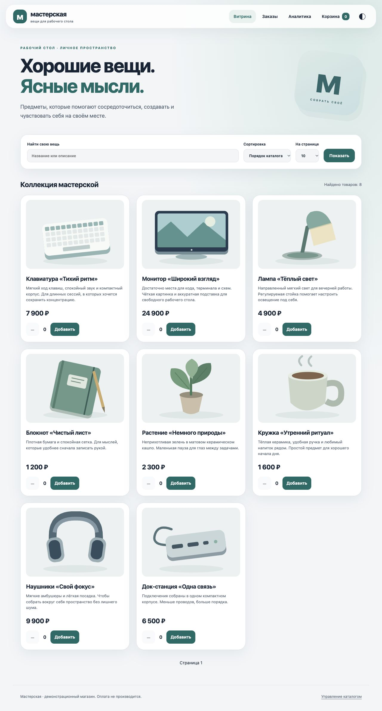
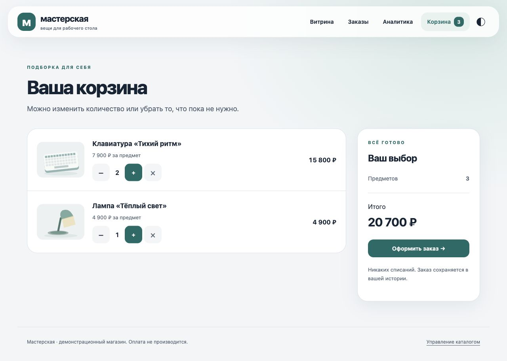
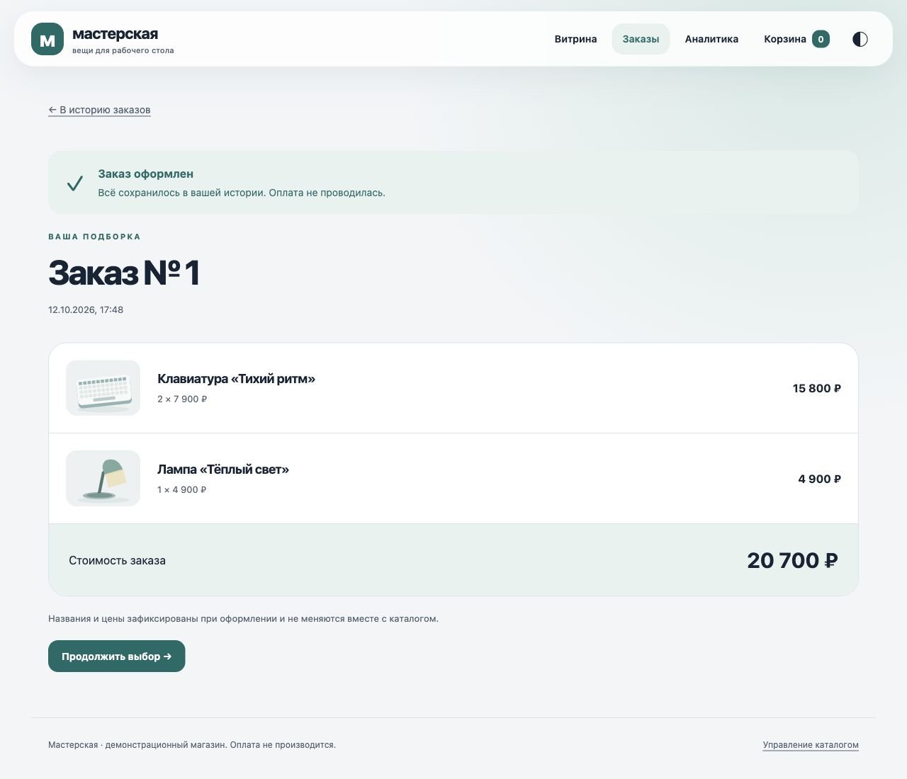
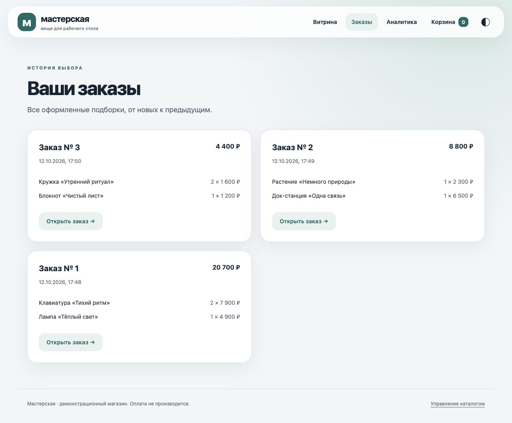
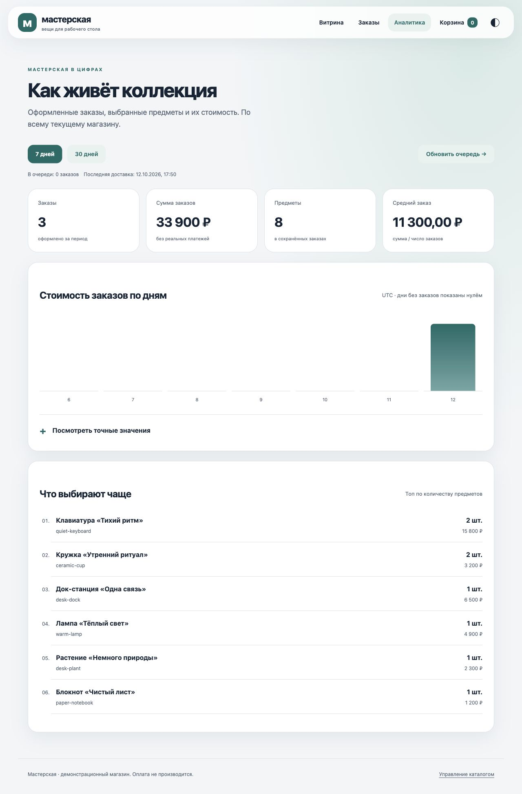
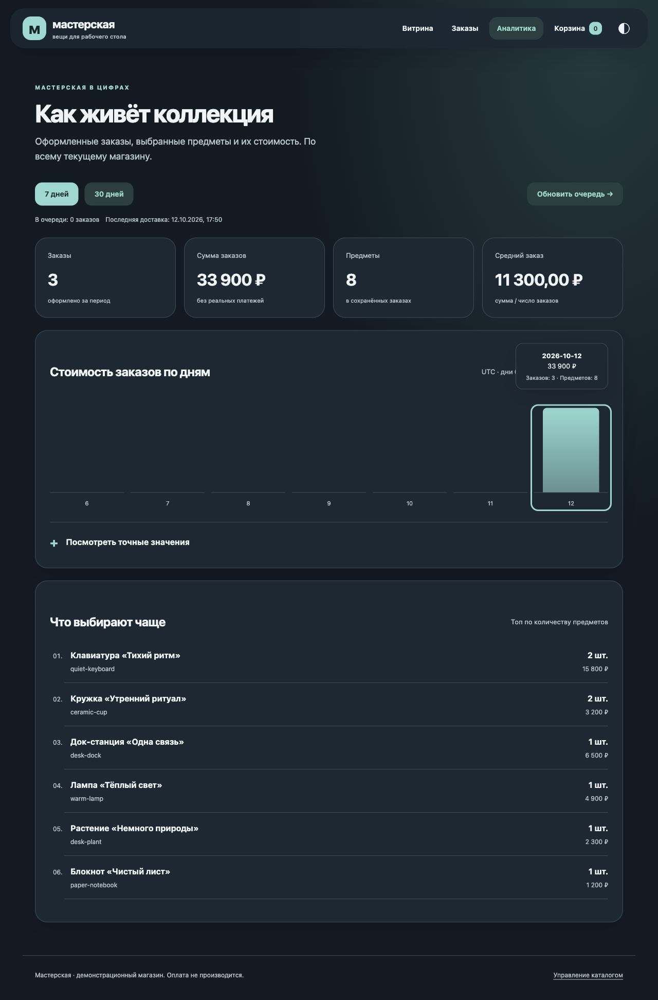

# Спринт 5. Витрина магазина

[К репозиторию курса](../../README.md) · [Запуск](#1-сборка-и-первый-запуск) · [Каталог](#2-каталог-поиск-и-карточка-товара) · [Заказы](#3-корзина-и-покупка) · [Аналитика](#4-аналитика-заказов-в-clickhouse) · [Деплой](#5-модульный-деплой-opentofu) · [Проверки](#6-проверки)

## Цель и описание

Витрина на Java 21, Spring Boot, Spring Web MVC и Spring Data JPA: каталог с поиском, сортировкой и пагинацией, карточка товара, корзина, покупка и история заказов. Приложение упаковано в **Executable JAR**; HTML, CSS и изображения обслуживает встроенный **Tomcat**.

| Компонент | Решение |
| --- | --- |
| Java / сборка | Java 21, Gradle wrapper 8.14.3 |
| Приложение | Spring Boot 3.5.16, блокирующий Spring MVC, Thymeleaf |
| Данные | Spring Data JPA, Hibernate; версии зависимостей задаёт BOM Spring Boot |
| Постоянное хранение | PostgreSQL 17, HikariCP, именованный Docker volume |
| Хранение в памяти | H2, собственный диалект, без режима совместимости PostgreSQL |
| Схема | Liquibase; Hibernate проверяет соответствие через `ddl-auto=validate` |
| Тесты | JUnit 5, Spring Boot Test, Mockito, реальные PostgreSQL/ClickHouse |
| Аналитика / деплой | ClickHouse 26.8, transactional outbox; OpenTofu 1.11.6, Docker provider 4.6.0 |

## 1. Сборка и первый запуск

Команды приложения - из `projects/sprint05-storefront/`. Нужны JDK 21 и Docker Engine; на macOS стенды проверены в OrbStack.

```sh
./gradlew --no-daemon --console=plain clean check bootJar
java -jar build/libs/storefront.jar
```

В IntelliJ IDEA открываем каталог приложения как Gradle-проект, выбираем JDK 21 для Project SDK и Gradle JVM. Для запуска из IDE используем `StoreApplication` с профилем `h2`; тот же запуск из исходников доступен через `./gradlew bootRun`.

Открываем [витрину на H2](http://localhost:18085). По умолчанию выбран профиль `h2`: внешняя БД и файлы паролей не нужны. Каталог изначально пустой. На странице «Управление каталогом» загружаем JSON или готовую коллекцию из восьми предметов.

**Почему H2:** быстрый самостоятельный запуск одного JAR с настоящей JPA-моделью и миграциями. Она не имитирует PostgreSQL: UUID, последовательности, ограничения и транзакции проверяются в её собственном диалекте. База `jdbc:h2:mem:storefront` живёт в JVM; после завершения процесса данные исчезают.

> **Примечание.** Решил дополнительно реализовать оба варианта хранения, поскольку заинтересовало сравнение работы Spring Data JPA, миграций и транзакций на H2 и PostgreSQL.

Для постоянного хранения:

```sh
python3 scripts/init-secrets.py
export STORE_UID="$(id -u)" STORE_GID="$(id -g)"
docker compose -f compose.yaml up -d --build --wait
```

Открываем [витрину на PostgreSQL](http://localhost:8085). БД доступна внутри сети Compose. Пароль хранится вне Git в `~/.config/java-engineering-course/sprint05/db_password` с правами `0600`; init не меняет существующее значение. В контейнере он монтируется как `spring.datasource.password` и читается стандартным Config tree Spring Boot.

**Почему PostgreSQL:** данные сохраняются независимо от JVM и контейнера приложения, а реальные блокировки и ограничения проверяются на целевой СУБД. H2 пригодна для автономного запуска и быстрых проверок; рабочие системы требуют выбора СУБД по нагрузке. Например, [Nexus Repository](https://help.sonatype.com/en/database-options.html) использует embedded H2, но для нагруженных или отказоустойчивых рабочих систем рекомендует PostgreSQL; это не делает нашу in-memory H2 эквивалентом постоянной БД.

<details>
<summary>Тот же JAR в Docker с H2</summary>

```sh
docker compose -f compose.h2.yaml up -d --build --wait
```

Адрес: [localhost:8086](http://localhost:8086). У H2 и PostgreSQL разные имена cookie корзины и сессии: cookie не разделяются по портам, поэтому параллельные стенды не должны подменять идентичность покупателя.

</details>

## 2. Каталог, поиск и карточка товара

Витрина выводит изображение, название, описание, цену и выбранное количество. Поиск работает по названию и описанию; сортировка - порядок каталога, название или цена. Размер страницы: **2, 5, 10, 20, 50, 100**. Дополнительная сортировка по ID делает порядок страниц устойчивым при равных значениях.

> **Примечание.** Решил дополнительно проработать интерфейс, поскольку стала интересна разработка удобного UX/UI при работе с Java, Spring MVC и Thymeleaf. Собственные шаблоны позволили проверить адаптивную навигацию, управление с клавиатуры и светлую/тёмную темы.



*Коллекция из восьми предметов загружена через интерфейс; изображения находятся внутри приложения.*

<details>
<summary>Сортировка и пагинация</summary>


*При сортировке по цене первая страница содержит блокнот за 1200 ₽ и кружку за 1600 ₽. Поиск «терминала» находит монитор по описанию.*

</details>

Из витрины переходим в карточку; изменение количества сразу отражается в корзине.


**Импорт:** JSON содержит `sku`, `title`, `description`, `image`, `price`. [Пример каталога](src/main/resources/static/catalog-demo.json) доступен и из интерфейса. Цена - целые рубли; арифметика использует `long`, сумма вычисляется с проверкой переполнения. Файл ограничен 1 МиБ и 1000 строками. Проверяются все строки и повторяющиеся SKU до первой записи; дробная цена, неизвестное поле или недопустимое изображение отменяют весь импорт.

SKU сохраняет идентичность товара при обновлении. JPA изменяет существующие managed entities, `@Version` защищает конкурентное редактирование. Изображение выбирается из локального набора SVG; пользовательский путь или внешний URL не принимается.

## 3. Корзина и покупка

Корзина показывает строки, цену за предмет, количество и общий итог. Доступны увеличение, уменьшение и удаление; нулевое количество удаляет строку. Ограничения: **99 предметов одного товара, 50 разных товаров**, максимальная цена **1 000 000 ₽**. Корзина может законно превышать `Integer.MAX_VALUE`: например, 50 × 99 × 1 000 000 = 4 950 000 000 ₽.



Покупка сохраняет заказ и очищает корзину одной транзакцией, затем отвечает **303 See Other** и открывает страницу заказа. Обновление страницы выполняет GET и не создаёт повторную покупку. Реального платежа нет.



**Почему снимок:** название, SKU, изображение, цена и количество фиксируются в строках заказа. Последующее обновление каталога не переписывает историю. Скалярный ID товара в снимке не создаёт зависимость исторического заказа от жизненного цикла товара. Отдельный `OrderLineView` содержит поля снимка, без фиктивного описания из текущего каталога.



Корзина и история принадлежат непредсказуемому UUID в `HttpOnly`/`SameSite=Lax` cookie; для HTTPS включается `Secure`. Чужой заказ по его числовому ID не возвращается. Это демонстрационный магазин без регистрации пользователей. Все POST-формы используют CSRF-токен, который Spring Security и Thymeleaf включают в настоящий HTTP-сеанс.

**Транзакции и запросы:** изменение корзины и покупка блокируют только корневую строку корзины, без `FOR UPDATE` по nullable outer join. Конкурентные покупки одной корзины дают один заказ. `open-in-view=false`; DTO собираются внутри сервисных транзакций. Связанные строки читаются через `@EntityGraph`, а коллекция заказов для outbox загружается после ограничения списка ID, не через пагинацию fetch join.

## 4. Аналитика заказов в ClickHouse

> **Примечание.** Решил дополнительно проработать кабинет аналитики, поскольку заинтересовала интеграция аналитической системы с Java-бэкендом и отображение результатов в веб-интерфейсе. Показатели строятся по заказам магазина: от транзакции покупки до доставки в ClickHouse и графиков.

Подключаем отдельный контур:

```sh
export STORE_UID="$(id -u)" STORE_GID="$(id -g)"
docker compose -f compose.yaml -f compose.analytics.yaml up -d --build --wait
```

Кабинет находится в [localhost:8085/analytics](http://localhost:8085/analytics). Он показывает число заказов, количество предметов, сумму и средний заказ, график по дням и топ товаров за **7 или 30 дней**. Группировка дней - UTC; время заказа и последней доставки отображается по Москве. Средний заказ вычисляется через `BigDecimal` с округлением до двух знаков.



*Результат трёх покупок через интерфейс: 20 700 + 8800 + 4400 = 33 900 ₽, средний заказ 11 300 ₽. Предыдущие дни имеют нулевые значения, поскольку тогда заказов не было. Сумма заказов не называется выручкой: платежи не проводились.*

```mermaid
sequenceDiagram
    participant Web as Покупка
    participant DB as PostgreSQL / H2
    participant Worker as Доставка outbox
    participant CH as ClickHouse
    Web->>DB: Заказ + снимки строк + outbox в одной транзакции
    DB-->>Web: Commit, корзина очищена
    Worker->>DB: До 100 заказов и их снимки
    DB-->>Worker: DTO; соединение освобождено
    Worker->>CH: Пакет JSONEachRow, ожидание подтверждения
    CH-->>Worker: Вставка подтверждена
    Worker->>DB: Отметка delivered_at
```

Недоступность ClickHouse не отменяет покупку. Фоновая доставка повторяет неподтверждённые записи каждые 5 секунд; один пакет содержит до 100 заказов, то есть до 5000 строк. HTTP не удерживает транзакцию БД. Ручное обновление очереди использует тот же путь доставки. `AnalyticsDeliveryCoordinator` сериализует ручной и плановый запуск в одной JVM; `AnalyticsExporter` отвечает за доставку и подтверждение. Состояния disabled/outage определяет сервис кабинета, контроллер только формирует модель, уведомление и редирект.

**Свойство движка:** `ReplacingMergeTree` сопоставляет записи по ключу сортировки; фоновые merge не гарантируют немедленного исчезновения дублей. **Решение проекта:** неизменяемый ключ `(source_id, order_day, order_uuid, line_number)` и `FINAL` перед агрегацией. Неопределённый исход записи может привести к повторной доставке; повтор не увеличивает показатели. Это не обещание общей транзакции PostgreSQL и ClickHouse или exactly-once delivery.

UUID набора данных сохраняется в PostgreSQL. Новая JVM с H2 получает другой UUID, поэтому сохранённые в ClickHouse факты предыдущего in-memory магазина не смешиваются с новым. Для небольшого стенда отдельные партиции не вводятся; фильтры по источнику и дате соответствуют началу ключа сортировки.

**Java-интеграция:** переиспользуемый `HttpClient` Java 21 и Jackson, без Spark или второй ORM. Значения UUID/дат передаются типизированными параметрами ClickHouse; данные вставки - JSONEachRow. Один запрос `GROUPING SETS` получает общие показатели, дни и товары из одного чтения. Маленькие пакеты используют `async_insert=1`, `wait_for_async_insert=1`.

HTTP 200 может предшествовать поздней ошибке ClickHouse: включено ожидание конца запроса, проверяются статус, exception header и тело подтверждения. Клиент ограничивает соединение 2 секундами, сетевую операцию целиком - 8 секундами, ответ - 256 КиБ; отмена и interrupt сохраняются. Серверный профиль ограничивает запрос 5 секундами, память 256 МиБ, результат 256 строками и 128 КиБ; превышение лимита не становится частичным успешным отчётом.

У приложения отдельные роли INSERT и SELECT; admin secret используется только для настройки сервера. Пароли передаются заголовками и file secrets, не через URL, Git или Terraform state. File secrets не шифруют хранение; рабочему окружению нужны внешний secret manager и TLS. PostgreSQL управляется версионными Liquibase changesets; схема ClickHouse v1 задаётся отдельным init SQL. Изменение уже существующей схемы warehouse требует отдельной миграции.

<details>
<summary>Тёмная тема, клавиатурная подсказка и мобильный интерфейс</summary>




Прозрачность применяется к навигации, содержимое остаётся на читаемых поверхностях. Есть видимый focus, подписи действий, цель нажатия от 44 px, светлая/тёмная темы и режимы reduced motion/transparency/повышенного контраста. Подсказка графика доступна с клавиатуры, Escape закрывает её без потери фокуса; точные значения доступны в таблице. Это веб-интерпретация принципов материалов Apple, а не native iOS rendering.

</details>

При отключённой или недоступной аналитике показывается отдельное состояние с очередью; выдуманные нулевые метрики не выводятся. Нули допустимы только для доступного источника без заказов. Отдельного мониторинга просмотров и складского учёта нет.

## 5. Модульный деплой OpenTofu

Команды - из корня репозитория. [Общий каталог infra](../../infra/README.md) управляет сервисами, сетями и томами отдельно от Compose.

```sh
python3 infra/deploy.py sprint05-postgresql plan --analytics
python3 infra/deploy.py sprint05-postgresql apply --analytics
python3 infra/verify.py sprint05-postgresql --analytics

python3 infra/deploy.py sprint05-h2 plan --analytics
python3 infra/deploy.py sprint05-h2 apply --analytics
python3 infra/verify.py sprint05-h2 --analytics
```

| Стенд | Приложение | ClickHouse | Данные магазина |
| --- | --- | --- | --- |
| `sprint05-postgresql` | `127.0.0.1:28085` | `127.0.0.1:28125` | Защищённый именованный volume |
| `sprint05-h2` | `127.0.0.1:28086` | `127.0.0.1:28126` | Память процесса JVM |

Профили используют один Dockerfile и Executable JAR; меняются параметры запуска и состав сервисов. У H2 нет контейнера внешней БД. Ресурсы, state и секреты каждого варианта изолированы; публикация портов ограничена loopback. Имена cookie включают имя стенда, чтобы параллельный Compose не подменял корзину или сессию. Применяется сохранённый проверенный план; постоянные тома защищены от удаления. Аналитика имеет отдельный жизненный цикл и не является зависимостью готовности магазина.

Проверка PostgreSQL сохраняет заказ и его cookie-владельца после пересоздания контейнера БД. Проверка H2 пересоздаёт JVM, получает пустые каталог/историю и исключает старые факты аналитики. После обоих сценариев повторный план пустой.

## 6. Проверки

```sh
./gradlew --no-daemon --console=plain check bootJar
python3 scripts/verify-jar.py
python3 scripts/verify-postgresql.py
python3 scripts/verify-analytics.py
python3 -m unittest discover -s src/test/python -v
node --check src/main/resources/static/store.js
```

| Проверка | Результат |
| --- | --- |
| Основной JUnit-прогон | 38 тестов: модель, сервисы, JPA, MVC, транспорт, расчёт аналитики и координация доставки |
| PostgreSQL | 11 проверок тех же JPA/транзакционных контрактов на отдельной настоящей БД |
| ClickHouse | 1 сквозной сценарий: повторы при остановленных merge, outage/recovery и готовый HTML кабинета |
| File secrets | 2 проверки: права/идемпотентность, опасные пути/симлинки/пустые значения |
| JAR / Docker / OpenTofu | Реальный HTTP-сеанс, CSRF, корзина/покупка, сохранность PostgreSQL, reset H2, пустой повторный план |

`@DataJpaTest`, `@WebMvcTest` и `@SpringBootTest` используют три конфигурации TestContext; `@DirtiesContext` не применяется. Аналитическая интеграция использует отдельный контекст и собственный сервер ClickHouse. Тестовые PostgreSQL/ClickHouse и их секреты создаются отдельно от работающего магазина.

Проверяются атомарность импорта, escaped LIKE-поиск, устойчивые страницы, цены и названия исторического заказа, принадлежность cookie-владельцу, конкурентная покупка и rollback при ошибке записи outbox. Транспортные тесты используют настоящий HTTP-сервер: поздняя ошибка при 200, ограничение тела, полный deadline, redirect и interrupt. Сценарий H2 JAR проверяет настоящий токен формы и POST/Redirect/GET, включая буквальный поиск `C++ &`.

Smoke-сценарии создают собственные товары и заказ в тестовом стенде. Для них используйте самостоятельный JAR, изолированный OpenTofu-стенд или CI; не запускайте их на ценном рабочем каталоге. CI содержит отдельный job `sprint05` и публикует JAR/отчёты тестов.

## Источники

- [Spring Boot: SQL и embedded databases](https://docs.spring.io/spring-boot/3.5/reference/data/sql.html)
- [Spring Boot: тестовые slices](https://docs.spring.io/spring-boot/3.5/reference/testing/spring-boot-applications.html)
- [H2: режимы хранения и lifetime](https://h2database.com/html/features.html)
- [Spring Data JPA](https://docs.spring.io/spring-data/jpa/reference/3.5/index.html)
- [Liquibase](https://docs.liquibase.com/)
- [Java 21 HttpClient](https://docs.oracle.com/en/java/javase/21/docs/api/java.net.http/java/net/http/HttpClient.html)
- [ClickHouse HTTP interface](https://clickhouse.com/docs/interfaces/http)
- [ClickHouse asynchronous inserts](https://clickhouse.com/docs/optimize/asynchronous-inserts)
- [ClickHouse ReplacingMergeTree](https://clickhouse.com/docs/engines/table-engines/mergetree-family/replacingmergetree)
- [ClickHouse GROUPING SETS](https://clickhouse.com/docs/sql-reference/statements/select/group-by)
- [Apple: материалы интерфейса](https://developer.apple.com/design/human-interface-guidelines/materials)
