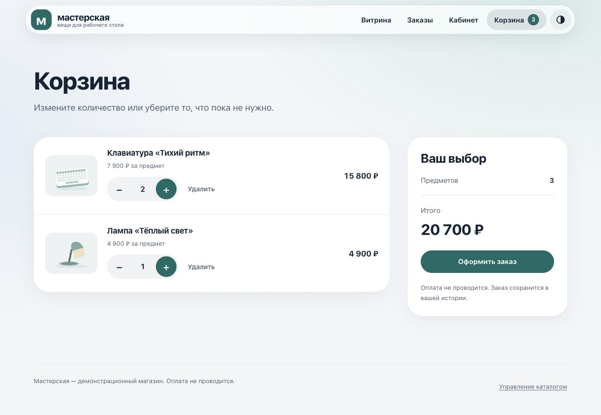
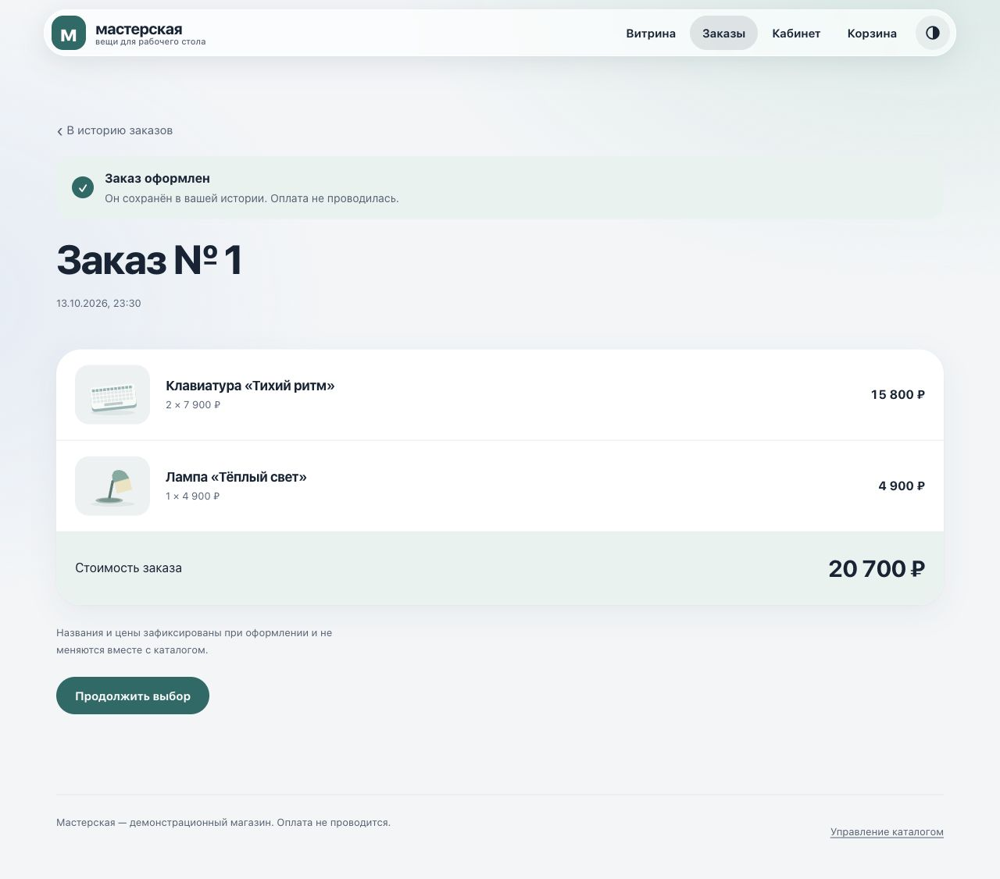
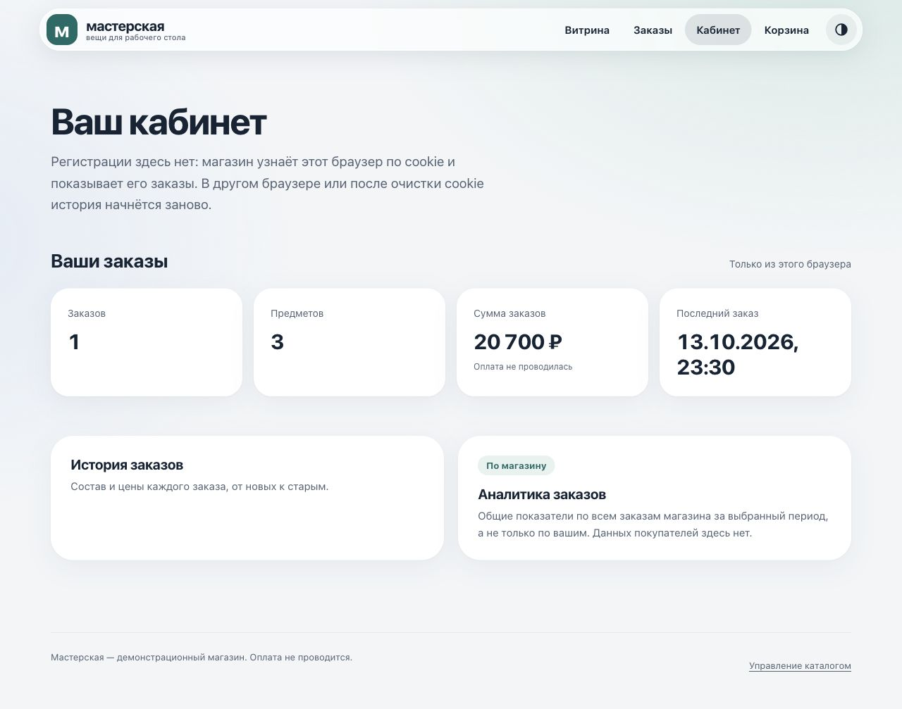
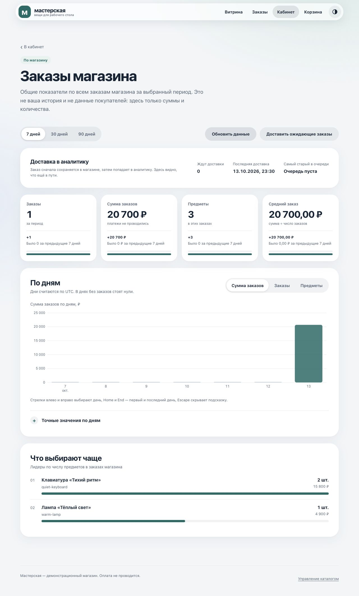

# Спринт 6. Витрина на реактивном стеке

[К репозиторию курса](../../README.md) · [Запуск](#1-сборка-и-первый-запуск) · [Каталог](#2-каталог-и-управление-количеством) · [Покупка](#3-корзина-покупка-и-история) · [Кабинет](#4-личный-кабинет-и-интерфейс) · [Аналитика](#5-реактивная-аналитика-в-clickhouse) · [Деплой](#6-модульный-деплой) · [Проверки](#7-проверки)

## Цель и описание

Перенос витрины [пятого спринта](../sprint05-storefront/README.md) на **Spring WebFlux и Spring Data R2DBC**. Сохраняются каталог с поиском, сортировкой и пагинацией, карточка товара, корзина, покупка и история заказов. Приложение упаковано в **Executable JAR** со встроенным **Reactor Netty**; собственные шаблоны Thymeleaf, CSS, D3.js и изображения находятся внутри приложения.

| Компонент | Решение |
| --- | --- |
| Java / сборка | Java 21, Gradle wrapper 8.14.3 |
| Приложение | Spring Boot 3.5.16, WebFlux, Reactor, Thymeleaf |
| Данные | Spring Data R2DBC, `DatabaseClient`, `R2dbcTransactionManager`, `TransactionalOperator` |
| Постоянное хранение | PostgreSQL 17, R2DBC-драйвер, именованный Docker volume |
| Локальный вариант | H2 in-memory через R2DBC, собственный диалект |
| Инициализация схемы | Упорядоченные идемпотентные SQL-файлы через `spring.sql.init` |
| Тесты | JUnit 5, StepVerifier, WebTestClient, Spring Boot Test, Mockito |
| Аналитика | ClickHouse 26.8, реактивный WebClient, transactional outbox, D3.js |

MVC, JPA и Hibernate исключены из зависимостей приложения. Контроллеры, сервисы и SQL-доступ составляют цепочки `Mono`/`Flux`; в обработчиках запросов нет `block()` и ручного `subscribe()`. Настройки библиотек согласованы BOM Spring Boot.

<details>
<summary>Что изменилось относительно пятого спринта и как сохранена история</summary>

- Tomcat и Spring MVC заменены на Reactor Netty и WebFlux; вместо MockMvc используется WebTestClient.
- JPA-графы заменены плоскими `@Table` records, реактивными репозиториями и явными SQL-запросами. Корзина читается одним JOIN, история заказов - двумя выборками без N+1.
- Покупка и изменение корзины используют реактивную транзакцию; записи одного соединения выполняются последовательно.
- Блокирующий HTTP-клиент аналитики заменён WebClient, а `synchronized` доставки - ленивым допуском с освобождением при завершении, ошибке или отмене.
- UI получил полноценное поле количества, быстрые изменения корзины, кабинет и графики D3 с сравнением периодов.

Работа продолжается в ветке `feature/sprint06-reactive-storefront`, созданной от `main`. Принятый проект пятого спринта сохранён в своём каталоге; его коммиты остаются предками новой ветки. Исходная копия зафиксирована отдельным коммитом до переноса на реактивный стек, поэтому можно проследить развитие файла через границу каталогов:

```sh
git log --follow --find-copies-harder -- \
  projects/sprint06-reactive-storefront/src/main/java/dev/principalwater/store/service/CheckoutService.java
```

Команду выполняем из корня репозитория. Формат копии не означает автоматической совместимости старой БД с новой схемой.

</details>

## 1. Сборка и первый запуск

Команды приложения - из `projects/sprint06-reactive-storefront/`. Нужны JDK 21 и Docker Engine; для запуска одного JAR Docker не требуется.

```sh
./gradlew --no-daemon --console=plain clean check bootJar
java -jar build/libs/storefront.jar
```

В IntelliJ IDEA открываем каталог как Gradle-проект, выбираем JDK 21 для Project SDK и Gradle JVM. Запускаем `StoreApplication` с профилем `h2` либо используем `./gradlew bootRun`.

Открываем [витрину на H2](http://localhost:18086). Профиль `h2` выбран по умолчанию: внешняя БД и файлы паролей не нужны. На странице «Управление каталогом» загружаем собственный JSON или коллекцию из восьми предметов.

**Почему H2:** автономный запуск и быстрые проверки SQL-модели без контейнера БД. Используется `r2dbc:h2:mem:///storefront`, без режима совместимости PostgreSQL; после завершения JVM данные исчезают. R2DBC-интерфейс не делает внутренний движок H2 неблокирующим: это локальный прототип, а поведение сетевого I/O и блокировок проверяется отдельно на PostgreSQL.

> **Примечание.** Решил сохранить оба варианта хранения, поскольку заинтересовало сравнение реактивных транзакций, кодеков UUID/времени и конкурентных операций на H2 и PostgreSQL.

Для постоянного хранения:

```sh
python3 scripts/init-secrets.py
export STORE_UID="$(id -u)" STORE_GID="$(id -g)"
docker compose -f compose.yaml up -d --build --wait
```

Открываем [витрину на PostgreSQL](http://localhost:8086). БД доступна внутри сети Compose; её том живёт независимо от контейнера приложения. Пароль хранится вне Git в `~/.config/java-engineering-course/sprint06/db_password` с правами `0600`; повторная инициализация не меняет его. Контейнер монтирует файл как `spring.r2dbc.password`, Spring Boot читает его через Config tree.

<details>
<summary>H2 в Docker и настройка соединений</summary>

```sh
docker compose -f compose.h2.yaml up -d --build --wait
```

Адрес: [localhost:8087](http://localhost:8087). H2 и PostgreSQL используют разные cookie корзины и сессии: cookie не разделяются по портам. Для одновременного подключения аналитики двум стендам задаём разные `ANALYTICS_PORT` и сохраняем отдельные Compose-проекты.

R2DBC-пул приложения: начальное соединение **1**, максимум **5**, ожидание получения и создания соединения - до **5 секунд**. Это пределы небольшого стенда, а не оценка рабочей нагрузки. Readiness проверяет R2DBC; создание контейнера само по себе не подтверждает готовность магазина.

</details>

**Схема:** `spring.sql.init` выполняет SQL-файлы в явном порядке, с отдельной инициализацией UUID набора данных для H2/PostgreSQL. Это не версионные миграции: `CREATE ... IF NOT EXISTS` сохраняет существующие таблицы, но не обновляет их структуру. Для переноса данных пятого спринта и следующих изменений схемы нужен отдельный план миграции; чужой том к этому стенду не подключаем.

## 2. Каталог и управление количеством

Витрина показывает изображение, название, описание, цену и количество в корзине. Поиск работает по названию и описанию; сортировка - порядок каталога, название или цена. Размеры страницы: **2, 5, 10, 20, 50, 100**. Дополнительная сортировка по ID сохраняет устойчивый порядок при равных цене или названии.


*Каталог, поиск и единый элемент управления количеством доступны без перехода в корзину.*

У каждого товара есть **минус, редактируемое число и плюс**. Первое добавление подтверждается сообщением со ссылкой «Открыть корзину». Количество можно ввести напрямую; ноль удаляет позицию. В карточке товара используется тот же элемент управления.

JavaScript последовательно отправляет изменения и показывает подтверждённый сервером снимок корзины. Обновляются количество, значок в навигации и итог; при ошибке остаются прежние значения и понятное действие для восстановления. Очередь ограничена **12 нажатиями**, запрос - **10 секундами**. Без JavaScript работают обычные POST-формы и **303 See Other → GET**; поиск `C++ & blue` сохраняется после редиректа.

<details>
<summary>Импорт каталога и безопасность поиска</summary>

JSON содержит `sku`, `title`, `description`, `image`, `price`; [готовый пример](src/main/resources/static/catalog-demo.json) доступен из интерфейса. Цена - целые рубли, максимум **1 000 000 ₽**. Файл ограничен **1 МиБ и 1000 строками**. Все строки, неизвестные поля, дробные цены, изображения и повторяющиеся SKU проверяются до первой записи; ошибка отменяет весь импорт.

SKU сохраняет ID товара и выбранное количество при обновлении; `@Version` защищает конкурентную запись. Изображения выбираются из локального набора SVG: внешний URL или пользовательский путь не принимаются. Ограниченный разбор JSON вынесен с event loop на `boundedElastic`; записи идут через R2DBC последовательно в одной транзакции.

Значения поиска связываются SQL-параметрами. `%`, `_` и `!` экранируются для LIKE, а столбцы сортировки выбираются из закрытого enum. Названия и описания выводятся через экранирование Thymeleaf.

</details>

## 3. Корзина, покупка и история

Корзина показывает строки, цену за предмет, количество и общий итог. Ограничения: **99 предметов одного товара, 50 разных товаров**. Арифметика использует `long` и проверку переполнения: допустимая корзина может стоить **4 950 000 000 ₽**, больше `Integer.MAX_VALUE`.



*Изменение подтверждается сервером; удаление последней позиции открывает пустое состояние и сохраняет доступный фокус.*

Покупка сохраняет заказ, снимки строк и outbox, затем очищает корзину **одной реактивной транзакцией**. `TransactionalOperator` охватывает подписанную операцию; SQL-записи выполняются последовательно через `concatMap`. Ошибка, включая последнюю запись outbox, откатывает весь заказ. После commit открывается страница заказа через 303; обновление выполняет GET. Реального платежа нет.



*Название, SKU, изображение, цена и количество зафиксированы при покупке. Изменение каталога не переписывает историю.*

`OrderLineView` содержит именно поля снимка, без фиктивного описания товара. История сортируется от новых заказов к старым; скалярный ID товара не связывает её с жизненным циклом каталога.

**Конкурентность:** изменение количества и покупка блокируют одну корневую строку корзины через `FOR UPDATE`, без JOIN. Поэтому две покупки создают один заказ, два увеличения с 98 не превышают 99, а покупка одновременно с добавлением не теряет предмет: он попадает либо в заказ, либо в оставшуюся корзину. Блокировка живёт до завершения или отмены всей транзакции.

## 4. Личный кабинет и интерфейс

[Кабинет](http://localhost:8086/profile) объединяет личные показатели и переходы в историю и аналитику. Число заказов, предметов, сумма и дата последней покупки считаются **только по корзине этого браузера**. Аналитика ClickHouse выделена отдельным разделом «По магазину»: это показатели всех заказов, а не персональный отчёт.



**Идентичность:** непрозрачный UUID хранится в `HttpOnly`/`SameSite=Lax` cookie; на HTTPS включается `Secure`. Чужой заказ по числовому ID не возвращается. Это не аутентификация: регистрации, пользователей и ролей нет; после очистки cookie или в другом браузере будет другая история. Все POST-формы используют настоящий CSRF-токен Spring Security, включая multipart-импорт.

> **Примечание.** Решил дополнительно переработать интерфейс, поскольку заинтересовала разработка удобного UX/UI на Java и WebFlux: явная обратная связь корзины, единая навигация и спокойные поверхности для чтения данных.

Полупрозрачный материал применяется к навигации, содержимое остаётся читаемым. Есть светлая/тёмная темы, клавиатурный focus, подписи действий, адаптивная компоновка и режимы reduced motion/transparency/повышенного контраста. Обработка удаления не оставляет фокус на исчезнувшей строке. Это веб-интерпретация принципов материалов Apple; нативный рендеринг iOS и полноценный аудит доступности не заявляются.

<details>
<summary>Мобильная компоновка</summary>


*Навигация, количество и подписи графиков адаптируются к узкому экрану; точные значения доступны отдельно от графика.*

</details>

## 5. Реактивная аналитика в ClickHouse

> **Примечание.** Решил дополнительно проработать интеграцию аналитической системы с реактивным Java-бэкендом и D3.js: хотелось связать транзакцию покупки, доставку данных и интерактивное представление результата.

```sh
export STORE_UID="$(id -u)" STORE_GID="$(id -g)"
docker compose -f compose.yaml -f compose.analytics.yaml up -d --build --wait
```

Открываем [аналитику магазина](http://localhost:8086/profile/analytics). Кабинет показывает число заказов, предметов, сумму и средний заказ за **7, 30 или 90 дней**, сравнение с предыдущим равным периодом, дневной график и топ **10 товаров**. Для графика переключаем сумму, заказы или предметы. Дни считаются в UTC; время заказа и доставки отображается в `store.display.zone` (по умолчанию Москва), одинаково в HTML и после обновления JSON. Средний заказ рассчитывается через `BigDecimal`, `HALF_UP`, два знака. Сумма заказов не называется выручкой: оплаты нет.



*Все показатели получены из сохранённых заказов. Пустые дни доступны как нули, недоступный источник отображается отдельным состоянием.*

### Доставка и подтверждение

```mermaid
sequenceDiagram
    participant Web as Покупка WebFlux
    participant DB as PostgreSQL / H2 R2DBC
    participant Worker as Реактивная доставка
    participant CH as ClickHouse HTTP
    Web->>DB: Заказ + снимки строк + outbox
    DB-->>Web: Commit, корзина очищена
    Worker->>DB: До 100 заказов и их строки
    DB-->>Worker: Снимок пакета; транзакция завершена
    Worker->>CH: WebClient: JSONEachRow
    CH-->>Worker: Подтверждение завершённой вставки
    Worker->>DB: Короткая транзакция ACK delivered_at
```

ClickHouse не участвует в транзакции покупки. Неподтверждённые записи повторяются через **5 секунд после завершения попытки**; пакет ограничен **100 заказами / 5000 строками**. Сетевой запрос находится между двумя короткими транзакциями и не удерживает соединение магазина.

`AnalyticsExporter` отвечает за capture → HTTP → ACK. `AnalyticsDeliveryCoordinator` допускает один ручной или плановый запуск **в одной JVM**; повторный запуск получает состояние «доставка выполняется». Допуск освобождается при complete/error/cancel. Для нескольких экземпляров экспортёра нужен долговечный lease очереди; локальный допуск его не заменяет. Контроллер остаётся тонким: отключение и недоступность аналитики обрабатывает сервис.

**Доставка at-least-once:** неопределённый исход INSERT может привести к повтору. Неизменяемый ключ `(source_id, order_day, order_uuid, line_number)` в `ReplacingMergeTree` и `FINAL` перед агрегацией исключают удвоение метрик до фонового merge. Общей транзакции PostgreSQL/ClickHouse и exactly-once delivery нет.

UUID набора данных сохраняется в PostgreSQL. Новая H2 получает другой UUID: старые факты сохранённого ClickHouse не смешиваются с новой JVM. Для небольшого стенда партиции не вводятся; источник и дата стоят в начале ключа сортировки.

### WebClient и запросы

ClickHouse доступен через его HTTP-протокол и Spring WebClient, без Spark, JDBC на event loop или самодельного Spring Data R2DBC-драйвера. Типизированные `AnalyticsFact`/`AnalyticsRow` и Jackson проверяют контракт данных; UUID и даты передаются параметрами ClickHouse. Это реактивная HTTP-интеграция, а не R2DBC.

У ClickHouse есть [официальный R2DBC-адаптер](https://clickhouse.com/docs/integrations/language-clients/java/r2dbc). Здесь выбрал WebClient: аналитические INSERT/SELECT не требуют OLTP-репозитория, а бюджет всего ответа, отмена и подтверждение доставки остаются под явным контролем. В [публикации ClickHouse о Netflix](https://clickhouse.com/blog/netflix-petabyte-scale-logging) описан переход с JDBC к низкоуровневому Java-клиенту с RowBinary и затем собственному Native-кодированию; для ограниченных пакетов этого магазина JSONEachRow проще проверить. Преимущество формата по скорости без нагрузочных измерений не заявляю.

[Запрос кабинета](src/main/resources/analytics/dashboard.sql) выполняет **два ограниченных чтения в одном HTTP-запросе**: `GROUPING SETS` получает текущие итоги, дни и товары; `UNION ALL` добавляет итог предыдущего равного окна. Оба диапазона ограничены источником и датой. Для небольших пакетов включены `async_insert=1` и `wait_for_async_insert=1`.

<details>
<summary>Пределы, отмена и секреты</summary>

- Соединение и ожидание пула - **2 секунды**, сетевой запрос с полным телом - **8 секунд**, ответ - **256 КиБ**. Пул: **4 соединения**, до **16 ожидающих запросов**; redirect не разрешён. Отмена завершает клиентский I/O, неподтверждённый пакет остаётся для повтора.
- HTTP 200 не гарантирует успешную вставку: включён `wait_end_of_query`, проверяются статус, exception header и тело подтверждения.
- Сервер ограничивает запрос **5 секундами**, память **256 МиБ**, чтение **1 000 000 строк / 100 000 000 байт**, результат **256 строками / 128 КиБ**. Превышение возвращает ошибку, а не частичный успешный отчёт.
- INSERT и SELECT используют отдельные роли; admin secret нужен только настройке ClickHouse. Пароли передаются заголовками и file secrets, не через URL, Git или Terraform state. File secrets не шифруют хранение; рабочему окружению нужны внешний secret manager и TLS.
- Начальная схема ClickHouse задаётся SQL v1; изменение уже созданной таблицы требует отдельной миграции.

</details>

### D3.js и читаемые значения

D3 поставляется локально вместе с лицензией: графики не зависят от CDN. Java отдаёт серверный HTML и JSON `/profile/analytics/data`; браузер строит SVG, меняет период без полной перезагрузки и сохраняет его в URL. Backend считает метрики, D3 отвечает за шкалы и отображение.

Счётчики `long` и суммы передаются строками, точные подписи используют `BigInt`; `Number` применяется для координат. Это сохраняет значения за пределами точного целого JavaScript. Без JavaScript/D3 остаются карточки, сравнение, очередь, топ и полная таблица дней. Стрелки, Home/End выбирают день, Escape закрывает подсказку; переключение серий также доступно с клавиатуры.

При отключённой или недоступной аналитике показывается состояние с очередью. Выдуманные нулевые метрики не выводятся; реальные нули допустимы только для доступного источника без заказов. Мониторинг просмотров, платежи, складской учёт и нагрузочные измерения не реализованы.

## 6. Модульный деплой

Compose остаётся самостоятельным способом запустить приложение; общая инфраструктура репозитория находится в [каталоге infra](../../infra/README.md). OpenTofu управляет сервисами, сетями и томами отдельно от исходного Java-проекта.

Из корня репозитория готовим и проверяем сохранённый план, затем применяем его:

```sh
python3 infra/deploy.py sprint06-postgresql plan --analytics
python3 infra/deploy.py sprint06-postgresql apply --analytics
python3 infra/verify.py sprint06-postgresql --analytics

python3 infra/deploy.py sprint06-h2 plan --analytics
python3 infra/deploy.py sprint06-h2 apply --analytics
python3 infra/verify.py sprint06-h2 --analytics
```

| Стенд | Магазин | ClickHouse |
| --- | --- | --- |
| PostgreSQL | `127.0.0.1:28087` | `127.0.0.1:28127` |
| H2 | `127.0.0.1:28088` | `127.0.0.1:28128` |

Оба стенда проверены с OpenTofu **1.11.6**, Docker provider **4.6.0** и OrbStack. Замена контейнера PostgreSQL сохранила заказ и принадлежность cookie; пересоздание H2 очистило каталог и историю, новый UUID исключил старые факты оставшегося ClickHouse. Повторные планы обоих стендов не содержат изменений.

Для каждого стенда нужны отдельные state, имя ресурсов и секреты. PostgreSQL и ClickHouse хранят данные в независимых томах; in-memory H2 живёт только в JVM. Пароли монтируются read-only, опубликованные порты ограничиваются loopback. Аналитика опциональна и не является зависимостью готовности магазина.

## 7. Проверки

```sh
./gradlew --no-daemon --console=plain check bootJar
python3 scripts/verify-jar.py
python3 scripts/verify-postgresql.py
python3 scripts/verify-analytics.py
python3 -m unittest discover -s src/test/python -v
node --check src/main/resources/static/store.js
node --check src/main/resources/static/analytics.js
```

| Проверка | Что проверяется |
| --- | --- |
| Основной JUnit-прогон | 48 тестов: модель, R2DBC, сервисные транзакции, WebFlux, реактивный HTTP-транспорт и аналитика |
| PostgreSQL | 17 проверок тех же mapping/транзакционных контрактов на отдельной настоящей БД |
| ClickHouse | 1 отдельный сценарий: FINAL при остановленных merge, источник данных, outage/recovery, очередь и кабинет |
| File secrets | 2 проверки: права и идемпотентность; опасные пути, симлинки и пустые значения |
| Executable JAR | Настоящий Netty/H2 HTTP-сеанс, readiness, CSRF, импорт, корзина, покупка, история и профиль |

`@DataR2dbcTest`, `@WebFluxTest` и `@SpringBootTest` используют отдельные кешируемые конфигурации TestContext; `@DirtiesContext` не применяется. Аналитическая интеграция запускается отдельно. PostgreSQL/ClickHouse и их секреты создаются в изолированных тестовых стендах. Поскольку обычный test-managed JDBC rollback не охватывает R2DBC, записи явно удаляются из выделенной тестовой БД в порядке внешних ключей.

Проверки защищают атомарность импорта, literal LIKE и поиск `C++ &`, устойчивую пагинацию, снимки заказа, принадлежность cookie-владельцу и полный rollback при ошибке outbox. Конкурентные publishers проверяют две покупки, предел 99 и покупку одновременно с добавлением; materialize сохраняет оба исхода, ошибка одного не отменяет другого. StepVerifier проверяет сигналы с ограниченным ожиданием.

Транспортные тесты используют настоящий HTTP-сервер: поздняя ошибка при 200, неверная структура ответа, ограничение тела, полный deadline, redirect и отмена с последующим запросом через тот же пул. WebFlux slice проверяет HTML/JSON и настоящий multipart CSRF-токен; JAR smoke - сетевой сервер, форму, cookie и 303/GET без подмены токена.

Локально прошли основной прогон, проверки PostgreSQL, ClickHouse и file secrets, JAR smoke, HTTP-сценарии обоих Compose-вариантов и OpenTofu. Во встроенном браузере проверены количество 0–99, ошибочный ввод, покупка, кабинет, периоды до 90 дней, обновление/клавиатура D3, темы и мобильная ширина 390 px без переполнения страницы. Smoke создаёт собственные товары и заказ: используем отдельный JAR или изолированный стенд, не ценный рабочий каталог.

## Источники

- [Spring WebFlux](https://docs.spring.io/spring-framework/reference/web/webflux.html)
- [Spring Data R2DBC](https://docs.spring.io/spring-data/relational/reference/r2dbc.html)
- [Spring: реактивные транзакции](https://docs.spring.io/spring-framework/reference/data-access/transaction/programmatic.html#tx-prog-operator)
- [Spring Boot: SQL-инициализация](https://docs.spring.io/spring-boot/3.5/how-to/data-initialization.html)
- [Spring Boot: тестовые slices](https://docs.spring.io/spring-boot/3.5/reference/testing/spring-boot-applications.html)
- [Reactor: тестирование](https://projectreactor.io/docs/core/release/reference/testing.html)
- [R2DBC H2](https://github.com/r2dbc/r2dbc-h2)
- [R2DBC PostgreSQL](https://github.com/pgjdbc/r2dbc-postgresql)
- [Spring WebClient](https://docs.spring.io/spring-framework/reference/web/webflux-webclient.html)
- [ClickHouse HTTP interface](https://clickhouse.com/docs/interfaces/http)
- [ClickHouse asynchronous inserts](https://clickhouse.com/docs/optimize/asynchronous-inserts)
- [ClickHouse ReplacingMergeTree](https://clickhouse.com/docs/engines/table-engines/mergetree-family/replacingmergetree)
- [ClickHouse GROUPING SETS](https://clickhouse.com/docs/sql-reference/statements/select/group-by)
- [D3](https://d3js.org/)
- [Apple: материалы интерфейса](https://developer.apple.com/design/human-interface-guidelines/materials)
