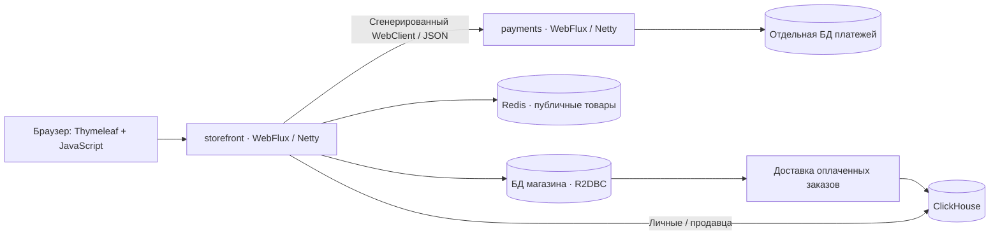
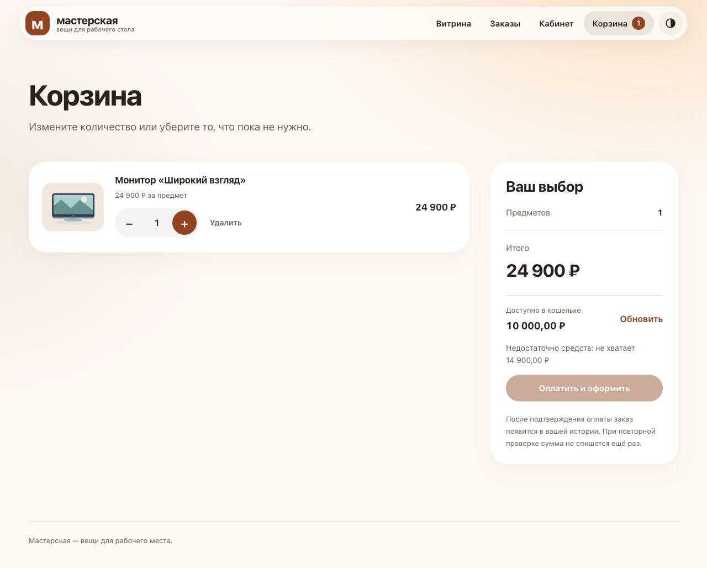
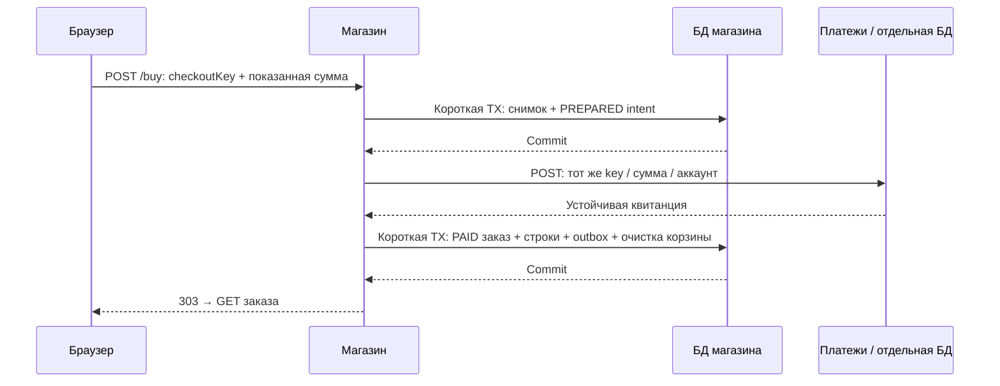
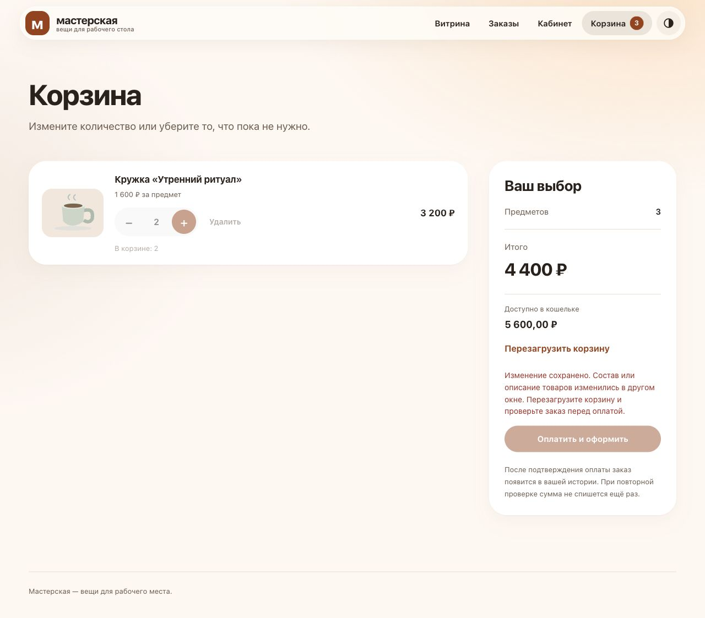
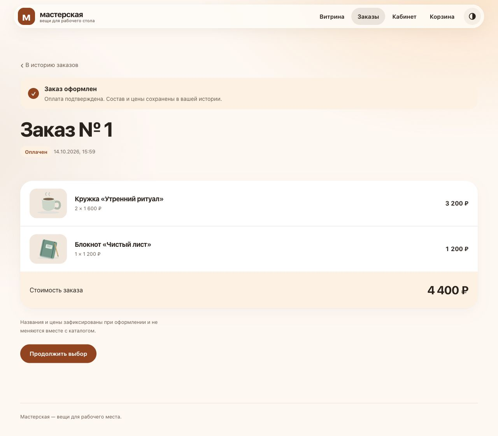
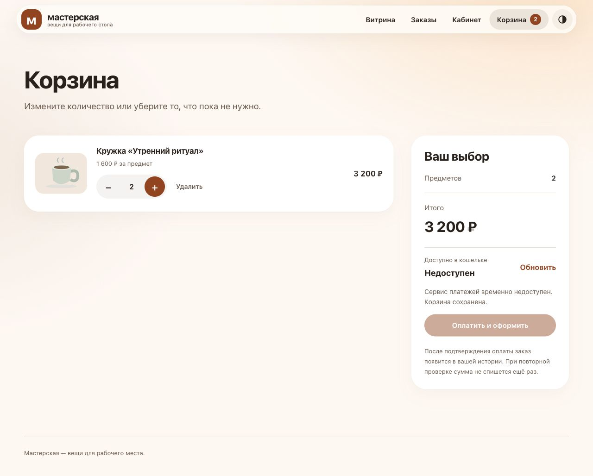
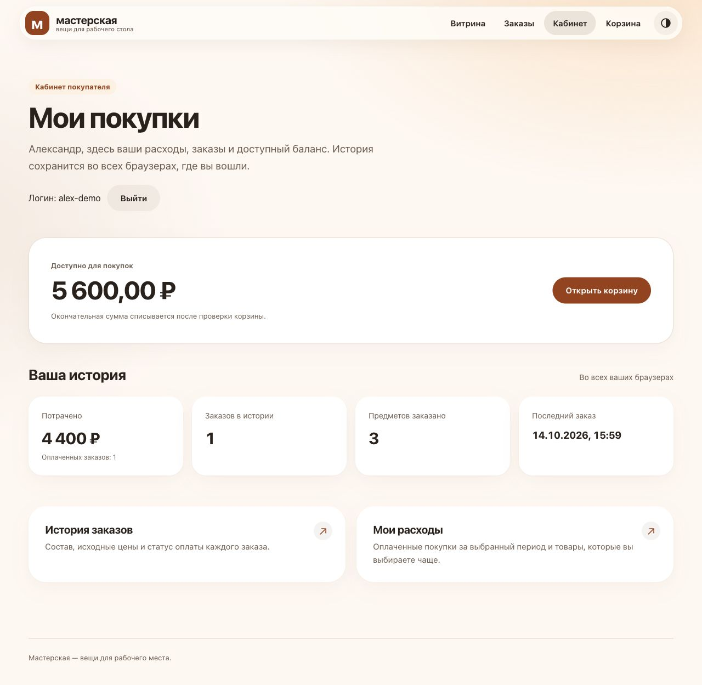
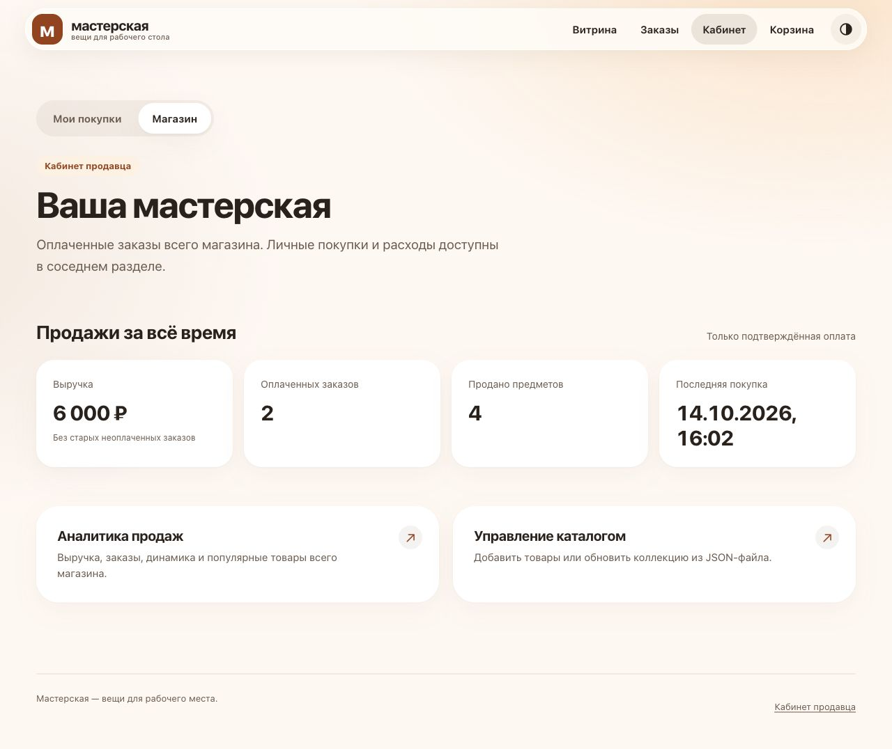
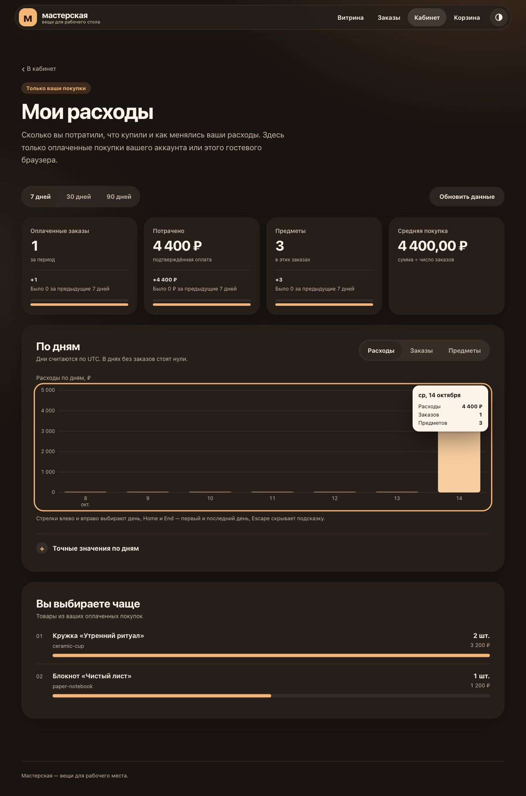
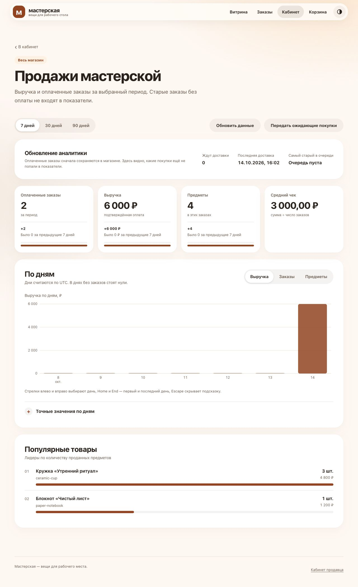

# Спринт 7. Витрина, платежи и Redis

## Цель

Продолжить реактивный магазин из [шестого спринта](../sprint06-reactive-storefront/README.md): выделить платежи в отдельное WebFlux-приложение, связать два приложения контрактом OpenAPI и добавить кеш товаров в Redis.

**Java 21 · Spring Boot 3.5.16 · WebFlux / Netty · R2DBC · Redis · OpenAPI · Gradle.** PostgreSQL сохраняет данные; H2 позволяет проверить тот же сценарий в памяти.

[Сборка и запуск](#1-сборка-и-запуск) · [Каталог и кеш](#2-каталог-и-кеш) · [Платежи](#3-платежи-и-оформление-заказа) · [Кабинеты](#4-покупатель-и-продавец) · [ClickHouse](#5-аналитика-в-clickhouse) · [Ресурсы](#6-ресурсы-jvm-и-отзывчивость) · [Деплой](#7-модульный-деплой) · [Проверки](#8-проверки)



<details>
<summary>Структура и продолжение истории</summary>

```text
api/payments.yaml     единый контракт двух бизнес-эндпоинтов
storefront/           магазин, кабинеты, Redis, аналитика
payments/             кошельки, решения платежей, журнал проводок
analytics/            схема и настройки ClickHouse
scripts/              сборка и проверки настоящих сервисов
```

В Gradle ровно два подпроекта. Сгенерированный код находится в `build/generated/openapi`, в Git его нет. Собственные слои: controller → service → dao; доменные enum/DTO остаются рядом со своей логикой, общие чистые функции — в `util`.

Ветка создана от принятого проекта спринта 6. Его коммиты остаются предками, исходная копия и последующий перенос в подпроект зафиксированы отдельно. Из корня репозитория:

```sh
git log --follow --find-copies-harder -- \
  projects/sprint07-rest-service/storefront/src/main/java/dev/principalwater/store/service/CheckoutService.java
```

</details>

## 1. Сборка и запуск

Команды приложения выполняем из `projects/sprint07-rest-service/`. Нужны **JDK 21**, Python 3.10+ и Docker Engine; локально проверено с OrbStack. `java -version` должен показывать 21: Gradle toolchain не меняет Java терминала.

```sh
python3 scripts/package.py
python3 scripts/init-secrets.py
export STORE_UID="$(id -u)" STORE_GID="$(id -g)"
docker compose -f compose.yaml up -d --build --wait
```

Открываем [магазин](http://localhost:8087); платежи доступны на `127.0.0.1:8097`, их API требует сервисный Bearer-токен. PostgreSQL обеих систем и Redis опубликованных портов не имеют. Каждый Java-сервис — **Executable JAR со встроенным Netty**, без Nginx или внешнего servlet-контейнера.

Пароли и токен создаются вне Git в `~/.config/java-engineering-course/sprint07/`: каталог `0700`, файлы `0600`, повторный запуск сохраняет значения. Read-only file secrets читаются Spring Boot Config tree. Это контроль доступа к локальным файлам, а не шифрование; для рабочего окружения нужны внешний secret manager и TLS.

При первом запуске продавец `seller` получает пароль из `seller_password`. Войдите через форму, откройте «Каталог» и загрузите пример JSON или свой файл. Для личной истории зарегистрируйте отдельного покупателя. Публичная регистрация не выдаёт роль продавца.

<details>
<summary>H2: две независимые БД в памяти</summary>

```sh
docker compose -f compose.h2.yaml up -d --build --wait
```

Адреса: [магазин 8088](http://localhost:8088), платежи `8098`. У каждого приложения собственная H2 внутри своей JVM; SQL не использует режим совместимости PostgreSQL. После остановки соответствующей JVM её данные исчезают. Это автономный стенд, не замена постоянному хранению финансовых данных. Сетевой I/O, ограничения SQL и конкурентные блокировки дополнительно проверяются на PostgreSQL.

Cookie корзины и сессии различаются между профилями и спринтами: браузер не разделяет cookie по портам.

</details>

<details>
<summary>Два JAR без контейнеров приложений</summary>

Нужен Redis; его можно запустить отдельно:

```sh
docker compose -f compose.h2.yaml up -d redis
```

Для доступа с хоста опубликуйте Redis только на loopback отдельным Compose override. Задайте `SPRING_DATA_REDIS_HOST`, `SPRING_DATA_REDIS_PORT`, `SPRING_DATA_REDIS_USERNAME=storefront` и пароль через Config tree. Без Redis работает SQL fallback, но это не проверка кеширования.

В отдельных терминалах запускаем Java 21. Имена env соответствуют relaxed binding Boot: дефисы в составных свойствах удалены. Токен берём из уже созданного внешнего файла, не сохраняем в истории команд:

```sh
export STORE_SECRETS_DIR="$HOME/.config/java-engineering-course/sprint07"
export PAYMENTS_SERVICETOKEN="$(cat "$STORE_SECRETS_DIR/payments_service_token")"
java -jar build/deployment/payments.jar
```

```sh
export STORE_SECRETS_DIR="$HOME/.config/java-engineering-course/sprint07"
export STORE_PAYMENTS_SERVICETOKEN="$(cat "$STORE_SECRETS_DIR/payments_service_token")"
export STORE_PAYMENTS_URL=http://127.0.0.1:18097
export STORE_SELLER_BOOTSTRAPPASSWORD="$(cat "$STORE_SECRETS_DIR/seller_password")"
java -jar build/deployment/storefront.jar
```

Магазин: [18087](http://localhost:18087). Переменные здесь — локальный вариант запуска; в контейнерах секреты передаются файлами. Для импорта входим как `seller` с паролем из внешнего файла; регистрация отдельного покупателя сохраняет разграничение ролей. Скрипт `verify-jar.py` автоматически готовит file secrets, Redis с ACL и оба настоящих JAR, затем проходит весь HTTP-сценарий.

</details>

### Gradle

```sh
./gradlew --no-daemon --console=plain check packageDeployment
./gradlew :payments:bootRun   # отдельный терминал и настроенный service-token
./gradlew :storefront:bootRun
```

Gradle — единственный сборщик: генерация OpenAPI, тесты, PMD и упаковка Boot JAR используют одну конфигурацию. Задача `packageDeployment` готовит `build/deployment/storefront.jar` и `payments.jar` для Docker и OpenTofu. Это исключает рассинхронизацию двух сборок при изменении зависимостей или проверок.

**Схемы БД:** магазин выполняет упорядоченные SQL-файлы через `spring.sql.init`; в PostgreSQL платежная БД и права создаются отдельно владельцем. Java-процесс платежей этого профиля работает как `payments_runtime` с `PAYMENTS_SQL_INIT_MODE=never`. Это ещё не версионные миграции: существующие структуры автоматически не преобразуются, кроме явных идемпотентных `ALTER`. Чужие тома и БД предыдущих спринтов к стенду не подключаем.

## 2. Каталог и кеш

Сохранены поиск по названию/описанию, сортировки «порядок каталога / название / цена» и страницы **2, 5, 10, 20, 50, 100** товаров. Вторичный порядок по ID делает пагинацию устойчивой. Карточка товара и корзина используют те же действия: **минус, редактируемое число, плюс**; ноль удаляет позицию.


*Тёплая палитра, единая навигация и явное подтверждение изменения корзины.*

Redis содержит только публичное представление товара: ID, название, описание, изображение и цену, а также результаты поиска/сортировки/пагинации. Количество и принадлежность корзины остаются в SQL. На miss читаем БД, проверяем представление и заполняем кеш; на hit используем сохранённый JSON. Для корзины выполняется пакетный `MGET`, пропуски добираются одним SQL-запросом.

**TTL — 60 секунд.** Абстрактный `AbstractJsonRedisCache` объединяет общий протокол кеша; конкретные кеши товара и страницы задают тип, ключ и проверку содержимого. Это реальное переиспользование без базового класса для несвязанных сервисов.

<details>
<summary>Согласованность и отказ Redis</summary>

- Ревизия каталога меняется в одной SQL-транзакции с импортом. Ключ включает UUID источника, а JSON-запись — ревизию, проверяемую при чтении. Поздний fill старой ревизии даёт miss, а не устаревший товар. Чтение ревизии остаётся коротким SQL-запросом: наличие кеша не означает полного отсутствия SQL.
- Ключ товара содержит полный ID: разные товары не вытесняют друг друга из-за коллизий. Объём ограничивают TTL и Redis `maxmemory`. Для страниц поиска остаются **128 фиксированных слотов**: число поисковых строк не ограничено каталогом, совпадение слота проверяется по identity в JSON.
- Предел JSON: **32 КиБ товар / 2 МиБ страница**; операции кеша имеют бюджет **150 мс**. Повреждённая запись или недоступный Redis ведут к SQL fallback, без отказа покупки.
- Redis имеет **32 МиБ maxmemory**, `allkeys-lfu`, без RDB/AOF: это восстанавливаемый кеш. ACL разрешает приложению только публичные product/page-ключи и необходимые команды; баланс, платежи, сессии и данные пользователя туда не записываются.
- На оформлении заказа цены всегда читаются из авторитетной SQL-модели; кеш не разрешает сумму списания.

</details>

Импорт доступен продавцу: JSON до **1 МиБ / 1000 строк**, уникальный SKU, проверенные локальные SVG, целые рубли до **1 000 000 ₽** за единицу. Проверка всего файла предшествует записи, ошибка откатывает импорт. Поиск использует bind-параметры и экранирование LIKE, вывод — экранирование Thymeleaf.

## 3. Платежи и оформление заказа

> **Примечание.** Решил подробнее проработать финансовую часть: точную арифметику Java, конкурентное списание и восстановление после потери сетевого ответа. Здесь важнее сохранить смысл операции при повторе, чем ускорить её небезопасным кешированием баланса.

[OpenAPI-контракт](api/payments.yaml) описывает ровно два бизнес-эндпоинта:

| Метод | Путь | Результат |
| --- | --- | --- |
| `GET` | `/api/v1/accounts/{accountId}/balance` | Баланс в копейках и валюта `RUB`; чтение ничего не записывает |
| `POST` | `/api/v1/payments` | Списание: `accountId`, `referenceId`, `amountMinor`, `currency` и заголовок `Idempotency-Key` |

Из одного YAML генерируются реактивный **контроллер** платежей с delegate и клиент **WebClient** магазина. Доменная логика остаётся в собственных сервисах. Все бизнес-запросы требуют сервисного Bearer-токена; health/readiness открыты для локального контроля. Кошелёк покупателя определяется серверной идентичностью, не параметром браузера.

### Деньги и журнал

Деньги в платежах — `long` в **копейках**, без `double`. Верхняя граница операции — **10¹⁵ копеек**; сложение и преобразование рублей проверяют переполнение. `BigDecimal` нужен для точного форматирования/среднего, а SQL `numeric` преобразуется через `longValueExact`: неверный итог не превращается в другое число. JSON не принимает дробные/строковые суммы, неизвестные и повторяющиеся поля.

Начальный баланс учебного кошелька — **10 000 000 ₽**, настройка `payments.opening-balance-minor`. На снимках отдельный демонстрационный стенд: `PAYMENTS_OPENING_BALANCE_MINOR=1000000` (10 000 ₽), чтобы показать нехватку средств; значение задаётся в `payments.environment` Compose override до первого списания. Это демонстрационный выпуск средств, не интеграция с банком. GET показывает начальный баланс без создания записи; первая попытка списания создаёт кошелёк и начальную проводку.

Короткая транзакция блокирует строку **конкретного кошелька** через `FOR UPDATE`. Параллельные списания не уводят баланс ниже нуля; разные кошельки не ждут общий merchant-row. Решение `SUCCEEDED` или `DECLINED` сохраняется неизменяемым вместе с привязкой ключа к аккаунту, заказу, валюте и сумме.

**Двойная запись:** строка журнала одновременно содержит дебет и кредит; SQL CHECK требует нулевой суммы пары. Начисление: `CUSTOMER + / ISSUER −`; оплата: `CLEARING + / CUSTOMER −`. Составной внешний ключ связывает платежную проводку с успешным решением того же аккаунта и суммы. Половина проводки отдельно существовать не может. Runtime-роль не имеет прав на UPDATE/DELETE журнала и решений, а в кошельке может менять только баланс.

Новый успешный POST возвращает **201**, повтор — **200** с исходной квитанцией; нехватка средств — **402**, переиспользование ключа с другим содержимым — **409**. Отказ также идемпотентен: повтор не превращает прежний отказ в новое списание. Возвращённый `balanceMinor` относится к этому решению, а не к более поздним операциям.

### Покупка как восстанавливаемая операция



*Доступность покупки зависит от настоящего баланса; нехватка средств и недоступность платежей показаны отдельными состояниями.*



Подготовка снимка и подтверждение заказа разделены между `CheckoutPreparationService` и `CheckoutSettlementService`; `CheckoutService` связывает их с платежным HTTP-вызовом. Сумму и состав заказа фиксируем перед HTTP, соединение магазина не удерживаем на время сети. Подтверждённый заказ появляется **только после успешного списания**; ошибка последней SQL-записи откатывает подтверждение. Оплаченный intent затем можно безопасно завершить повторно. Ошибка локального подтверждения возвращает состояние проверки платежа с сохранённой SQL-причиной в серверном логе, не объявляет успешное списание отменённым.

Форма связывает согласие на покупку с `checkoutKey` и показанной суммой. Ключ учитывает версию корзины и ревизию каталога в одном SQL-снимке; изменение цены или корзины требует нового подтверждения. Повтор уже начатого POST возвращает прежний результат и не оплачивает товары, добавленные позже. Устаревшая форма без созданного intent получает 409. Снимки строк сохраняют исходные цены и названия.

ACK изменения количества не разрешает оплатить невидимый состав: если ответ содержит новую позицию или другое название/изображение, корзина требует перезагрузки. Сохранённая мутация остаётся успешной, оплата блокируется до просмотра полного состава.

<details>
<summary>Корзина изменена в другом окне</summary>



*Второй браузер добавил блокнот, первый ещё показывает только кружку. Изменение количества сохранено, но новая сумма не превращается в согласие оплатить невидимый товар.*

</details>

Если ответ потерян, timeout **не означает отказ**. Intent остаётся `PREPARED`, корзина временно недоступна для изменений; повторная проверка и фоновое восстановление используют **тот же ключ и сумму**. Recovery читает не более **32** готовых intent за проход и освобождает SQL-соединение до HTTP. До **2** попыток работают параллельно: медленный платеж не останавливает остальных, в пулах R2DBC (5) и HTTP (8) остаётся запас для обычных покупок. После прохода планировщик ждёт **1 секунду**.

Первые **30 секунд** от создания intent оставлены исходному запросу покупателя; затем условный SQL claim допускает фоновую попытку только для ещё не занятого `PREPARED` intent. Соседний worker пропускает занятую запись; retry разрешён через **30 секунд**, чтение очереди и каждая попытка ограничены **15 секундами**. Часы реплик должны быть синхронизированы. При отмене или падении worker intent остаётся повторяемым. Необработанные и давно ожидающие записи идут первыми; устойчивые ошибки не удерживают начало очереди. Это временное исключение повторной фоновой работы, а финансовую безопасность, включая ручной повтор и истечение claim, обеспечивают прежний ключ платежа и атомарное подтверждение заказа. Двойного списания от повтора не возникает, но общей распределённой SQL-транзакции у двух приложений нет.



*Статус оплаты отделён от истории заказа; обновление страницы выполняет GET.*

<details>
<summary>Проверка отказа платежного сервиса</summary>



*Платёжный контейнер остановлен: каталог и корзина работают, оплата недоступна. После запуска сервиса кнопка «Обновить» восстанавливает доступность без изменения корзины.*

</details>

Старые заказы получили `LEGACY_UNPAID`: отсутствие платежа нельзя задним числом назвать оплатой. Они доступны в истории, но не участвуют в оплаченных итогах и ClickHouse-фактах. Максимум корзины — **99 единиц × 50 товаров**, арифметика допускает итог больше `Integer.MAX_VALUE`.

## 4. Покупатель и продавец



Покупатель видит собственные покупки, оплаченные суммы, дату последнего заказа, ожидающие платежи и баланс. Аккаунт восстанавливает одну корзину и историю в разных браузерах; гостевой режим сохраняет отдельную cookie-корзину. Идентификатор чужого заказа или подставленная cookie не дают доступ к его данным.

Продавец открывает `/account/seller`: оплаченные заказы, сумма, число предметов, ожидающие платежи, управление каталогом и общая аналитика магазина. Эти маршруты закрыты ролью `SELLER`; регистрация создаёт только `BUYER`, bootstrap не повышает права уже существующего покупателя.



> **Примечание.** Дополнительно развёл кабинеты: покупателю нужны его расходы и покупки, продавцу — оплаченные продажи всего магазина. Отдельно переработал UX/UI на Java/WebFlux: единые элементы количества, тёплая палитра и мягкая прозрачная навигация при спокойном фоне данных.

Формы работают с CSRF и POST/Redirect/GET; JavaScript улучшает отклик, но не заменяет серверную проверку. Очередь изменений ограничена 12 действиями, ответ обновляет только подтверждённый снимок. Светлая/тёмная темы, keyboard focus, reduced motion/transparency и мобильная компоновка сохранены. Это веб-интерпретация принципов материалов Apple, без заявления о нативном iOS-рендеринге или полном аудите доступности.

<details>
<summary>Мобильная карточка товара</summary>


*Тот же серверный HTML: навигация, количество и обратная связь помещаются без горизонтального скролла.*

</details>

Сессии локальны одной JVM: после рестарта нужен повторный вход; горизонтальный запуск потребует общего хранилища сессий. BCrypt выполняется вне event loop в ограниченном scheduler. Восстановление пароля и подтверждение контактов не реализованы.

## 5. Аналитика в ClickHouse

> **Примечание.** Решил продолжить интеграцию аналитической системы с Java-бэкендом и D3.js, теперь отразив в ней именно оплаченные покупки и разные задачи кабинетов.

```sh
docker compose -f compose.yaml -f compose.analytics.yaml up -d --build --wait
```

Личная аналитика: `/profile/analytics`; продавца: `/account/seller/analytics`. Вторая суммирует оплаченные покупки всех покупателей **этого источника**, первая всегда ограничена владельцем из серверной идентичности. Периоды **7 / 30 / 90 дней**, сравнение с предыдущим окном, сумма/заказы/предметы по дням, средний заказ и топ-10 товаров.



<details>
<summary>Продажи магазина отдельно от личных расходов</summary>



*Личный кабинет первого покупателя показывает 4400 ₽; продавец видит две оплаченные покупки на 6000 ₽. Показатели получены из настоящих заказов, без вымышленных прошлых дат.*

</details>

D3 поставляется локально с лицензией, строит SVG из JSON WebFlux; расчёты принадлежат Java/ClickHouse. Счётчики и суммы передаются строками, подписи используют `BigInt`; `Number` нужен только для координат. Без JS остаются показатели и таблицы. Недоступность источника не выдаётся за нулевые продажи.

**Доставка:** PAID-заказ и outbox фиксируются в одной транзакции магазина. В capture последовательно загружаются заказы, владельцы и факты; запасной UUID вычисляется только для гостевых корзин. Между capture и ACK выполняется реактивный WebClient INSERT, без SQL-соединения на время сети. Пакет до **100 заказов / 5000 строк**, повтор через **5 секунд** после завершения попытки. ClickHouse не блокирует покупку; локальный координатор допускает один экспорт в JVM, для нескольких экспортёров нужен долговечный lease.

Новая `paid_purchase_facts` не смешивается с неоплаченными фактами прошлых спринтов. `ReplacingMergeTree`, неизменяемый ключ и `FINAL` защищают метрики от повторной доставки до merge; это **at-least-once**, не распределённый exactly-once. SQL использует `PREWHERE` по источнику/владельцу/дате, `GROUPING SETS`, `uniqExact` и отдельный итог предыдущего периода. SELECT и INSERT имеют разные роли и ограниченные ресурсы.

<details>
<summary>Два шарда, две реплики и отказ узла</summary>

```sh
WEB_PORT=8089 PAYMENTS_PORT=8099 docker compose -p sprint07-rest-cluster \
  -f compose.yaml -f compose.cluster.yaml up -d --build --wait
```

`ReplicatedReplacingMergeTree` + `Distributed`; Java выбирает coordinator endpoints, а ClickHouse — шард по `cityHash64(user_id)` и здоровую реплику. Прямая рассылка в каждую реплику из Java продублировала бы ответственность сервера. `internal_replication=true`, `distributed_foreground_insert=1`, `insert_quorum=2`: ACK требует обе реплики. При их отказе покупка сохранена, аналитический outbox ждёт восстановления.

Keeper проверяется настоящей сессией до старта узлов: открытого TCP-порта недостаточно для холодного старта реплицированной схемы. Тест проверяет повторы, изоляцию владельца, отказ coordinator и восстановление quorum. Один Keeper — предел локального стенда; рабочему кластеру нужны quorum Keeper, TLS, backup и план распределения по дата-центрам. Изменение шардирования требует переноса данных.

</details>

## 6. Ресурсы JVM и отзывчивость

Ресурсами управляет отдельный пакет `runtime`: общие управляемые event loops для Netty server, WebClient и PostgreSQL R2DBC, ограниченные scheduler/очереди и admission filter. Для реактивного `fixedDelay` [Spring ожидает завершения подписки](https://docs.spring.io/spring-framework/docs/6.2.x/javadoc-api/org/springframework/scheduling/annotation/Scheduled.html): два ограниченных потока планировщика позволяют восстановлению платежей и аналитике работать независимо. Используется штатный жизненный цикл Spring/Reactor; ручной GC и небезопасная работа с памятью не добавлены.

| Ресурс | Бюджет стенда |
| --- | --- |
| Магазин / платежи | 1 CPU, 512 / 384 МиБ; heap до 40%, direct memory до 48 МиБ |
| Netty I/O | 2 worker на приложение |
| Плановые задачи магазина | 2 потока для recovery и аналитической доставки |
| Recovery | Пакет 32, параллельно 2; до 2/5 SQL и 2/8 HTTP; пауза 1 с, grace/retry 30 с, scan/attempt timeout 15 с |
| JSON-кодек кеша и аналитики | 1 worker, очередь 32 |
| Запросы приложения | До 64 одновременно; при переполнении 503 и `Retry-After: 1` |
| Пул R2DBC | 1 начальное / 5 максимум |
| Платежный WebClient | 8 соединений / 32 ожидающих; общий debit deadline 5 с |
| Lettuce | 2 I/O + 2 computation; очередь 256, отказ при disconnected |
| PostgreSQL | По 256 МиБ / 1 CPU, отдельный том каждой БД |
| Redis | 128 МиБ контейнер, 32 МиБ данных кеша |

Короткие финансовые транзакции, ограниченные очереди и сброс перегрузки ограничивают расход ресурсов. Значения нужно согласовывать с нагрузкой, задержками БД и количеством экземпляров.

### Проверка на ограниченном стенде

Локальный HTTP-прогон в OrbStack, Java 21, **по 1 CPU**, магазин **512 МиБ**, платежи **384 МиБ**; десять товаров после импорта. Постоянные HTTP-соединения, одна существующая гостевая корзина, полный приём HTML/JSON. Последний контрольный прогон после прогрева JVM:

| Сценарий | Запросы / одновременно | p50 / p95 / p99, мс | Запросов/с | Ошибки |
| --- | --- | --- | --- | --- |
| Каталог, Redis доступен | 400 / 8 | 14,09 / 94,74 / 101,12 | 181,4 | 0 |
| Каталог, Redis остановлен | 400 / 8 | 11,09 / 93,97 / 145,03 | 200,3 | 0 |
| Новые списания одного кошелька | 100 / 4 | 14,43 / 72,01 / 81,66 | 149,8 | 0 |

Каждое списание — настоящая короткая PostgreSQL-транзакция на **1 копейку** с отдельным ключом; итог 999 900 копеек из 1 000 000, повтор первой операции не меняет баланс. Пик cgroup memory: магазин **401,35 МиБ**, платежи **251,55 МиБ**; `oom`, `oom_kill` и события достижения hard limit — **0**. Пик включает файловый кеш, а не только Java heap.

При лимите 384 МиБ магазин после отказа Redis достигал hard limit: запросы завершались без ошибок и OOM, но запас памяти исчезал. Heap 30% оставил лишь 23 МиБ после короткой проверки, поэтому сохранил heap 40% и увеличил только бюджет магазина до 512 МиБ. Это оставляет место native memory, не зажимая Java heap ради формального малого лимита. Прогрев JIT и результаты коротких прогонов различаются; таблица показывает последний отдельный прогон, не оценку причинного эффекта настройки.

Это короткая проверка работоспособности под лимитами, не оценка максимального TPS или гарантия SLO. Для десяти товаров SQL fallback в этом прогоне быстрее: стоимость Redis/JSON сопоставима с простым SQL-чтением. Большой каталог, длительная нагрузка и отказ целого хоста здесь не моделировались.


### Recovery под нагрузкой k6

```sh
python3 scripts/verify-payment-load.py
```

Нужны собранные Gradle JAR, Java 21, Docker и [k6](https://grafana.com/docs/k6/latest/using-k6/). Скрипт поднимает две настоящие JVM, две PostgreSQL и Redis на случайных loopback-портах. У каждой JVM heap **192 МиБ**, direct memory **48 МиБ**, `ActiveProcessorCount=1`; последнее настраивает JVM, не ограничивает CPU хоста. Тестовый HTTP-прокси добавляет **200 мс** задержки списания; баланс и журнал ведёт настоящий платежный сервис.

Через формы/CSRF создаются **80 PREPARED intent** - больше одного recovery-пакета. Восемь старейших временно получают 503, остальные должны завершиться без их ожидания. Параллельно k6 выполняет **400 чтений каталога / 4 VU** и **20 покупок / 2 VU** с повтором checkout. Затем восстанавливаем последние восемь платежей.

| Результат локального прогона | Значение |
| --- | --- |
| 72 доступных intent + 20 новых покупок после возврата платежей, включая первый grace period | 41,46 с |
| Восстановлены все 80 intent, включая ожидание grace/retry | 62,52 с |
| Пик одновременных recovery HTTP | 2 |
| Каталог / полная покупка, p95 | 15,32 / 342,15 мс |
| Неожиданные HTTP-ошибки / проваленные k6 checks | 0 / 0 |

Прокси зафиксировал ровно **80** успешных recovery-запросов и **20** отдельных платежей новых покупок, каждый отправлен один раз. Финальная сверка обеих PostgreSQL: **100 PAID-заказов = 100 успешных решений = 100 сбалансированных платежных проводок**; корзины пусты, outbox содержит 100 заказов. Повтор всех **100** платежей возвращает исходные квитанции с 200, не меняя балансы и число проводок. Условный claim и срок повтора проверяются отдельно на H2/PostgreSQL. Логи и JSON-результаты остаются во внешнем каталоге проверки; сервисы останавливаются в `finally`.

Это конечный regression/load-прогон, не максимальный TPS и не промышленный SLO. Он проверяет прогресс очереди, изоляцию медленных платежей, доступность обычных покупок и финансовые инварианты.

## 7. Модульный деплой

Из корня репозитория, [общая инфраструктура](../../infra/README.md):

```sh
python3 infra/deploy.py sprint07-postgresql plan --analytics
python3 infra/deploy.py sprint07-postgresql apply --analytics
python3 infra/verify.py sprint07-postgresql --analytics

python3 infra/deploy.py sprint07-h2 plan --analytics
python3 infra/deploy.py sprint07-h2 apply --analytics
python3 infra/verify.py sprint07-h2 --analytics
```

| Стенд | Магазин | Платежи | ClickHouse |
| --- | --- | --- | --- |
| PostgreSQL | `127.0.0.1:28089` | `127.0.0.1:29089` | `127.0.0.1:28129` |
| H2 | `127.0.0.1:28090` | `127.0.0.1:29090` | `127.0.0.1:28130` |

OpenTofu моделирует отдельные приложения, БД, Redis, ClickHouse, сеть и тома, не вызывает Compose вместо ресурсов. План сохраняется и проверяется до apply; хеши исходников и обоих JAR запрещают применение устаревшей сборки.

Проверено с **OpenTofu 1.11.6 / Docker provider 4.6.0 / OrbStack**: в PostgreSQL отдельная замена каждого контейнера БД сохраняет заказ, баланс и квитанцию; JVM при этом не пересоздаются. В H2 отдельная замена каждой JVM сбрасывает её данные, после чего новая покупка проходит. Повторные планы обоих работающих стендов пусты.

После ручной остановки сначала запускаем принадлежащие стенду контейнеры, затем строим новый plan: Docker provider 4.6.0 читает порты остановленного контейнера как пустые и может предложить лишнюю замену JVM. Такой план не применяем; скрывать расхождение через `ignore_changes` нельзя. Команды остановки и повторного запуска приведены в общей документации деплоя.

State и секреты каждого стенда находятся вне Git, порты ограничены loopback. Readiness приложения зависит только от его БД; Redis, платежный HTTP и аналитика её не блокируют. При первом apply OpenTofu общий граф `for_each` ждёт обе PostgreSQL: это ограничение оркестрации небольшого стенда. Отдельная замена одной БД не пересоздаёт приложения. После проверки ненужные локальные контейнеры останавливаем, сохраняя тома, секреты и state; обычная очистка не выполняет destroy/prune.

## 8. Проверки

```sh
python3 scripts/package.py
python3 scripts/verify-jar.py
python3 scripts/verify-postgresql.py
python3 scripts/verify-cache.py
python3 scripts/verify-analytics.py
python3 scripts/verify-cluster.py
python3 -m unittest discover -s storefront/src/test/python -v
node --check storefront/src/main/resources/static/store.js
node --check storefront/src/main/resources/static/analytics.js
```

Основной `check` запускает **110 тестов** (76 магазин / 34 платежи) и **PMD 7.13.0** обоих приложений. Дополнительно прошли **51 PostgreSQL**, **7 Redis**, по одному сценарию одиночного и кластерного ClickHouse и две Python-проверки file secrets. Gradle JAR прошли настоящий HTTP smoke; интерфейс проверен во встроенном браузере. `@DataR2dbcTest`, `@WebFluxTest`, `@SpringBootTest`, `StepVerifier` и `WebTestClient` разделяют границы модели/SQL/HTTP и переиспользуют TestContext без `@DirtiesContext`. Узкие тестовые базы и фабрики устраняют повторение setup, unit-тесты не загружают Spring.

Финансовые проверки защищают конкурентное списание, баланс и двойную запись, идемпотентный успех/отказ, конфликт ключа, потерю ответа, откат подтверждения, повтор старой формы и справедливое восстановление очереди из 33 операций. Отдельно проверяются ограниченная параллельность, timeout чтения очереди и зависшей попытки, начальный grace period, условный SQL claim двух worker и повтор после истечения claim. PostgreSQL проверяет настоящий диалект и блокировки; JAR smoke проходит форму/CSRF/импорт/покупку и повтор платежа через сеть. Redis gate проверяет hit/miss, независимость товаров с прежней коллизией ключей, TTL, повреждённые значения, обновление каталога и восстановление после отказа. Отдельные ClickHouse gates проверяют оплаченные факты гостей и зарегистрированных покупателей, изоляцию владельцев и кластер.

Тестовые сервисы получают изолированные имена, БД и внешние файлы секретов. Проверки останавливают свои контейнеры, сохраняя артефакты в `~/.local/state/java-engineering-course/sprint07-tests/`. Это настоящие сервисы, а не замена Redis или PostgreSQL in-memory заглушкой.

**Граница проекта:** демонстрационный RUB-кошелёк, без реального эквайринга, пополнения, возвратов, налоговых документов и PCI DSS-контура. H2 теряет деньги вместе с процессом; для постоянных платежных данных используем PostgreSQL. Локальные file secrets и один экземпляр сервисов не равнозначны промышленной эксплуатации.

## Полезные материалы

- [Spring Boot 3.5](https://docs.spring.io/spring-boot/3.5/) — конфигурация, Config tree, executable archives и тесты.
- [Spring Data Redis](https://docs.spring.io/spring-data/redis/reference/) — реактивный доступ, сериализация и кеширование.
- [OpenAPI Generator: Spring](https://openapi-generator.tech/docs/generators/spring/) и [Java WebClient](https://openapi-generator.tech/docs/generators/java/) — генерация двух сторон контракта.
- [PostgreSQL: явные блокировки](https://www.postgresql.org/docs/17/explicit-locking.html) — граница конкурентного списания.
- [Java 21 Math](https://docs.oracle.com/en/java/javase/21/docs/api/java.base/java/lang/Math.html) — проверяемая целочисленная арифметика.
- [ClickHouse: Java и R2DBC](https://clickhouse.com/docs/integrations/language-clients/java/r2dbc) — альтернативный клиентский интерфейс; в проекте используется WebClient HTTP.
- [Apple: материалы](https://developer.apple.com/design/human-interface-guidelines/materials) — принципы прозрачности и читаемости.
