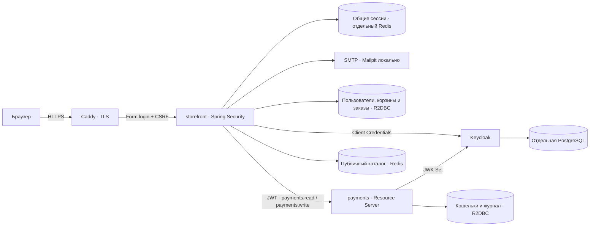
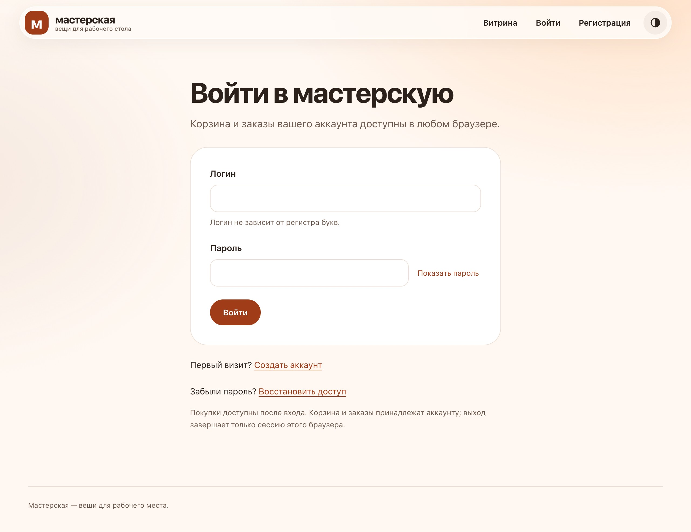
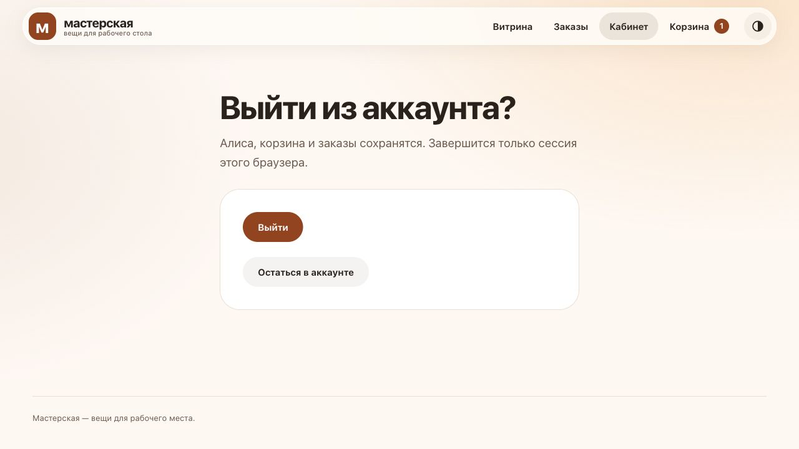
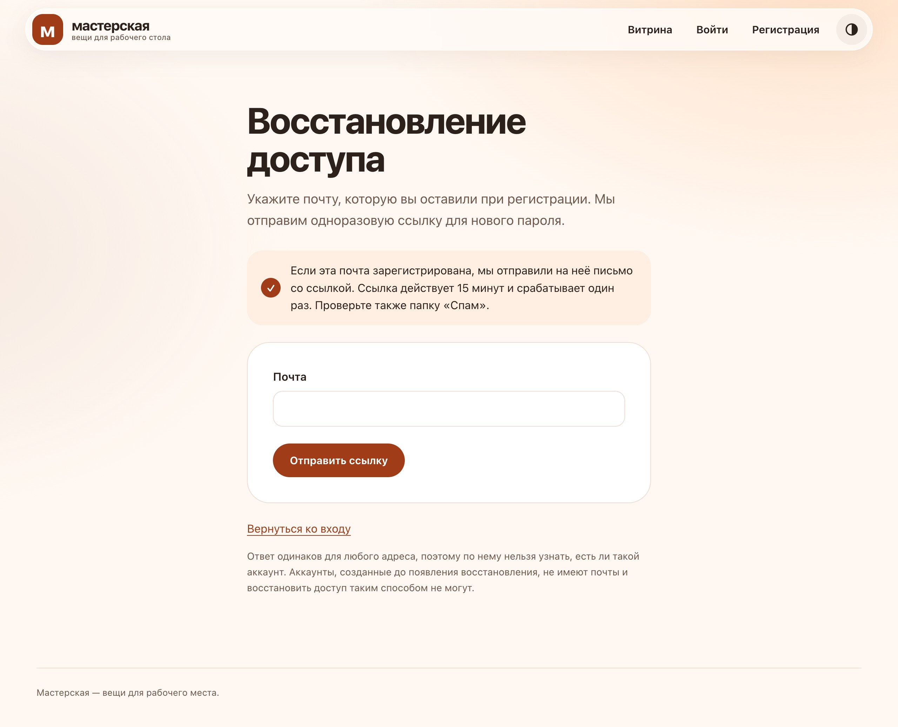
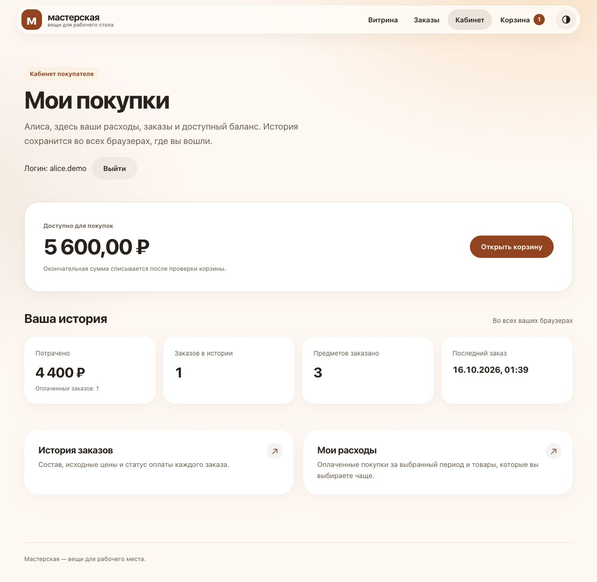
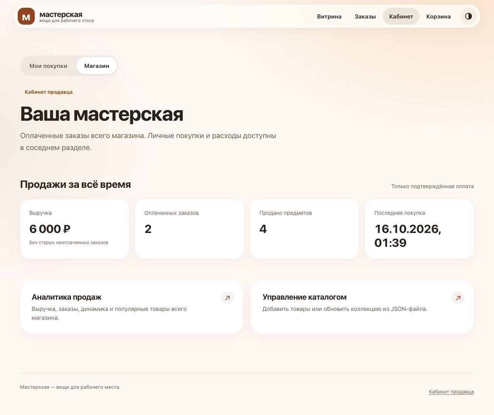
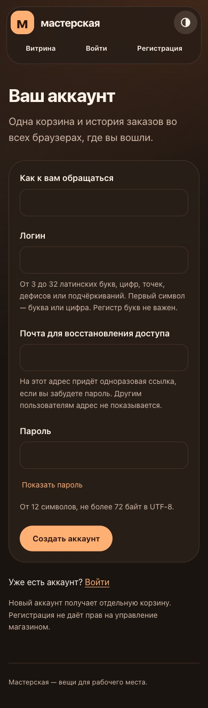

# Спринт 8. Spring Security и OAuth2 для витрины

## Цель

Продолжить [принятый магазин спринта 7](../sprint07-rest-service/README.md): закрыть персональные операции авторизацией, сохранить отдельные данные покупателей и перевести взаимодействие витрины с платежами на OAuth2 Client Credentials.

**Java 21 · Spring Boot 3.5.16 · Spring Security 6.5.11 · WebFlux / Netty · R2DBC · Redis · Keycloak 26.8.1 · Gradle.** В Gradle остаются два подпроекта: `storefront` и `payments`. Keycloak — отдельный сервис окружения.

[Запуск](#1-сборка-и-запуск) · [Вход и выход](#2-вход-регистрация-и-выход) · [Права и данные](#3-покупатель-и-владелец-магазина) · [OAuth2](#4-oauth2-между-приложениями) · [Хранение](#5-хранение-и-платежные-инварианты) · [Пагинация](#6-пагинация) · [Деплой](#7-деплой) · [Проверки](#8-проверки)



Регистрация, каталог, снимки заказов, финансовый журнал и восстановление платежей продолжают предыдущую реализацию. Изменения:

| Граница | Реализация |
| --- | --- |
| Анонимный доступ | Каталог, карточки, формы входа/регистрации/сброса пароля и необходимые статические файлы |
| Данные покупателя | Корзина, заказы, расходы и платежный счёт выбираются по серверному principal |
| Владелец магазина | Отдельная роль `SELLER`, управление каталогом и продажи магазина |
| Выход | Своя страница подтверждения, POST с CSRF, очистка context и общей WebSession |
| Восстановление | Одноразовая ссылка по email; смена пароля отзывает все прежние сессии аккаунта |
| Межсервисный доступ | Короткий JWT вместо постоянного общего Bearer-токена |
| История заказов | Ограниченные страницы с курсором, связанным с владельцем |

Ветка `feature/sprint08-security` создана от принятого спринта 7. Все прежние коммиты остаются предками; перенос исходной реализации и последующие изменения разделены. Старые каталоги проектов сохраняются как самостоятельные результаты спринтов.

## 1. Сборка и запуск

Команды выполняем из `projects/sprint08-security/`. Нужны **JDK 21**, Python 3.10+, OpenSSL 3 и Docker с Compose; локальный Docker работает в OrbStack. Gradle toolchain не переключает Java вашего терминала.

```sh
./gradlew --no-daemon --console=plain check packageDeployment
python3 scripts/init-secrets.py
python3 scripts/init-tls.py
export STORE_UID="$(id -u)" STORE_GID="$(id -g)"
docker compose -f compose.yaml up -d --build --wait --wait-timeout 300
```

| PostgreSQL-стенд | Адрес |
| --- | --- |
| Магазин | [shop.valgrind-home.localhost:8448](https://shop.valgrind-home.localhost:8448) |
| Платежный API | `127.0.0.1:8098` |
| Keycloak | [auth.valgrind-home.localhost:8448](https://auth.valgrind-home.localhost:8448) |
| Локальный почтовый ящик | [localhost:18028](http://localhost:18028) |

Базы данных и Redis не публикуют порты. Оба приложения запускаются как **Executable JAR со встроенным Netty**. PostgreSQL магазина, платежей и Keycloak имеют отдельные данные и тома. Никакой внешний servlet-контейнер не нужен.

На macOS сначала установите `brew install mkcert openssl@3` и один раз выполните `mkcert -install`: macOS запросит пароль администратора для доверия локальному CA. `init-tls.py` выпускает сертификат для `shop.valgrind-home.localhost` и `auth.valgrind-home.localhost`. Суффикс `.localhost` разрешается в loopback без публичного DNS и владения доменом. Caddy завершает TLS, удаляет переданные клиентом proxy-заголовки и задаёт доверенные Host/Proto. Магазин дополнительно фиксирует Secure для cookie в TLS-стендах.

**Docker Compose secrets используются:** отдельные read-only файлы доступны сервисам через `/run/secrets`, Java читает Boot Config tree. Платежам не передаётся секрет OAuth-клиента. Compose монтирует внешние файлы и сам не шифрует их источник. Поэтому на macOS CLI `init-secrets.py` хранит источник в AES-256 sparse image: пароль диска находится в macOS Keychain, открытый том монтируется в `~/.config/java-engineering-course/sprint08/` (`0700`, файлы `0600`). Существующие значения сохраняются; закрытый ключ локального CA также перенесён на зашифрованный том. Это локальная защита хранения, не распределённый secret manager; рабочему окружению нужен внешний Vault или аналог с ротацией и контролем доступа.

После остановки сервисов том можно закрыть командой `python3 scripts/init-secrets.py --lock`; при работающих контейнерах с его файлами скрипт откажет. Повторный `init-secrets.py` открывает прежние значения. В Linux/CI используются внешние файлы с правами `0600`; управление шифрованием их источника относится к окружению. Сертификаты, ключи, пароли и данные Keychain в Git/образ/state не попадают.

При первом старте создаётся владелец `seller` с паролем из внешнего файла `seller_password`. Войдите, откройте управление каталогом и загрузите демонстрационный JSON либо свой файл. Для покупок зарегистрируйте отдельного пользователя. Bootstrap не повышает права уже существующего покупателя.

<details>
<summary>Вариант с H2 в памяти</summary>

```sh
docker compose -f compose.h2.yaml up -d --build --wait --wait-timeout 300
```

Магазин — [shop.valgrind-home.localhost:8449](https://shop.valgrind-home.localhost:8449), Keycloak — `https://auth.valgrind-home.localhost:8449`, платежи — `8099`, почта — `localhost:18029`. У каждого приложения отдельная H2 внутри JVM, без режима совместимости PostgreSQL. Остановка соответствующей JVM удаляет её данные. Для постоянных заказов и финансового журнала используем PostgreSQL.

Keycloak также сохраняет realm и ключи в PostgreSQL: проверка H2 относится к двум Java-приложениям. H2 defaults задают отдельные TLS/Auth/Mail порты и issuer; имена cookie сессии между профилями различаются. Порты сами по себе не изолируют browser cookie.

</details>

<details>
<summary>Настоящие JAR на хосте</summary>

```sh
python3 scripts/verify-jar.py
```

Скрипт готовит изолированные Redis и Keycloak с PostgreSQL, запускает две настоящие JVM и выполняет сценарии через HTTP. Это воспроизводимый вариант проверки Executable JAR без контейнеров приложений. JAR не содержит секретов или заранее зарегистрированных покупателей.

Для ручного запуска используются стандартные свойства `spring.security.oauth2.client.registration.payments.*`, `PAYMENTS_OAUTH_TOKEN_URI`, `PAYMENTS_OAUTH_ISSUER`, `PAYMENTS_OAUTH_JWK_SET_URI` и Config tree. Настройки двух приложений находятся в [storefront](storefront/src/main/resources/application.properties) и [payments](payments/src/main/resources/application.properties); базовые порты JAR — `18088` и `18098`.

</details>


## 2. Вход, регистрация и выход

Покупатель создаёт аккаунт с логином, именем, email и паролем во время работы приложения. В одной реактивной транзакции сохраняются пользователь и его собственная корзина. Уникальность нормализованного логина и связи с корзиной защищает SQL; повтор регистрации откатывает создание лишней корзины.

Пароли хранятся как **BCrypt-хеши с солью**, а не в открытом виде или обратимом шифровании. Ограничение — от 12 символов, максимум 72 байта UTF-8; оно проверяется и на сервере. Хеширование выполняется вне event loop, в ограниченном scheduler, до открытия SQL-транзакции. Сессионный principal не хранит пароль или его хеш.

Свои формы используют прежнюю тему, навигацию и понятные состояния ошибок. Поля поддерживают password manager, автозаполнение и клавиатуру; показ пароля — дополнительное действие с `aria-pressed`. Без JavaScript формы продолжают работать. После истечения сессии изменение корзины отклоняется как устаревшая форма; проверка доступности покупки предлагает войти заново. Ни один запрос на изменение не повторяется молча.



> **Примечание.** Собственный HTML нужен для согласованного UX кабинета, а проверку пароля, сохранение security context, смену ID сессии и CSRF оставил штатному Spring Security. Это позволяет доработать интерфейс без собственного протокола аутентификации.

Выход начинается со страницы подтверждения. GET ничего не меняет; POST требует CSRF и завершает WebSession вместе с security context. Старая cookie не восстанавливает доступ. Корзина и заказы остаются в БД; другой браузер того же пользователя продолжает свою сессию. При успешном входе заменяются ID сессии и CSRF-токен; оставленная в другой вкладке гостевая форма становится устаревшей. Cookie — HttpOnly, SameSite=Lax; при HTTPS используется Secure. Idle timeout — **30 минут**.



После входа открывается `/cabinet`; личная аналитика находится в `/cabinet/analytics`, управление магазином — в `/cabinet/store`, продажи — в `/cabinet/store/analytics`. Прежние GET-адреса перенаправляются на эти маршруты.

У собственных redirect handlers явно отключён request cache: ранее запрошенный чужой заказ не становится неожиданной стартовой страницей нового пользователя.

### Общие сессии

Compose/OpenTofu включают профиль `shared-sessions`: штатный `ReactiveRedisSessionRepository` хранит сессии отдельно от публичного кеша каталога. Обе JVM используют одну сессию; перезапуск приложения не требует входа. У Redis собственные пароль, ACL и том, AOF синхронизируется при каждой записи: подтверждённый выход не восстанавливается после перезапуска хранилища.

Соединения сессий и кеша изолированы через Spring Session qualifier и `@Bean(defaultCandidate = false)`: Boot создаёт свою фабрику кеша, Spring Session получает только выделенную. JSON с явным allowlist типов поверх модулей Spring Security заменяет JDK-сериализацию; principal содержит UUID, роль и эпоху учётных данных, без email/пароля/хеша. При каждом запросе текущая эпоха проверяется одним SQL: смена пароля отзывает старые сессии всех реплик, ошибка БД не разрешает доступ.

Redis ограничен 64 MiB при лимите контейнера 128 MiB. `volatile-lru` вытесняет сессии с TTL при давлении памяти: возможен повторный вход, а не отказ всех записей. Connect/command timeout — 250/500 мс, очередь команд конечна; недоступность или загрузка AOF возвращает `503` без выдачи недействительной cookie и без локального fallback. Readiness проверяет `PING` хранилища. Ограничитель HTTP работает до security; health имеет отдельные два слота, восстановление пароля — не более четверти общего бюджета и максимум восемь запросов одновременно.

### Восстановление пароля

Форма `/account/recovery` принимает email и одинаково подтверждает запрос для известного и неизвестного адреса. Минимальная пауза 300 мс сглаживает быстрые ответы; SMTP выполняется вне event loop и HTTP-ответа, отдельно от BCrypt (два worker, очередь до 32 на каждый). Регистрация всё ещё сообщает о занятом логине/email: это не обещание скрыть существование аккаунтов во всём приложении.

Ссылка содержит 32 случайных байта, действует 15 минут; БД хранит только SHA-256, один токен на аккаунт и cooldown в одну минуту, общий для реплик. Ссылка строится из фиксированного `store.recovery.public-base-url`, а не Host запроса. Страницы сброса не кешируются и не передают Referer. В одной R2DBC-транзакции удаляется одноразовый токен, меняются BCrypt-хеш и эпоха; повтор/просроченная ссылка отклоняются. Автоматического входа после сброса нет; корзины, заказы и кошелёк сохраняются.

В локальном стенде письмо приходит в Mailpit: SMTP доступен только внутренней сети, UI — loopback. Приложение без заданных SMTP/отправителя/публичного URL явно отключает восстановление. Доставка best effort с конечными SMTP-таймаутами: после потери письма можно повторить запрос по истечении cooldown. Аккаунты старой схемы без email требуют отдельного подтверждённого добавления контакта; `store.seller.email` может заполнить пустой контакт bootstrap-владельца, не перезаписывая уже заданный.



## 3. Покупатель и владелец магазина

**Тут реализовано как один магазин и две роли.** Публичная регистрация создаёт только `BUYER`: поля `role`, `accountId` или cookie корзины не назначают права. Покупателю доступны его корзина, история, баланс и расходы. Владелец с `SELLER` дополнительно управляет каталогом и видит оплаченные продажи всего магазина; его личные покупки остаются отдельным разделом.

На скринах — два зарегистрированных покупателя с реальными тестовыми заказами. Для наглядности начальный баланс стенда уменьшен до 10 000 ₽: Алиса потратила 4 400 ₽, Борис — 1 600 ₽. Остатки и история различаются.






Видимость кнопок согласована с серверной защитой: гостю не предлагаются корзина, заказы или изменение количества. Прямой HTTP-запрос проходит те же проверки, даже если вручную составить URL или форму.

| Запрос | Результат |
| --- | --- |
| Гость открывает HTML кабинета/корзины/заказов | Переход к форме входа |
| Гость запрашивает персональный JSON | `401` |
| Покупатель открывает управление магазином | `403` |
| Другой пользователь запрашивает заказ или платёжный документ | `404`, как для отсутствующей записи |
| Изменение без корректного CSRF | `403`, без изменения данных |

[CartIdentityFilter](storefront/src/main/java/dev/principalwater/store/controller/CartIdentityFilter.java) переносит идентичность из principal, а запросы к заказам включают владельца в SQL-предикат. Новая гостевая корзина не создаётся; прежняя cookie корзины больше не служит основанием для доступа. Recovery уже созданных операций сохраняет прежние ключи и привязку платежа.

## 4. OAuth2 между приложениями

Вход человека и доступ одного сервиса к другому — разные механизмы. Покупатель входит в витрину по логину/паролю из её БД. **Витрина** получает в Keycloak токен по **Client Credentials**; браузер не получает секрет клиента или сервисный JWT.

[Realm](authorization/storefront-api-realm.json) разрешает конфиденциальному клиенту `storefront` только service account flow. Browser login, implicit grant и password grant для него выключены. Запрашиваются два scope: `payments.read` и `payments.write`; audience токена — `payments`, срок — **180 секунд**.

`AuthorizedClientServiceReactiveOAuth2AuthorizedClientManager` сохраняет токен на уровне приложения и получает новый при истечении срока. Один служебный principal используется и из HTTP-запроса покупателя, и в фоновом recovery. При ответе `invalid_token` кеш клиента очищается для следующего обращения; автоматического повторного списания эта обработка не добавляет.

| Метод API | Право |
| --- | --- |
| `GET /api/v1/accounts/{accountId}/balance` | `payments.read` |
| `POST /api/v1/payments` | `payments.write` |

[OpenAPI](api/payments.yaml) задаёт OAuth2 Client Credentials и права операций; из одного контракта генерируются реактивный сервер и WebClient. Платежи проверяют **RS256-подпись, issuer, audience, exp/nbf, subject и `azp=storefront`**. Подписанный токен без нужного scope получает `403`; отсутствующий, неверный или истёкший — `401`. Неоднозначные заголовки Authorization отвергаются.

Платежный API не принимает browser session и не создаёт cookie. CSRF выключен только на этой Bearer-границе; формы магазина остаются защищёнными. Недоступный JWK endpoint ограничен таймаутами и даёт `503`, а не разрешение без проверки подписи. Readiness Java-приложений зависит от их БД, поэтому отказ Keycloak не ломает просмотр публичного каталога.

> **Примечание.** Issuer — публичный адрес realm, а token endpoint и JWK Set внутри контейнерной сети используют имя сервиса. Отдельный `jwk-set-uri` убирает discovery-запрос при старте платежей, сохраняя проверку issuer. Новые ключи должны быть доступны для проверки JWT.

## 5. Хранение и платежные инварианты

| Хранилище | Данные и граница |
| --- | --- |
| БД магазина | Пользователи, роли, отдельные корзины, снимки заказов, intents и outbox |
| БД платежей | Кошельки по UUID пользователя, неизменяемые решения и сбалансированный журнал |
| БД Keycloak | Realm, конфиденциальный клиент и ключи подписи; не покупатели магазина |
| Redis кеша | Только публичные товары и страницы каталога, без балансов и пользовательских данных |
| Redis сессий | Отдельное хранилище: JSON security context, CSRF и короткие уведомления; TTL и AOF |

Регистрация, изменение корзины, подготовка оплаты и подтверждение заказа имеют отдельные короткие транзакции. Во время HTTP к платежам SQL-соединение магазина не удерживается. Сумма списания и плательщик определяются сохранённым снимком и текущим пользователем; параметры браузера не выбирают чужой кошелёк.

Деньги в платежах — целые копейки `long`, с проверкой переполнения. Двойная запись и ограничения SQL сохраняются. Новый успешный платёж возвращает `201`, повтор — `200` с прежней квитанцией, нехватка средств — `402`, конфликт ключа с другим содержимым — `409`. Начальное демонстрационное начисление — **10 000 000 ₽**, настройка `payments.opening-balance-minor`; реального эквайринга нет. В Java используем `openingBalanceMinor`, в Spring properties — `payments.opening-balance-minor`, в окружении — `PAYMENTS_OPENING_BALANCE_MINOR`: сохраняем нативные соглашения каждого слоя. Значение по умолчанию и единицы пояснены рядом с настройкой.

Заказ появляется только после подтверждения оплаты. Timeout не объявляет списание отменённым: сохранённый intent, тот же ключ и сумма используются при повторе и recovery. Очередь по-прежнему обрабатывается ограниченными пакетами с двумя параллельными попытками; сбой одного платежа не удерживает остальные. Подробности финансового протокола и границы журнала сохранены в [проекте спринта 7](../sprint07-rest-service/README.md#3-платежи-и-оформление-заказа).

JSON квитанции отказа `402` разбирается на существующем ограниченном codec scheduler: сетевой event loop остаётся свободен, а общий deadline включает ожидание очереди и декодирование. При сбое чтения баланса интерфейс показывает «Недоступен», журнал содержит тип ошибки без тела ответа, данных аккаунта и секретов.

**Инициализация схем:** упорядоченные идемпотентные SQL-файлы магазина и отдельная подготовка платежной БД владельцем. Платёжная runtime-роль не меняет схемы и не редактирует журнал/решения. Это ещё не версионные миграции: произвольная старая схема автоматически не преобразуется. Чужие тома и данные прежних спринтов к новому стенду не подключаются. Keycloak не перезаписывает существующий realm при повторном `--import-realm`; изменение его конфигурации требует отдельной процедуры обновления.

## 6. Пагинация

Каталог сохраняет страницы **2 / 5 / 10 / 20 / 50 / 100**, поиск по названию/описанию и сортировки «каталог / название / цена». OFFSET нужен для перехода по номеру страницы; SQL имеет LIMIT, а уникальный ID завершает порядок сортировки. Значения связываются параметрами, порядок выбирается из закрытого enum, смещение вычисляется в `long`.

История заказов использует **keyset** по `(created_at DESC, id DESC)` и индекс с ведущим `cart_id`. Курсор содержит границу времени/ID и владельца; сервер проверяет его область и всегда добавляет владельца из principal в запрос. Чужой или повреждённый курсор получает `400`. LIMIT + одна строка определяет наличие следующей страницы без полного COUNT и глубокого OFFSET.

Граница `(created_at, id) < (?, ?)` повторяет порядок индекса. На отдельной fixture из 30 000 строк `EXPLAIN (ANALYZE, BUFFERS)` подтвердил `Index Cond` по кортежу: следующая страница читает 21 строку без фильтрации более новых заказов. Предикат через OR на тех же данных отфильтровывал 15 001 строку. Это проверка формы запроса, не промышленный benchmark.

Время курсора берётся из прочитанной `TIMESTAMP(3)`, чтобы Java наносекундами не сдвинула SQL-границу. Строки ограниченного набора заказов загружаются одним пакетным запросом, без N+1. Новые покупки не вставляются в уже просмотренную часть истории; это навигация по текущим данным, а не обещание snapshot при произвольных конкурентных изменениях.

## 7. Деплой

Из корня репозитория — [общая инфраструктура](../../infra/README.md):

```sh
python3 infra/deploy.py sprint08-postgresql plan
python3 infra/deploy.py sprint08-postgresql apply
python3 infra/verify.py sprint08-postgresql

python3 infra/deploy.py sprint08-h2 plan
python3 infra/deploy.py sprint08-h2 apply
python3 infra/verify.py sprint08-h2
```

OpenTofu моделирует отдельные приложения, базы, Redis, сервер авторизации, сеть и тома. Gradle готовит те же два JAR для Docker и OpenTofu; второй сборочной системы нет. Сохранённый план проверяется до apply, исходники и артефакты имеют контрольные хеши. Значения секретов не передаются в state.

| Стенд | Магазин (HTTPS) | Платежи | Keycloak (HTTPS) | Почта |
| --- | --- | --- | --- | --- |
| PostgreSQL | `shop.valgrind-home.localhost:28448` | `127.0.0.1:29091` | `auth.valgrind-home.localhost:28448` | `localhost:28028` |
| H2 | `shop.valgrind-home.localhost:28449` | `127.0.0.1:29092` | `auth.valgrind-home.localhost:28449` | `localhost:28029` |

Compose использует небольшие отдельные подсети `10.251.8.64/27` (PostgreSQL), `10.251.8.96/27` (H2), `10.251.8.128/27` (кластер); при конфликте их можно изменить через `STORE_NETWORK_SUBNET`. OpenTofu использует `10.251.8.0/27` и `10.251.8.32/27`. Изолированные проверки выбирают свободную `/27` из `10.250.0.0/16`, учитывая все существующие Docker-сети. Это позволяет сохранять остановленные стенды, не исчерпывая стандартный IPAM-пул.

После проверки локальные сервисы останавливаем, сохраняя тома, секреты и state. Обычная очистка не выполняет destroy/prune.

<details>
<summary>Сохранённая аналитика</summary>

```sh
docker compose -f compose.yaml -f compose.analytics.yaml up -d --build --wait --wait-timeout 300
```

ClickHouse остаётся дополнительным контуром: оплаченные факты, персональные расходы покупателя и продажи владельца магазина; права проверяются на сервере. Общая выручка не подменяет расходы покупателя. Доставка at-least-once через outbox не блокирует покупку. Без ClickHouse кабинет сообщает о недоступности аналитики и продолжает показывать данные из SQL.

Кластерный стенд и D3.js сохранены, новая модель магазина вокруг них не строилась. [Описание аналитического протокола](../sprint07-rest-service/README.md#5-аналитика-в-clickhouse).

</details>

## 8. Проверки

```sh
./gradlew --no-daemon --console=plain check packageDeployment
python3 scripts/verify-jar.py
python3 scripts/verify-postgresql.py
python3 scripts/verify-cache.py
python3 scripts/verify-sessions.py
# После запуска Compose; явное доверие CA работает и без глобальной установки.
STORE_TLS_CA="$HOME/.config/java-engineering-course/sprint08/tls_ca.pem" python3 scripts/verify-recovery.py
python3 scripts/verify-analytics.py
python3 scripts/verify-cluster.py
python3 scripts/verify-payment-load.py
python3 -m unittest discover -s storefront/src/test/python -v
```

Основной `check` включает unit/integration-тесты и PMD двух подпроектов. Настоящий JWT fixture публикует JWK Set по HTTP: проверяются подпись, issuer/audience, время, scope, смена ключа и недоступность провайдера. `mockJwt` не подменяет декодер. Клиентские тесты проверяют получение, повторное использование, обновление и удаление отвергнутого токена.

`WebTestClient`, `StepVerifier`, `@DataR2dbcTest`, `@WebFluxTest` и `@SpringBootTest` разделяют границы модели, SQL, HTTP и security. Контексты переиспользуются без `@DirtiesContext`; unit-тесты не загружают Spring ради общей базы. Реальные сервисы проверяются изолированными скриптами, артефакты остаются вне Git в `~/.local/state/java-engineering-course/sprint08-tests/`.

Локальные результаты:

| Проверка | Результат |
| --- | --- |
| Основной Gradle `check` | 224 теста: 165 витрины и 59 платежей; PMD без нарушений |
| Native PostgreSQL | 62 теста на двух БД, затем HTTP-сценарий двух покупателей с настоящим Keycloak |
| H2 / Redis | Два Executable JAR через HTTP; 7 отдельных проверок кеша |
| Общие сессии | 3 проверки с Redis, затем две настоящие JVM: AOF restart, общий выход и отказ хранилища; поток новых гостей достигает вытеснения при тестовом лимите 2 MiB, активный покупатель сохраняет доступ |
| TLS / восстановление | PostgreSQL и H2: реальный HTTPS/SMTP, фиксированный origin, Secure/HttpOnly, cooldown, одноразовый сброс, отзыв двух сессий, сохранность чужого входа и оплаченного заказа |
| ClickHouse | Доставка реальных заказов и восстановление после отказа; кластер из двух шардов и двух реплик |
| Конечная нагрузка k6 | 80 ожидающих и 20 новых покупок; 8 временных отказов не блокируют остальные; повтор 100 платежей не меняет балансы/журнал |
| Compose | Обе команды запуска из README проверены через реальный HTTP с Keycloak |
| H2 / OpenTofu | Сброс данных обеих JVM, новая покупка, сохранение realm/ключей и пустой повторный план |
| PostgreSQL / OpenTofu | Пересоздание обеих БД, Keycloak и его БД; сохранность данных/ключей, пустой повторный план, отсутствие значений секретов в state |
| WebUI | Два покупателя и владелец, регистрация, покупка, выход; ширина 390 px и тёмная тема |

Нагрузка — изолированный локальный сценарий с искусственной задержкой платежей 200 мс; это не промышленный SLO. При проверке JAR каждой JVM заданы heap 192 MiB и direct memory 48 MiB. Подробный отчёт k6 сохраняется вне Git вместе с остальными артефактами.

**Границы стенда:** TLS защищает браузерную границу; соединения Caddy → приложения и внутренних сервисов остаются HTTP/TCP в закрытой Docker-сети, промышленному окружению нужны TLS/mTLS и отдельная сетевая политика. Redis сессий и Keycloak пока в одном экземпляре: AOF/том не заменяют HA и резервные копии. Без профиля `shared-sessions` локальный запуск JAR использует память JVM. Idle timeout — 30 минут, абсолютный срок входа не задан; изменение ролей в будущем должно увеличивать `auth_version`. Offline JWT не обещает немедленный отзыв выданного токена. MFA, внешний anti-bruteforce и настоящий эквайринг не реализованы. Локальный CA, Mailpit и Keychain не заменяют публичный сертификат, рабочий SMTP и внешний secret manager.

<details>
<summary>Мобильная регистрация, тёмная тема</summary>

На ширине 390 px форма остаётся в пределах экрана. Показ пароля доступен с клавиатуры; новый пользователь создаётся без прав владельца.



</details>

## Материалы

- [Spring Security 6.5: Reactive OAuth2 Client](https://docs.spring.io/spring-security/reference/6.5/reactive/oauth2/client/core.html).
- [Spring Security 6.5: Reactive Resource Server JWT](https://docs.spring.io/spring-security/reference/6.5/reactive/oauth2/resource-server/jwt.html).
- [Keycloak: контейнеры](https://www.keycloak.org/server/containers) и [импорт realm](https://www.keycloak.org/server/importExport).
- [OAuth2 Security BCP, RFC 9700](https://www.rfc-editor.org/rfc/rfc9700.html).
- [OWASP: хранение паролей](https://cheatsheetseries.owasp.org/cheatsheets/Password_Storage_Cheat_Sheet.html) и [сессии](https://cheatsheetseries.owasp.org/cheatsheets/Session_Management_Cheat_Sheet.html).
- [PostgreSQL: индексы и сортировка](https://www.postgresql.org/docs/17/indexes-ordering.html).

- [Redis: политики вытеснения и предел памяти](https://redis.io/docs/latest/develop/reference/eviction/).
