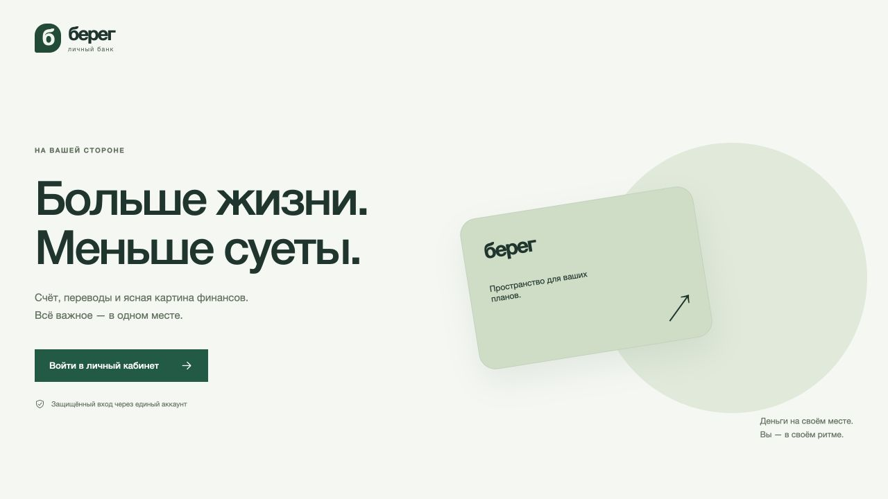
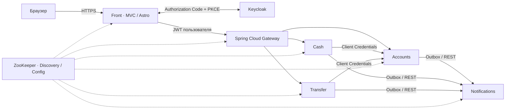
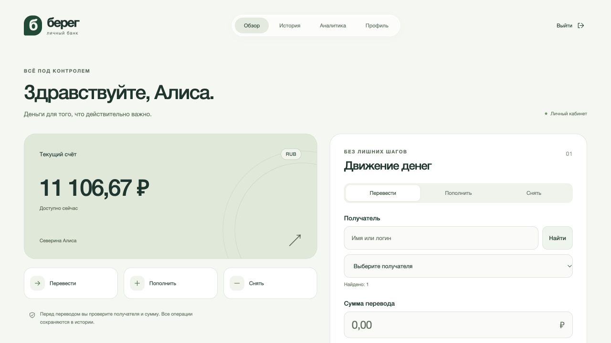
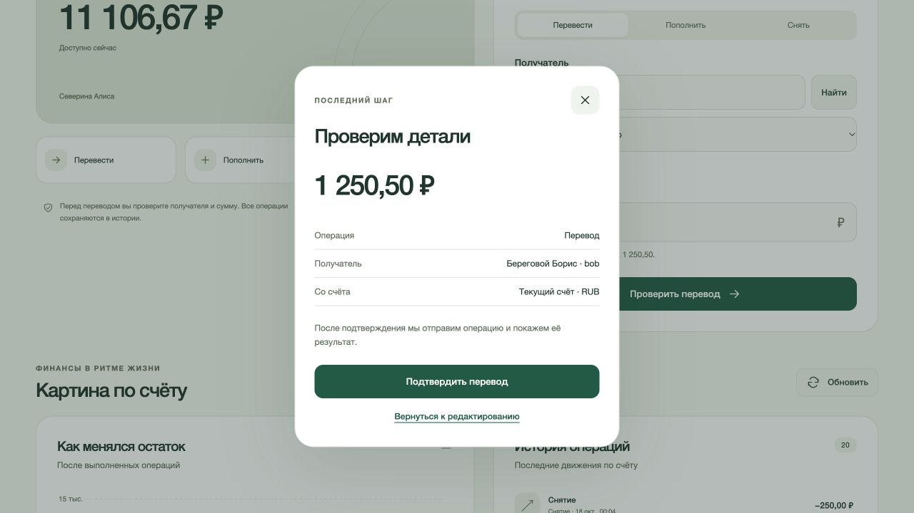
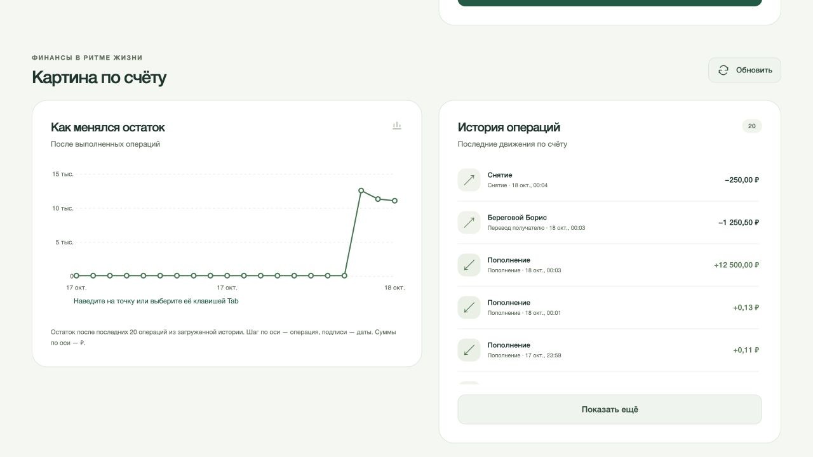
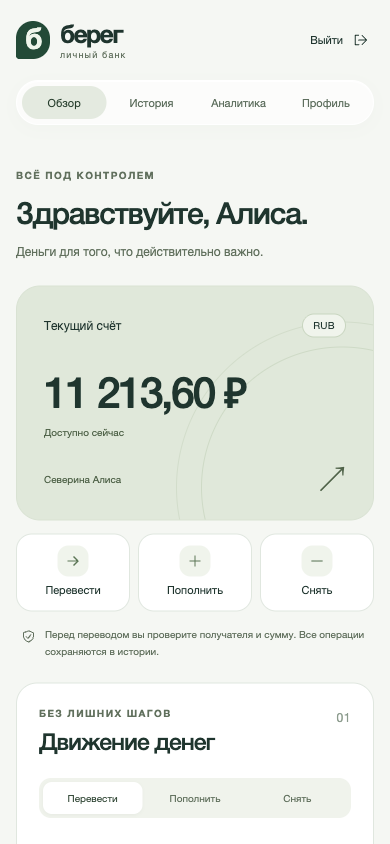
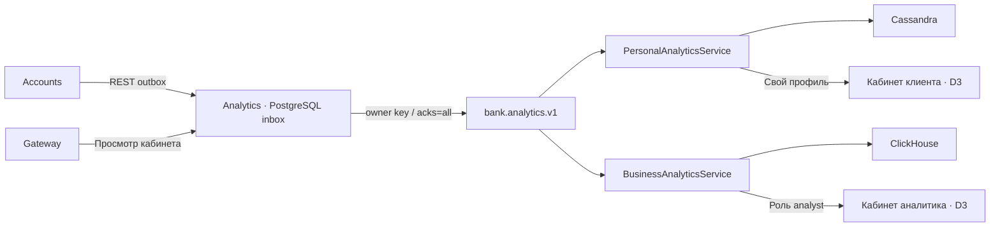
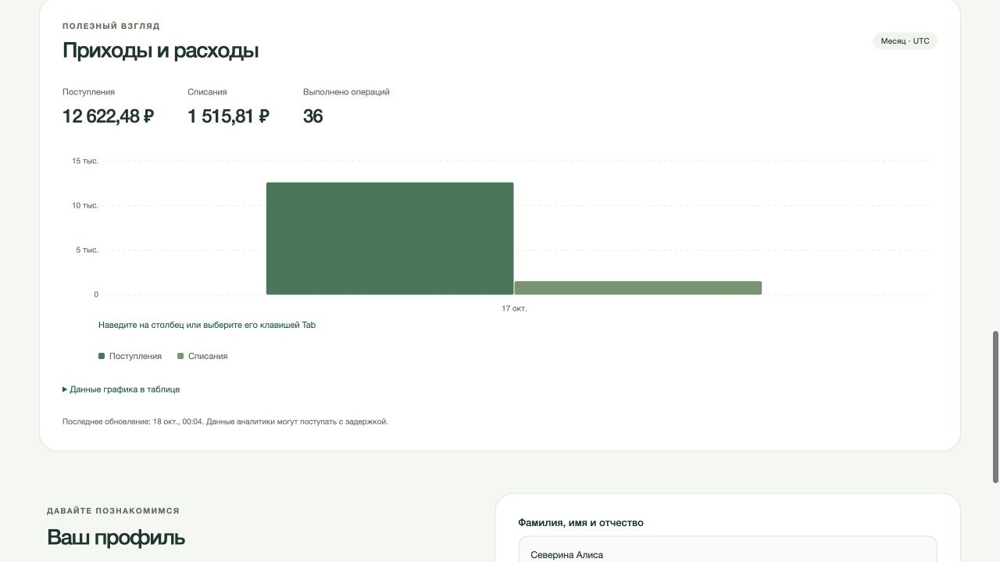
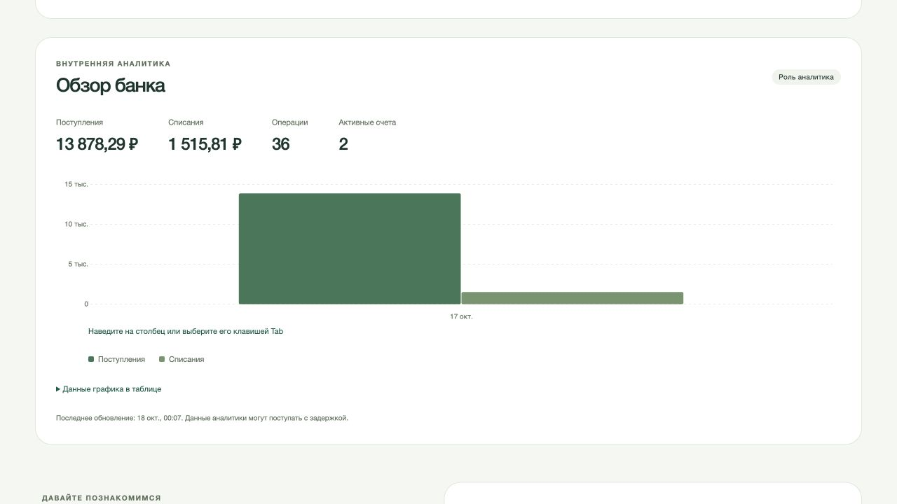

# Спринт 9. Микросервисное приложение «Банк»

**[Сборка и запуск](#1-сборка-и-запуск) · [Архитектура](#2-архитектура) · [Безопасность](#3-авторизация-и-границы-доверия) · [Деньги](#4-денежные-операции) · [Интерфейс](#5-личный-кабинет) · [Аналитика](#6-дополнительная-аналитика) · [Тесты](#7-проверки) · [Ограничения](#8-границы-решения)**

Приложение «Берег» позволяет редактировать свой профиль, пополнять и снимать виртуальные рубли, переводить их другому клиенту и просматривать историю. Основная задача проекта - разделить эти сценарии на независимые Spring Boot-сервисы, сохранив понятные границы данных, авторизации и транзакций.

Используются Java 21, Spring Boot 3.5.16, Spring Cloud 2025.0.3 и Gradle 8.14.3. Front, Accounts, Cash, Transfer и Notifications работают на Spring MVC/Tomcat; Gateway - на WebFlux/Netty. Каждый сервис собирается в собственный Executable JAR и Docker-образ. Maven-сборка не дублируется.

## 1. Сборка и запуск

Нужны JDK 21, Node.js 24, Python 3.10+, Docker с Compose и OpenSSL 3. Node используется только при сборке интерфейса; готовое приложение запускается без него. Docker также нужен интеграционным тестам PostgreSQL и Kafka.

Из корня репозитория:

```bash
cd projects/sprint09-bank
./gradlew check packageDeployment
```

На macOS с Homebrew при необходимости выберите JDK:

```bash
export JAVA_HOME="$(brew --prefix openjdk@21)/libexec/openjdk.jdk/Contents/Home"
export PATH="$JAVA_HOME/bin:$PATH"
```

### Локальный HTTPS и секреты

При первом запуске на Mac установите `mkcert` и доверьте его локальный CA командой `mkcert -install`. Если ключ уже существующего CA находится на зашифрованном томе, откройте этот том перед выпуском сертификата. Скрипт не заменяет существующий CA и не меняет системное доверие.

```bash
python3 scripts/init-secrets.py
python3 scripts/init-tls.py
BANK_UID="$(id -u)" BANK_GID="$(id -g)" docker compose up -d --build
```

Откройте **[личный кабинет](https://bank.valgrind-home.localhost:8449)**. Авторизация использует отдельный адрес `https://auth-bank.valgrind-home.localhost:8449/realms/bank`. Наружу опубликован только HTTPS-порт на `127.0.0.1`; PostgreSQL, ZooKeeper и внутренние API доступны в Docker-сети.



| Логин | Назначение | Файл пароля вне репозитория |
| --- | --- | --- |
| `alice` | Первый клиент | `~/.config/java-engineering-course/sprint09/demo_alice_password` |
| `bob` | Второй клиент | `~/.config/java-engineering-course/sprint09/demo_bob_password` |
| `analyst` | Клиент и внутренняя аналитика | `~/.config/java-engineering-course/sprint09/demo_analyst_password` |

После первого входа заполните имя и дату рождения. Получателем перевода становится другой клиент с заполненным профилем. Начальные остатки равны нулю; деньги появляются только после пополнения.

> **Примечание.** Compose secrets монтируют файлы и сами по себе не шифруют источник. На Mac исходные файлы находятся на AES-256-томе, ключ хранится в Keychain; повторная инициализация сохраняет значения. В контейнеры передаются только нужные сервису файлы. Keycloak материализует конфигурацию в private tmpfs, значения не передаются через argv или Docker environment. Для промышленного окружения источник заменяется внешним secret manager.

### Запуск с аналитикой

```bash
BANK_UID="$(id -u)" BANK_GID="$(id -g)" \
  docker compose -f compose.yaml -f compose.analytics.yaml up -d --build
```

Добавляются Analytics, Kafka, Cassandra и ClickHouse. Общий [деплой OpenTofu](../../infra/) предоставляет отдельный селектор `sprint09`, собственные state, сеть, контейнеры и данные; он не подключает тома Compose. Его HTTPS-порт - `28450`. Для повседневной работы достаточно одного стенда; завершённые проверки останавливают свои контейнеры, сохраняя данные.

### Работа в IDE и остановка

Откройте этот каталог как Gradle-мультипроект, выберите JDK 21 и делегируйте сборку и тесты Gradle. `check packageDeployment` запускается из Gradle tool window или терминала IDE; Compose запускается через Docker Services либо указанными выше командами. Серверная часть полностью написана на Java, Astro/D3 собираются в ресурсы Front.

Изменение Java или интерфейса требует повторной упаковки JAR и `up --build`. После изменения подключённого Caddyfile выполните `docker compose restart edge`. Импорт realm применяется только при создании нового realm: изменение JSON не обновляет уже существующие учётные записи автоматически.

```bash
docker compose -f compose.yaml -f compose.analytics.yaml stop
python3 scripts/init-secrets.py --lock
```

Остановка сохраняет контейнеры и постоянные тома. Перед переключением профилей также остановите прежний стенд; удалять данные для повторного запуска не требуется.

## 2. Архитектура



| Модуль | Ответственность и данные |
| --- | --- |
| [front](front/) | Авторизованная HTML-страница, серверная сессия, BFF `/ui/**`; обращается только в Gateway |
| [gateway](gateway/) | Явные маршруты `/api/**`, проверка JWT и передача исходного пользовательского токена |
| [accounts](accounts/) | Профили, остатки, журнал и окончательные результаты денежных операций |
| [cash](cash/) | Команды пополнения/снятия и их восстановление |
| [transfer](transfer/) | Команды перевода и их восстановление |
| [notifications](notifications/) | Дедуплицированные уведомления о подтверждённых действиях |
| [bank-runtime](bank-runtime/) | Технические HTTP/OAuth-клиенты, проверки доступа, outbox и исполнитель сохранённых команд |
| [bank-contracts](bank-contracts/) | Небольшие типизированные контракты, строгий формат денежных сумм |
| [bank-test-support](bank-test-support/) | Общие тестовые базы, фабрики и HTTP-стенд подписанных JWT/JWK |

У сервисов отдельные PostgreSQL-схемы и роли без доступа к чужим схемам. Flyway накатывает миграции при старте; владелец соединения выбирается конфигурацией сервиса, а не параметром HTTP-запроса. Front и Gateway не получают доступ к денежной БД.

ZooKeeper хранит регистрации сервисов и общие настройки, включая сетевые таймауты. Межсервисные вызовы используют DiscoveryClient, не Gateway; `lb://` в Gateway разрешает единственный зарегистрированный экземпляр. Дублирующий кеш LoadBalancer отключён, DNS-кеши JVM и Netty ограничены по времени, чтобы пересоздание контейнера не оставляло старый IP другого сервиса.

> **Примечание.** Общий модуль содержит технические механизмы, но не общую БД или универсальный бизнес-сервис. Денежные правила принадлежат Accounts; Cash и Transfer не обходят его API прямыми SQL-запросами.

## 3. Авторизация и границы доверия

Front использует Authorization Code с PKCE. Access/refresh tokens остаются на сервере; браузер получает HttpOnly/Secure cookie `__Host-bank-session` и защищает изменяющие запросы CSRF-токеном. Logout отправляется POST-формой и завершает также сессию Keycloak. CSP разрешает только собственные ресурсы и конкретный logout endpoint настроенного IdP.

Gateway передаёт исходный пользовательский JWT; каждый конечный сервис независимо проверяет подпись RS256, issuer, audience, срок действия, `azp` и нужный scope. Каталог получателей содержит идентификатор, логин и имя, но не чужой остаток. Владелец данных определяется проверенными `issuer/sub`; логин остаётся отображаемым атрибутом.

| Вызов | Разрешение |
| --- | --- |
| Front → Accounts | `accounts.read` / `accounts.write` |
| Front → Cash / Transfer | `cash.write` / `transfer.write` |
| Cash → Accounts | `accounts.cash`, `azp=cash-service` |
| Transfer → Accounts | `accounts.transfer`, `azp=transfer-service` |
| Accounts/Cash/Transfer → Notifications | `notifications.write` и разрешённый caller |

Client Credentials обслуживает отдельный manager с постоянным service principal, пригодный для фоновых worker. Внутренние endpoint не публикуются Gateway. Например, токен Cash не разрешает вызвать Transfer, а переданные клиентом заголовки владельца не определяют доступ к данным.

> **Примечание.** Issuer остаётся публичным HTTPS-адресом, а token/JWK endpoint внутри стенда используют Docker DNS. Это сохраняет проверку issuer без обращения контейнера к собственному loopback. Межсервисная сеть здесь доверенная: скомпрометированный разрешённый Cash/Transfer способен действовать в пределах своих полномочий. Client Credentials не является криптографическим подтверждением согласия клиента на отдельную операцию.

## 4. Денежные операции

Суммы хранятся целыми копейками в `long/BIGINT`. JSON принимает только целое число: строки, дроби, экспоненциальная запись и переполнение отвергаются до изменения состояния. Ограничения проверяются в Java и дублируются SQL `CHECK`; остаток не может стать отрицательным.

Перевод - **одна транзакция Accounts**, а не два независимых REST-вызова списания и зачисления. Оба счёта блокируются в одинаковом порядке, затем одновременно меняются остатки, журнал и результат операции. `FOR NO KEY UPDATE` сохраняет совместимость с внешними ключами журнала при встречных переводах.

Cash/Transfer сначала сохраняют неизменную команду с UUID, затем вызывают Accounts вне своей SQL-транзакции. Повтор с прежним UUID и тем же содержимым возвращает первоначальный результат; другое содержимое даёт конфликт. Ключ включает стабильного владельца и тип операции. Переименование логина не меняет владельца и не ломает повтор. Время результата нормализуется до микросекунды, чтобы первый ответ и replay совпадали с точностью PostgreSQL.

При неизвестном исходе команда остаётся `PENDING`: клиент и recovery используют тот же UUID и тело. Временные `408/429`, транспортные ошибки и непонятный ответ не превращаются в выдуманный окончательный отказ. Известный бизнес-отказ сохраняется, чтобы поздний повтор не выполнил ранее отклонённую операцию.

Уведомление записывается в outbox вместе с локальным результатом и доставляется отдельно. Стабильный eventId и receipt получателя предотвращают повторную обработку. Отказ Notifications не откатывает подтверждённый перевод. В журнал выводится только проверенный тип действия; ФИО, токены, остатки и payload не логируются.

Для ограниченного стенда используются два recovery worker, очередь из 16 задач, leases и постраничный выбор due-записей. JDBC-пул ограничен четырьмя соединениями на сервис, SQL - таймаутами выполнения и ожидания блокировки; HTTP - таймаутами, bulkhead и Circuit Breaker. Виртуальные потоки не заменяют эти ограничения.

## 5. Личный кабинет

Одна авторизованная страница объединяет профиль, счёт, денежные формы и историю. Сервер проверяет полноту имени и возраст строго старше 18 лет, включая високосные даты.



Сначала проверяются получатель и сумма, затем пользователь подтверждает действие. Неизвестный результат переживает перезагрузку вкладки вместе с исходным UUID; новый запрос с новым идентификатором автоматически не создаётся.



> **Примечание.** Дополнительно решил проработать удобный UX/UI на стыке Java-бэкенда и веб-интерфейса: спокойная палитра, прозрачная навигация, явные состояния ожидания и подтверждения. Astro используется как статический сборщик, а авторизация, валидация и выполнение операций остаются в Java. D3 строит график только по фактически загруженной истории; подпись указывает его границы.

Формы имеют видимые подписи, ошибки и клавиатурную навигацию; учтены reduced motion, reduced transparency и forced colors. При обновлении после смены пользователя в соседней вкладке старое состояние кабинета сбрасывается; CSRF не позволяет выполнить старую форму от новой сессии.



<details>
<summary>Мобильный кабинет: проверены ширины 320 и 390 px</summary>



Формы и подтверждение не выходят за границы экрана; также проверен планшетный размер 1024 px.

</details>

## 6. Дополнительная аналитика

> **Примечание.** Решил дополнительно разобраться, как связать финансовый Java-сервис с персональной read model и отдельным аналитическим контуром. Этот модуль включается независимо и не участвует в подтверждении денежной операции.

Accounts публикует реальные денежные факты через REST outbox только при включённой аналитике. Операции за время отключения не выгружаются задним числом; полная история остаётся в Accounts. Просмотр кабинета приходит отдельным событием через Gateway; владелец определяется сервером, а повторный eventId не увеличивает счётчик.



Analytics сначала сохраняет неизменяемый факт в PostgreSQL inbox, затем публикует его в Kafka. Две независимые consumer groups обслуживают персональную и внутреннюю витрины; в Java у каждой свой сервис чтения и обработки. Offset подтверждается после записи в целевое хранилище и его ACK в inbox. Остановка Cassandra не блокирует доставку в ClickHouse и наоборот.

> **Примечание.** Kafka решил проработать именно для аналитики: интересно проследить путь от действия в Java-приложении до двух разных витрин. Финансовое подтверждение и основные межсервисные вызовы сохраняют REST; развитие брокерного взаимодействия основных сервисов остаётся отдельным этапом.

Брокерный ACK не завершает доставку: пока обе проекции не подтверждены, inbox повторно публикует исходный факт. Поэтому истечение Kafka retention не теряет недоставленное событие. Повторы после аварии поглощаются стабильным ключом проекции. Неизвестный eventId, изменённый payload или неверный owner key сохраняются в quarantine как метаданные и SHA-256 без исходного содержимого; при недоступности PostgreSQL offset не подтверждается.

Relay читает ограниченные партии из PostgreSQL без очереди в памяти. Два worker и [CallerRunsPolicy](https://docs.oracle.com/en/java/javase/21/docs/api/java.base/java/util/concurrent/ThreadPoolExecutor.CallerRunsPolicy.html) дают не более трёх одновременных публикаций: заполненный пул замедляет сканирование, а не обрывает его после двух событий. Первые попытки имеют приоритет над повторами; соответствующий partial index сохраняет этот порядок. Повтор успешно опубликованного, но ещё не подтверждённого факта отступает от 30 секунд до 15 минут, чтобы длительный отказ одной витрины не заполнял брокер дублями. Ошибки аутентификации consumer повторяются через 10 секунд; причины повторов и аварийной остановки логируются без payload.

| Контур | Назначение и особенности |
| --- | --- |
| Kafka | Один KRaft-брокер, тема `bank.analytics.v1`, группы `bank.analytics.personal.v1` / `bank.analytics.business.v1`; SASL и ACL только на тему и группы аналитики |
| Cassandra | Личная активность; чтение одного раздела `owner/month`, текущий месяц UTC, максимум 1000 событий без `ALLOW FILTERING` |
| ClickHouse | Внутренняя агрегированная витрина только для `analyst`; без ФИО, логинов и банковских остатков |
| D3 | Дневные приходы/расходы, число операций и состояние актуальности проекции |



ClickHouse использует типизированные UUID/Enum8/Int64/DateTime64, месячные партиции и `ReplacingMergeTree`. Стабильный ключ включает дату исходного события, владельца и eventId; чтение с `FINAL` не удваивает повторную доставку. Для небольших вставок включены async inserts с ожиданием фактического flush.

В общем числе денежных операций перевод учитывается по исходящей стороне один раз. Его входящая сторона участвует в денежных потоках получателя; просмотры считаются отдельно. При незавершённых событиях inbox, превышении лимита или отказе нужного хранилища API возвращает недоступность аналитики, а не фиктивный ноль. Этот статус не видит события, ещё ожидающие доставки из Accounts outbox: витрина согласуется с источником асинхронно.



Проекции имеют срок хранения 180 дней; ClickHouse перемещает данные старше 7 дней на отдельный cold volume. TTL исполняется фоновыми процессами. Оба тома находятся на одном локальном хосте: это проверка механики storage policy, без обещания аппаратной отказоустойчивости.

> **Примечание.** В качестве примера посмотрел, как устроены хранение и обработка данных в [Discord](https://discord.com/blog/how-discord-stores-trillions-of-messages) и [Netflix](https://netflixtechblog.com/how-netflix-uses-druid-for-real-time-insights-to-ensure-a-high-quality-experience-19e1e8568d06). У Discord взял идею ограниченных временных разделов и контроля конкуренции и адаптировал её для небольшой персональной read model в Cassandra; в самом описанном кейсе компания перешла с Cassandra на ScyllaDB. Пример Netflix с Druid помог отделить внутренние агрегированные метрики от клиентской истории. Для этого контура выбрал ClickHouse, а обе витрины связал с Java-сервисом Analytics и D3-интерфейсом.

## 7. Проверки

```bash
./gradlew check packageDeployment
python3 -m unittest discover -s scripts -p 'test_*.py'
python3 scripts/verify-runtime.py --analytics
```

Последняя команда запускает настоящий стенд, проверяет TLS/OIDC и бизнес-сценарии, затем останавливает принадлежащие ему контейнеры и закрывает локальный secret disk, сохраняя данные. `--keep-running` оставляет стенд для ручной проверки. `--external` проверяет уже запущенное окружение без управления контейнерами и без fault probes.

| Уровень | Что проверяется |
| --- | --- |
| Unit | Возрастные границы, денежный wire format, точные копейки и восстановление неизменной команды в UI |
| PostgreSQL integration | Атомарность перевода, откат, встречные операции, сохранение отказа и результата, lease, outbox и изоляция владельцев |
| Security | Реально подписанные JWT и JWK Set по HTTP, issuer/audience/scope/caller, CSRF, приватные маршруты и исходный JWT в Gateway |
| Spring Cloud Contract | Сгенерированные producer-тесты Accounts и потребление проверенного stubs JAR клиентом Cash в одном Gradle build |
| Kafka integration | Настоящий брокер, offset после sink/PG ACK, перезапуск consumer, очередь из 200 событий, повторная публикация после удаления broker records и durable quarantine повреждённых записей |
| Runtime | Настоящий Authorization Code/Client Credentials, несколько пользователей, денежные инварианты, конечная конкурентная проверка и восстановление после отказов |

На настоящем стенде отдельно проверены отказы Accounts, Notifications, Kafka, Cassandra и ClickHouse. Неизвестный денежный исход восстанавливался с прежним UUID, уведомления догружались из outbox; отказ одного аналитического хранилища не останавливал вторую витрину. При остановке Kafka обе проекции показывали недоступность, но денежная операция подтверждалась. После запуска зависимостей проекции догоняли источник; повтор команды не увеличивал баланс и число записей ledger повторно. Конкурентный сценарий проверяет 24 команды и 24 повтора по фактическому остатку и журналу.

`bank-test-support` переиспользует базовые классы и фабрики; Spring-контексты кешируются без `@DirtiesContext`. `SecurityTestBase` владеет стабильной JWT/JWK-fixture, `ServletSecurityTestBase` - HTTP-проверками без БД, `PostgresTestBase` - общим контейнером и сбросом данных, `JdbcServiceTestBase` объединяет JDBC и HTTP. Базы Accounts/Notifications/Analytics добавляют только настройки своего сервиса. Чистые unit-тесты не наследуют Spring/контейнерный bootstrap. Параллельные случаи передаются через JUnit `MethodSource`/`CsvSource`, общие данные - через `BankFixtures`.

Контрактные тесты не зависят от локального Maven cache: stubs подключены артефактом подпроекта, а consumer запускается после producer verification. Spotless и PMD входят в `check`; импорты остаются явными.

## 8. Границы решения

Это локальное приложение с виртуальными деньгами и одним экземпляром каждого сервиса. Kafka включается только с аналитикой; один брокер и replication factor 1 проверяют механизм доставки, но не защищают от потери хоста. Topic ограничен 256 МиБ на партицию и retention 7 дней; очистка выполняется в фоне. Исходный PostgreSQL inbox сохраняет незавершённую доставку. SASL_PLAINTEXT работает в закрытой Docker-сети, промышленный контур требует TLS и нескольких брокеров. Репликация, Kubernetes, распределённые трассировки и отдельная платформа мониторинга здесь не настраиваются. Внутренний HTTP также требует защиты сети при промышленном деплое; локальный CA предназначен для этого стенда.

Сессия Front хранится в памяти одного экземпляра: его перезапуск требует повторного входа. Денежная идемпотентность и журнал сохраняются в PostgreSQL и не удаляются по TTL. Очереди и inbox также долговечны; при длительном отказе зависимостей потребуется эксплуатационный контроль их объёма. Recovery ограничивает нагрузку, но не задаёт гарантированную пропускную способность для промышленного потока платежей. Уведомление имеет долговечный receipt; запись в лог после его commit остаётся best effort при аварийном завершении процесса.
