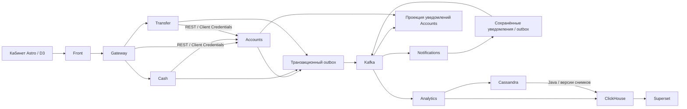
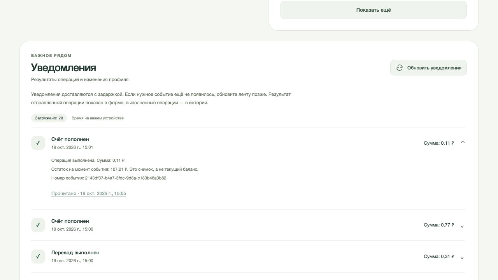
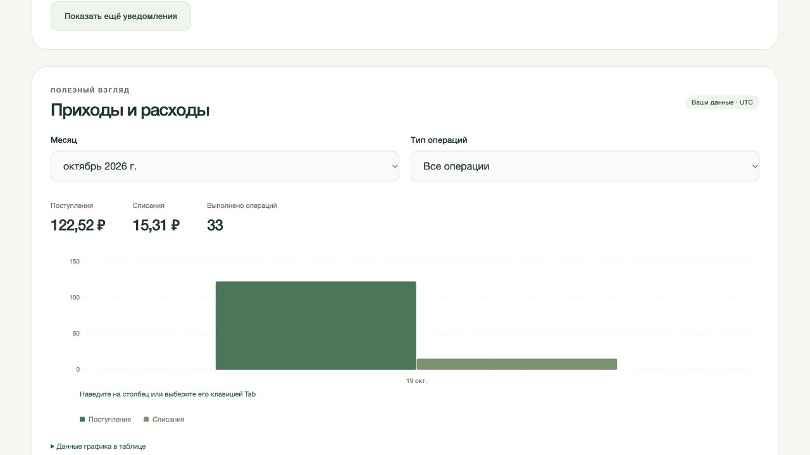
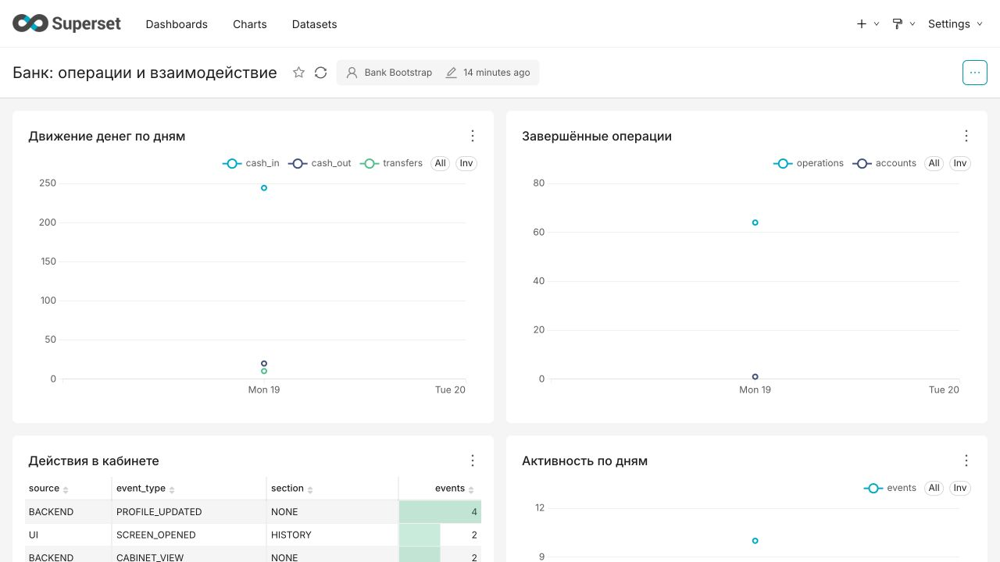
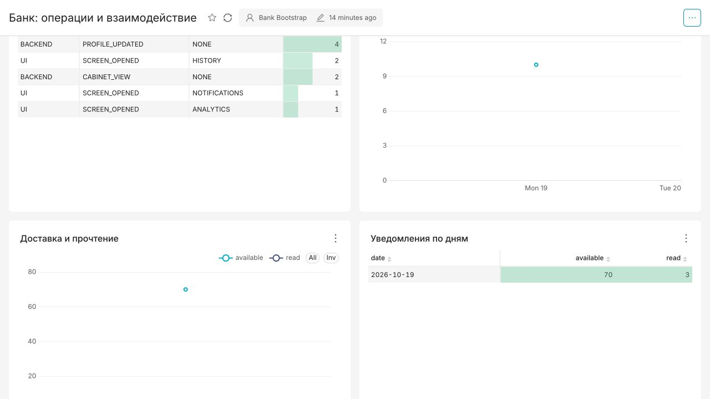
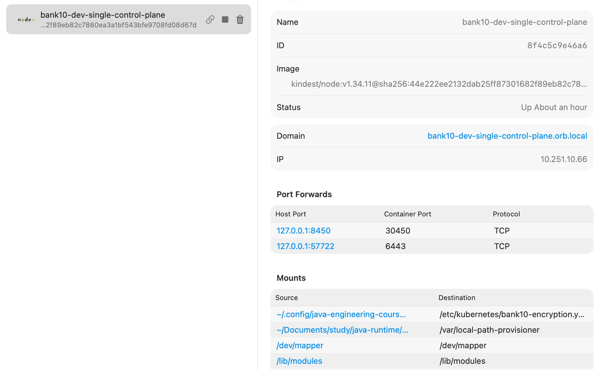

# Банк: Apache Kafka

Продолжение банка спринта 9. Денежные команды сохраняют REST-контракты и атомарную запись в Accounts; уведомления переходят на Kafka. Notifications работает без HTTP-сервера, а кабинет читает отдельную проекцию уведомлений в Accounts.

[Архитектура](#архитектура) · [Kafka](#доставка-событий) · [Кабинет](#кабинет) · [Аналитика](#аналитика) · [Деплой](#деплой) · [Проверки](#проверки) · [Ограничения](#границы-стенда)

## Архитектура



| Модуль | Ответственность |
| --- | --- |
| `accounts` | Профиль, баланс, история, атомарный перевод, собственный список уведомлений и отметка прочтения |
| `cash`, `transfer` | Идемпотентные денежные команды, восстановление неизвестного результата, уведомления через outbox |
| `notifications` | Kafka consumer, неизменяемая квитанция, Kafka-публикация результата, ограниченное восстановление проекции |
| `front`, `gateway` | Authorization Code + PKCE, CSRF, серверная сессия, Token Relay и маршрутизация |
| `bank-contracts` | Общие типы команд, событий и ответы API |
| `bank-messaging` | Невебовые Kafka/JDBC-механизмы и ограниченная доставка |
| `bank-runtime`, `bank-service-client` | HTTP/JWT-инфраструктура и отдельно REST-клиенты с Client Credentials |
| `bank-test-support` | Общие PostgreSQL/JWT/Kafka fixtures и адаптер контрактных Kafka-тестов |
| `analytics`, `bank-bi` | Дополнительные проекции событий и Java-инициализация дашборда Superset |

> Разделение общих модулей позволяет исключить MVC/WebFlux из Notifications, не копируя доставку и JDBC-код. OAuth-клиент подключён только там, где остались исходящие REST-вызовы; Kafka не требует получать HTTP access token перед каждой публикацией.

## Доставка событий

Accounts, Cash и Transfer публикуют в собственные topics. ACL разрешают каждому сервису запись только в его topics; Notifications определяет источник по topic, а не доверяет переданному клиентом заголовку. Партиционирование по владельцу распределяет нагрузку и сохраняет локальность событий одного счёта. Между разными topics глобального порядка нет.

1. Изменение бизнес-данных и запись outbox происходят в одной PostgreSQL-транзакции.
2. Ограниченные workers публикуют неизменяемое событие. `acks=all` и idempotent producer защищают запись в Kafka; неизвестный результат отправки повторяется с прежним идентификатором.
3. Notifications сохраняет квитанцию и исходящее событие одной транзакцией. Offset подтверждается после commit.
4. Accounts сохраняет собственную проекцию до подтверждения consumer offset. Кабинет читает её без синхронного запроса в Notifications.

Ключ квитанции — `(source, eventId)`: одинаковый UUID у разных сервисов не считается одним уведомлением. Повтор с тем же ключом и другим владельцем или содержимым отклоняется. Деньги не списываются из consumer уведомлений.

> `PUBLISHED` означает подтверждение брокера. Это не подтверждение появления записи в кабинете и тем более не прочтение пользователем. Первое прочтение хранится отдельно; повторная отметка не меняет его время.

Временные ошибки PostgreSQL и брокера не превращаются в потерянные финансовые события. Некорректные сообщения отправляются в DLT; исходный offset разрешено продвинуть только после подтверждённой записи туда. Бизнес-процессы не ждут потребителя уведомлений и не выдают выдуманный баланс при неизвестном результате команды.

Бизнес-темы и их DLT имеют по шесть partitions. Retention бизнес-тем — семь дней, DLT — 30 дней; автоматическое создание topics отключено. Consumer groups фиксированы; при отсутствии offset используется `earliest`.

### Восстановление проекции

После истечения retention можно повторно опубликовать сохранённый PostgreSQL outbox: исходные payload, key и ID не меняются. В одноразовом Job с текущим образом, JDBC-конфигурацией и Secret соответствующего сервиса команда из `/app` выглядит так:

```bash
java -cp application.jar dev.principalwater.bank.messaging.replay.OutboxReplayApplication \
  --BANK_CONFIG_IMPORT=optional:classpath:bank-common.properties \
  --spring.config.import=classpath:bank-common.properties \
  --bank.outbox.replay.after=0 --bank.outbox.replay.limit=1000
```

Каждый вызов обрабатывает не более 1000 записей; следующий получает возвращённый `nextSequence`, до `count=0`. Активные leases не сбрасываются. Источник ограничен application name: Accounts публикует свои notification/analytics topics, Cash и Transfer — свои notifications, Notifications — receipts. HTTP-сервер и Kafka listeners в этом процессе не запускаются.

Если нужно восстановить именно выход из сохранённых квитанций Notifications, отдельный профиль того же образа повторно ставит их в исходящий outbox:

```bash
java -jar application.jar --spring.profiles.active=notification-replay \
  --bank.notification.replay.after=0 --bank.notification.replay.limit=1000
```

Сначала восстанавливается исходная цепочка, затем receipt-проекция; завершение проверяется по данным Accounts. Повтор не меняет сохранённое время прочтения. Исходные PostgreSQL-записи не очищаются автоматически; их потеря или утрата Accounts требует восстановления БД из backup. Retention Kafka резервную копию не заменяет.

## Кабинет

Сохранились профиль, проверка возраста, пополнение, снятие, перевод, история и разграничение прав. Дополнительно можно открыть сохранённые уведомления и отметить их прочитанными. Уведомление связано с квитанцией Notifications, а не только с ответом денежной команды.

Список и отметка прочтения проверяют владельца на сервере. Подмена `ownerId`, идентификатора уведомления или параметров браузера не выбирает чужой счёт. `GET /api/accounts/notifications` использует ограниченный keyset `before/limit`; новые записи не сдвигают уже открытые страницы. `POST /api/accounts/notifications/read` принимает `{source, eventId}` и требует `accounts.write`. Front проксирует эти операции через `/ui/notifications` и проверяет CSRF при изменении.



## Аналитика

> Решил дополнительно разобрать интеграцию аналитического контура с Java: от явного действия в кабинете и завершённой денежной операции до пользовательской проекции и отдельного BI-дашборда. Этот контур включается отдельно и не участвует в проведении платежа.

Есть два вида входных данных:

- **Backend:** завершённые денежные операции, изменение профиля, появление уведомления и первое прочтение. Владелец и финансовые значения определяются сервером.
- **Frontend:** фактическое открытие раздела или формы. Клиент передаёт UUID события и ограниченный тип действия; сервер добавляет владельца и время. Содержимое форм, токены и клиентские денежные суммы в эти события не попадают. Клиентские UUID преобразуются в отдельное пространство с учётом владельца и endpoint: пользователь не может заранее занять идентификатор финансового события. Лимит просмотров и UI-действий — 1000 новых событий на владельца в месяц; идемпотентный повтор квоту не расходует.

Accounts сначала доставляет события в устойчивый inbox Analytics. Затем внутренний Kafka-поток независимо обновляет пользовательскую Cassandra-проекцию и финансовую витрину ClickHouse. Отказ одного хранилища не подтверждает доставку в другое.

### Два пути в ClickHouse

Финансовые факты Java записывает через HTTP `JSONEachRow` с `async_insert` и ожиданием подтверждения вставки. `ReplacingMergeTree` и чтение с `FINAL` позволяют повторить неизменяемое событие без повторного учёта операции.

Для действий в интерфейсе используется другой путь: после подтверждения Cassandra сохраняется версия изменённого раздела; Java читает конкретный ограниченный раздел `owner/month` и пакетно публикует снимок официальным ClickHouse client-v2. Снимки имеют монотонную версию; перед агрегацией выбирается актуальная версия. Это чтение конкретных разделов, без полного сканирования Cassandra.

> Оба пути используют HTTP `JSONEachRow`, но разные источники и правила подтверждения: неизменяемый финансовый факт и версионный снимок Cassandra. Пользовательская проекция и BI-витрина имеют разные задачи; дополнительный OLAP-движок поверх ClickHouse не нужен.

Личная аналитика в кабинете фильтруется по месяцу и типу операции; D3 показывает фактические поступления и списания с доступной табличной альтернативой.



### Superset

Отдельный адрес — `https://insights.valgrind-home.localhost:8450`. Вход проходит через существующий Keycloak и разрешён роли `analyst`. Обычный клиент банка не получает доступ к внутреннему BI.

Java-модуль `bank-bi` импортирует дашборд через HTTPS API Superset со стабильными UUID, назначает права на три dataset и выполняет запросы графиков. Повторная инициализация обновляет активы, не создавая копий. Python в образе Superset используется только для его штатной конфигурации и запуска; ETL остаётся в Java.

BI-пользователь ClickHouse читает только три месячных агрегатных представления: денежные операции, взаимодействия и уведомления. Идентификаторы владельцев в них не выдаются. Перевод считается по `TRANSFER_OUT`; зачисление получателю не удваивает число переводов или их объём. Денежный оборот не называется выручкой банка. Число активных счетов уникально внутри дня, поэтому дневные значения не суммируются в месячный unique count.



<details>
<summary>UI-события, доставка и прочтение уведомлений</summary>

Шесть графиков и таблиц показывают реальные операции проверочного стенда. Открытие разделов приходит с фронта, изменение профиля и статусы уведомлений — с бэкенда. Для единственного дня наблюдений включены маркеры: одна точка не превращается в пустой линейный график.



</details>

## Деплой

Основной путь спринта — Kubernetes + Helm через отдельный OpenTofu root. Второй Compose-деплой для этого проекта не поддерживается: предыдущие спринты сохраняют свои способы запуска.

Нужны Java 21, Docker/OrbStack, Python 3, `kind`, `kubectl`, Helm, OpenTofu и локальный доверенный CA (`mkcert` на macOS). Версии образов и зависимостей закреплены в исходниках; образы приложений получают имя по содержимому собранных JAR.

Начальная подготовка ниже показана для macOS/Homebrew; на Linux укажите `JAVA_HOME` своего JDK 21.

```bash
cd projects/sprint10-kafka
export JAVA_HOME=/opt/homebrew/opt/openjdk@21/libexec/openjdk.jdk/Contents/Home
./gradlew --no-daemon check packageDeployment
python3 -m venv ~/.venvs/bank10-kubernetes
~/.venvs/bank10-kubernetes/bin/pip install -r kubernetes/requirements.txt
python3 scripts/init-secrets.py
python3 scripts/init-tls.py
```

Секреты на macOS находятся в AES-256 томе, пароль — в Keychain. Kubernetes получает отдельные Secret с файловыми проекциями только нужных сервису значений. Содержимое Secret не передаётся Helm/OpenTofu и не попадает в state. Etcd шифрует Secret; локальные PVC защищены шифрованием хоста. Это разные уровни защиты.

Клиенты читают секреты при запуске: после ротации нужен управляемый перезапуск соответствующих сервисов в maintenance window. Импорт Keycloak рассчитан на новую БД; существующий realm меняется через администрирование IdP, без сброса базы авторизации.

> Для реального окружения источник секретов следует заменить внешним Vault/Secret Manager с управляемой ротацией, а локальные hostPath PVC — подходящим StorageClass и резервным копированием. Kubernetes Secret сам по себе не является внешним хранилищем секретов.

### Одна нода

```bash
export BANK_STATE="$HOME/Documents/study/java-runtime/sprint10-bank-single"
export BANK_SECRETS_DIR="$HOME/.config/java-engineering-course/sprint10"
export BANK_PYTHON="$HOME/.venvs/bank10-kubernetes/bin/python"
"$BANK_PYTHON" kubernetes/prepare.py --output-dir "$BANK_STATE" --profile single --superset
"$BANK_PYTHON" kubernetes/runtime.py --state-dir "$BANK_STATE" create --secrets-dir "$BANK_SECRETS_DIR" --profile single
"$BANK_PYTHON" kubernetes/runtime.py --state-dir "$BANK_STATE" secrets --secrets-dir "$BANK_SECRETS_DIR"
"$BANK_PYTHON" kubernetes/runtime.py --state-dir "$BANK_STATE" load-images
```

Из корня репозитория:

```bash
"$BANK_PYTHON" infra/kubernetes/deploy.py plan --project-dir "$PWD/projects/sprint10-kafka" --state-dir "$BANK_STATE" --secrets-dir "$BANK_SECRETS_DIR"
# Проверить сохранённый plan и перечень действий до apply.
"$BANK_PYTHON" infra/kubernetes/deploy.py apply --project-dir "$PWD/projects/sprint10-kafka" --state-dir "$BANK_STATE" --secrets-dir "$BANK_SECRETS_DIR"
"$BANK_PYTHON" projects/sprint10-kafka/kubernetes/runtime.py --state-dir "$BANK_STATE" ready
```

Внешний порт опубликован только на loopback по TCP; Caddy использует HTTP/1.1 и HTTP/2, не рекламируя недоступный через этот проброс QUIC/HTTP/3. Внутренние Kafka-клиенты используют TLS, SCRAM и индивидуальные ACL; настройки подключения лежат в ConfigMap, пароли — в отдельных Secret.



### Несколько нод

| Параметр | `single` | `ha` |
| --- | --- | --- |
| Kubernetes | Одна kind-нода | Три kind-ноды: control plane с рабочей ролью и две worker-ноды |
| Kafka | Один combined broker/controller | Три отдельных controller и три broker |
| Репликация / min ISR | `1 / 1` | `3 / 2` |
| Назначение | Полный локальный стенд, аналитика и BI | Проверка кворума и отказа одного worker |
| Kafka при отказе ноды | Сервис временно недоступен | Запись возможна при сохранении min ISR и кворума |

Deployment приложений использует одну replica и `Recreate`: старый writer завершается перед Flyway нового Pod. Для обновлений требуется maintenance window; rolling overlap и HPA в этом стенде не поддерживаются.

Совмещение control plane с рабочей ролью уменьшает накладные расходы локальной VM, сохраняя три хоста для разнесения Kafka-процессов. Это учебная топология; выделенный отказоустойчивый control plane для промышленного окружения требует отдельного расчёта ресурсов. Проверка отказа останавливает worker, сохраняя доступ к Kubernetes API.

Для `ha` используются другой state-каталог, профиль и отдельная идентичность кластера. Смена quorum-топологии не является переключателем существующего кластера. Вызовы `prepare.py` и `runtime.py create` принимают `--environment dev|test|prod`; namespace имеет вид `bank10-dev`, `bank10-test` или `bank10-prod`.

<details>
<summary>Команды отдельного HA-профиля из корня репозитория</summary>

Сначала остановить single, затем использовать отдельный state:

```bash
"$BANK_PYTHON" projects/sprint10-kafka/kubernetes/runtime.py --state-dir "$BANK_STATE" stop
export BANK_STATE="$HOME/Documents/study/java-runtime/sprint10-bank-test-ha"
"$BANK_PYTHON" projects/sprint10-kafka/kubernetes/prepare.py --output-dir "$BANK_STATE" --environment test --profile ha
"$BANK_PYTHON" projects/sprint10-kafka/kubernetes/runtime.py --state-dir "$BANK_STATE" create --environment test --profile ha --secrets-dir "$BANK_SECRETS_DIR"
"$BANK_PYTHON" projects/sprint10-kafka/kubernetes/runtime.py --state-dir "$BANK_STATE" secrets --secrets-dir "$BANK_SECRETS_DIR"
"$BANK_PYTHON" projects/sprint10-kafka/kubernetes/runtime.py --state-dir "$BANK_STATE" load-images
"$BANK_PYTHON" infra/kubernetes/deploy.py plan --project-dir "$PWD/projects/sprint10-kafka" --state-dir "$BANK_STATE" --secrets-dir "$BANK_SECRETS_DIR"
# Проверить план перед apply.
"$BANK_PYTHON" infra/kubernetes/deploy.py apply --project-dir "$PWD/projects/sprint10-kafka" --state-dir "$BANK_STATE" --secrets-dir "$BANK_SECRETS_DIR"
"$BANK_PYTHON" projects/sprint10-kafka/kubernetes/runtime.py --state-dir "$BANK_STATE" ready
"$BANK_PYTHON" projects/sprint10-kafka/kubernetes/probe.py --state-dir "$BANK_STATE" persistence
```

Проверка `persistence` создаёт собственные короткоживущие topic/user, подтверждает запись, останавливает один worker с broker/controller, проверяет запись при двух оставшихся broker/controller и чтение после восстановления. В `finally` worker возвращается в исходное рабочее состояние; постоянные claims сохраняются. Это отдельный контролируемый сценарий отказа, не шаг обычного запуска.

</details>

> При лимите OrbStack 12 ГБ полный аналитический стенд и HA-профиль запускаются последовательно. Все kind-ноды находятся в одной VM: это проверка отказа процессов и локальных worker-нод, без независимых дисков, датацентров или физической отказоустойчивости. Само имя namespace `prod` этих свойств не добавляет.

Kafka PVC в учебном профиле — 2 GiB на Pod. Семидневный retention не гарантирует, что поток поместится на таком диске: перед увеличением нагрузки нужны расчёт ёмкости, запас свободного места и план расширения хранилища.

### Повторный запуск и остановка

```bash
"$BANK_PYTHON" projects/sprint10-kafka/kubernetes/runtime.py --state-dir "$BANK_STATE" stop
python3 projects/sprint10-kafka/scripts/init-secrets.py --lock
# Перед следующим запуском разблокировать источник секретов.
python3 projects/sprint10-kafka/scripts/init-secrets.py
"$BANK_PYTHON" projects/sprint10-kafka/kubernetes/runtime.py --state-dir "$BANK_STATE" resume
```

Остановка ограничена сохранённой идентичностью собственного кластера; приложения завершаются до хранилищ. PVC, образы, конфигурация и state сохраняются. Чужие стенды и контексты не выбираются автоматически.

## Проверки

```bash
cd projects/sprint10-kafka
./gradlew --no-daemon check packageDeployment
python3 -m unittest discover -s scripts
"$BANK_PYTHON" scripts/verify-runtime.py --state-dir "$BANK_STATE" --secrets-dir "$BANK_SECRETS_DIR" --analytics --faults
```

Java-проверки включают деньги и откат транзакций, повторные команды, JWT с настоящими подписями и HTTP JWK Set, права сервисов и владельцев, Kafka-доставку и контрактные сообщения. Общие Spring-контексты переиспользуются без `@DirtiesContext`. Инфраструктура отдельно проверяет рендеринг Helm, допустимые планы OpenTofu и реальное сохранение Kafka-данных после отказа.

Runtime-проверка проходит через HTTPS, Keycloak, Front/Gateway и настоящие хранилища: два пользователя, CSRF, баланс, перевод, история, уведомления, первое прочтение и конечная конкурентная нагрузка.

На локальном single-стенде прошли TLS/OIDC, изоляция двух владельцев, доставка и прочтение уведомлений, шесть запросов BI и независимое восстановление Cassandra/ClickHouse. Конечная нагрузка — 24 команды от четырёх клиентов и 24 повтора, наблюдаемый p95 — 0,414 с после прогрева и 4,331 с после обновления сервисов при одновременной работе BI. Это замеры двух конечных прогонов на общем стенде, без заявления SLO или предельной пропускной способности.

## Границы стенда

- События доставляются как минимум один раз; единая транзакция PostgreSQL и Kafka не заявляется.
- Денежные значения передаются целым количеством минимальных денежных единиц. Аналитика не проводит операции и может отставать.
- Текущий BI-дашборд ограничен месяцем UTC; личная аналитика доступна за текущий и три предыдущих месяца. Чтение одного Cassandra-раздела ограничено 1000 событиями: при превышении аналитика показывает недоступность, а не неполную сумму; банковская история и проведение денег продолжают работать. Для большего объёма нужны более мелкие временные buckets и инкрементальные агрегаты.
- Hot/cold ClickHouse здесь — каталоги одного retained PVC, без независимых физических носителей.
- Локальный CA, hostPath и внутренние HTTP-вызовы авторизации требуют другой настройки для внешнего промышленного окружения.
- Исполнение NetworkPolicy в стандартном kind CNI не подтверждено; изоляция сетевыми политиками здесь не заявляется. Kafka отдельно проверяет TLS, SCRAM и ACL.
- Kafka retention и локальный retained PVC не заменяют backup и проверенное восстановление из него.

## Источники

- [Spring Kafka: обработка ошибок и подтверждённая публикация в DLT](https://docs.spring.io/spring-kafka/reference/kafka/annotation-error-handling.html).
- [Strimzi 1.3: KRaft, KafkaNodePool и persistent storage](https://strimzi.io/docs/operators/1.3.0/deploying).
- [Superset: импорт активов через API](https://superset.apache.org/developer-docs/api/import-export/).
- [Caddy: выбор протоколов публичного listener](https://caddyserver.com/docs/caddyfile/options#protocols).
