# Банк: наблюдаемость и защита конфигурации

Продолжение доработки Kafka-контура под приложение банка из спринта 10: HTTP-запрос, SQL и доставка события связаны одной трассой; метрики, логи и финансовые отказы доступны оператору без доступа к пользовательской сессии. Денежные команды, transactional outbox и сохранённые уведомления продолжают работать независимо от аналитики.

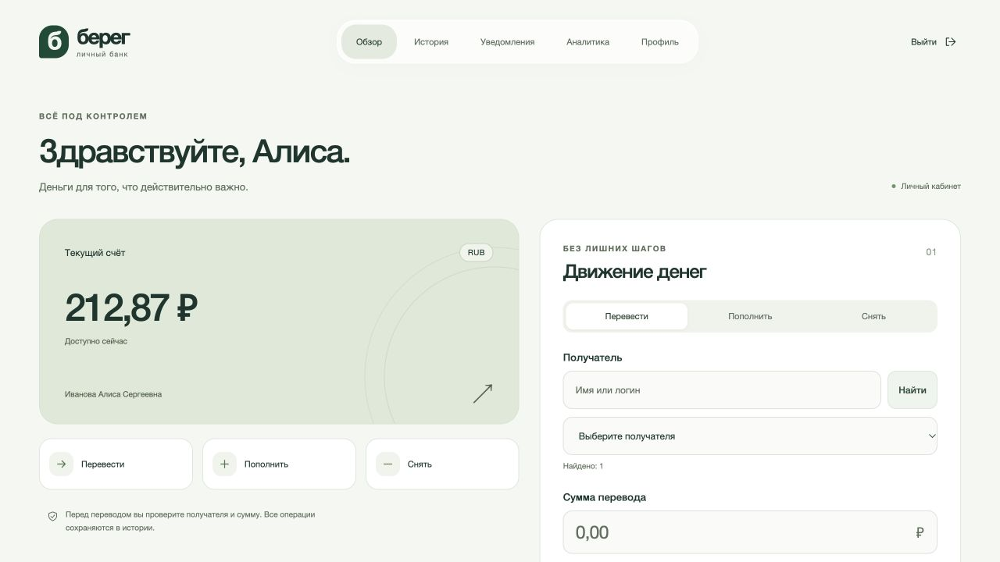

[Структура](#структура) · [Архитектура](#архитектура) · [Наблюдаемость](#наблюдаемость) · [Kafka](#доставка-событий) · [Кабинет](#кабинет) · [Аналитика](#аналитика) · [OpenBao](#секреты-openbao) · [Деплой](#деплой) · [Проверки](#проверки) · [Ограничения](#границы-стенда)

## Структура

```text
sprint11-observability/
├── services/                 # восемь приложений, включая Java-инициализатор BI
│   ├── accounts/             # профиль, баланс, история и проекция уведомлений
│   ├── cash/, transfer/      # денежные команды
│   ├── notifications/        # консьюмер Kafka без HTTP-сервера
│   ├── front/ui/, gateway/   # кабинет Astro/D3 и API Gateway
│   └── analytics/, bank-bi/  # аналитические проекции и настройка Superset
├── libraries/                # общие Java-модули и тестовая поддержка
│   ├── bank-contracts/, bank-runtime/, bank-service-client/
│   ├── bank-messaging/, bank-test-support/
│   └── bank-observability/, bank-secrets/
├── deployment/               # исходные файлы деплоя, отдельно от Java-кода
│   ├── charts/bank/          # зонтичный Helm-чарт и сабчарты Kafka, Zipkin, Prometheus, Grafana, ELK, Superset
│   ├── kubernetes/           # подготовка, управление kind и проверки Kafka
│   ├── scripts/              # секреты, TLS, запуск зависимостей и HTTP-проверки
│   └── authorization/, database/, discovery/, edge/, superset/, jenkins/
├── zipkin/, prometheus/       # трассировка, сбор метрик и правила алертов
├── grafana/, elk/             # дашборды, Logstash, Elasticsearch и Kibana
├── config/                   # правила PMD и настройки JVM
├── gradle/, gradlew          # единая сборка Gradle
├── Jenkinsfile              # альтернативный CI/CD на выделенном агенте
└── Dockerfile                # общий образ Java-приложений
```

Имена Gradle-модулей остаются плоскими: `:accounts`, `:bank-runtime`, `:front` и остальные. Их каталоги задаёт `settings.gradle`; зависимости, команды сборки и координаты контрактных артефактов не меняются. `packageDeployment` собирает готовые JAR в `build/deployment/` — это результат сборки, а не исходный каталог `deployment/`.

Ориентировался на разделение модулей и вспомогательных инструментов в [Spring Boot](https://github.com/spring-projects/spring-boot) и [Elasticsearch](https://github.com/elastic/elasticsearch). Общая конфигурация OpenTofu остаётся в [infra/kubernetes/](../../infra/kubernetes/), чтобы не дублировать её внутри проекта.

## Архитектура

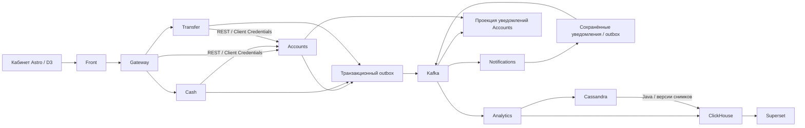

| Модуль | Ответственность |
| --- | --- |
| [accounts](services/accounts/) | Профиль, баланс, история, атомарный перевод, собственный список уведомлений и отметка прочтения |
| [cash](services/cash/), [transfer](services/transfer/) | Идемпотентные денежные команды, восстановление неизвестного результата, уведомления через outbox |
| [notifications](services/notifications/) | Консьюмер Kafka, неизменяемая квитанция, Kafka-публикация результата, ограниченное восстановление проекции |
| [front](services/front/), [gateway](services/gateway/) | Authorization Code + PKCE, CSRF, серверная сессия, Token Relay и маршрутизация |
| [bank-contracts](libraries/bank-contracts/) | Общие типы команд, событий и ответы API |
| [bank-messaging](libraries/bank-messaging/) | Невебовые Kafka/JDBC-механизмы и ограниченная доставка |
| [bank-runtime](libraries/bank-runtime/), [bank-service-client](libraries/bank-service-client/) | HTTP/JWT-инфраструктура и отдельно REST-клиенты с Client Credentials |
| [bank-test-support](libraries/bank-test-support/) | Общие тестовые фикстуры PostgreSQL/JWT/Kafka и адаптер контрактных Kafka-тестов |
| [bank-observability](libraries/bank-observability/), [bank-secrets](libraries/bank-secrets/) | Общие метрики, трассировка, безопасный лог-энкодер и штатный ConfigData-клиент OpenBao |
| [analytics](services/analytics/), [bank-bi](services/bank-bi/) | Дополнительные проекции событий и Java-инициализация дашборда Superset |

> Разделение общих модулей позволяет исключить MVC/WebFlux из Notifications, не копируя доставку и JDBC-код. OAuth-клиент подключён только там, где остались исходящие REST-вызовы; Kafka не требует получать HTTP access token перед каждой публикацией.

## Наблюдаемость

Один запрос проходит Front → Gateway → Cash/Transfer → Accounts. Micrometer Tracing с Brave передаёт W3C trace context через штатные HTTP-клиенты; инструментированный DataSource добавляет дочерние JDBC spans. Отложенная публикация outbox сохраняет контекст в PostgreSQL, поэтому перезапуск процесса не обрывает связь с исходным запросом. Kafka producer, consumer и DLT используют наблюдаемость Spring Kafka.

На локальном стенде выбирается 100% трасс для воспроизводимой проверки; профиль `prod` использует 10%. Заголовки авторизации, параметры SQL, содержимое форм и query string не включаются в экспорт. Повторная операторская публикация outbox начинает новую трассу, сохраняя идентификатор бизнес-события.

### Метрики и дашборды

Prometheus собирает HTTP RPS, 4xx/5xx, гистограммы задержки, JVM/GC, HikariCP и Kafka-клиентов. Для Notifications сохранён невебовый запуск: отдельный ограниченный JDK scrape-server слушает внутренний порт 9400, без MVC/WebFlux. Его очередь, соединения и время чтения/записи ограничены.

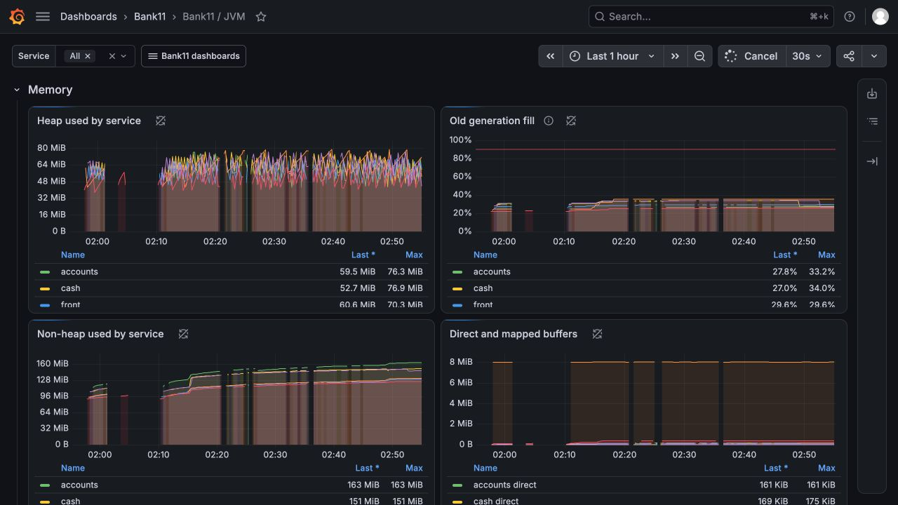

Heap не равен полной памяти процесса: отдельно показаны non-heap и direct buffers. Поэтому лимиты контейнеров не выбираются только по графику Java heap.

| Дашборды Grafana | Что показывают |
| --- | --- |
| Обзор, HTTP, JVM | Доступность сервисов, RPS, ошибки, p50/p90/p95/p99, heap/non-heap, GC и пулы |
| Kafka health / topics | Брокеры, контроллеры, ISR, диски, потоки сообщений и lag групп |
| Бизнес и pipeline | Отклонённые денежные команды, недоставка уведомлений и состояние контура наблюдаемости |
| ClickHouse | Доступность, вставки, запросы и состояние хранилища дополнительной аналитики |
| Prometheus / Grafana | Scrape, TSDB, оценка правил и работа самих средств мониторинга |
| Логи и трассы | Структурированные события Elasticsearch и переход по traceId в Zipkin |

Всего предусмотрено 11 дашбордов и 35 правил. Отсутствующие данные не подменяются `vector(0)`: отключённая аналитика и ещё не возникшее событие отличаются от исправного компонента с нулевым значением. У счётчиков отказов учтено первое наблюдение серии, до появления предыдущего scrape.

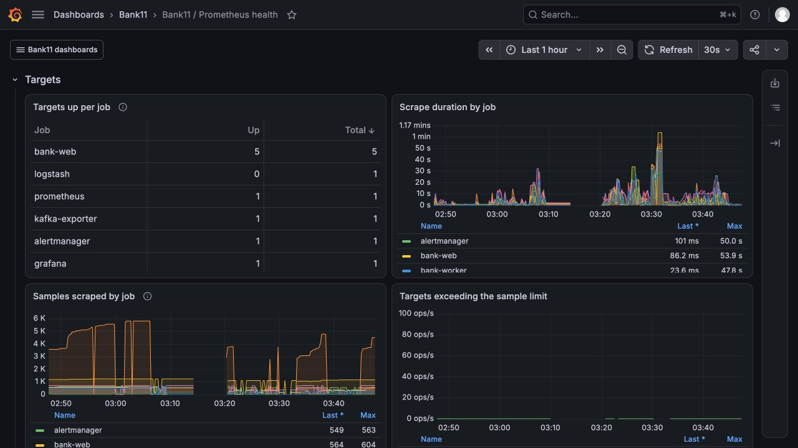

На локальном Mac с 16 ГБ RAM дополнительные контуры проверяются поэтапно. На этом снимке Logstash временно остановлен: `0/1` отражает его фактическое состояние, а не ошибку Prometheus. Для одновременного запуска ELK, Cassandra, ClickHouse и Superset нужен больший бюджет памяти хоста и Kubernetes-ноды; данные и PVC между этапами сохраняются.

Zipkin, Prometheus/Alertmanager, Grafana и ELK оформлены отдельными сабчартами зонтичного `bank`: каждый содержит свои ConfigMaps, Services, workloads и хранилища. Общие публичные настройки задаются в `global.observability`; подготовка передаёт каждому компоненту только его assets. Секреты остаются вне Helm values.

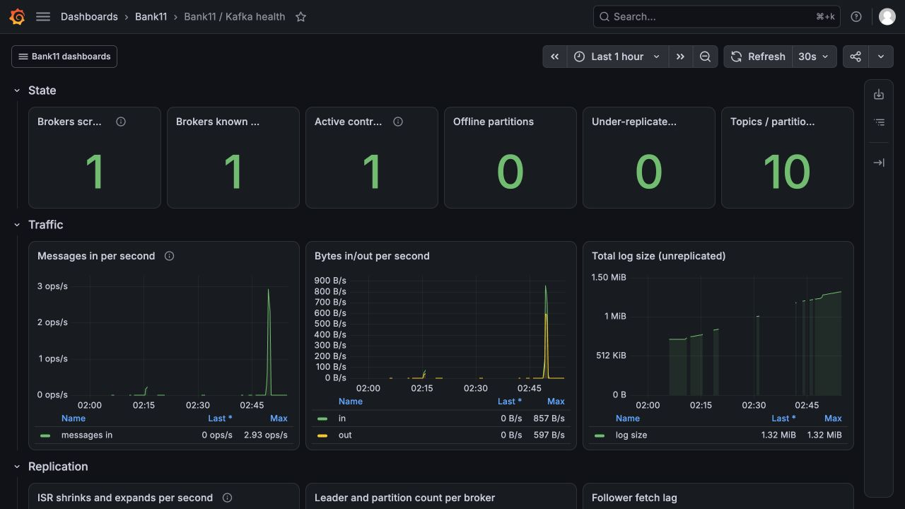

На снимке — профиль `single`: один брокер и контроллер, без офлайн-партиций; всплески трафика появились после проверочных денежных операций. Это локальный стенд, а не измерение промышленной пропускной способности.

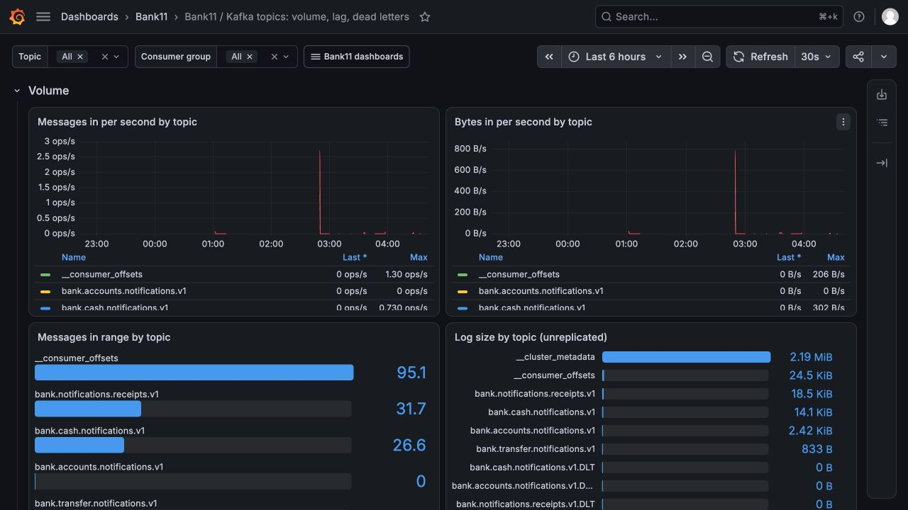

История за шесть часов связывает всплески публикации с денежными сценариями. Размер журнала показан отдельно для каждого топика; пустая DLT означает отсутствие сохранённых сообщений, а не подставленные данные.

Снятие, перевод и доставка уведомлений имеют отдельные счётчики. Login, отправитель и получатель определяются сервером; пользовательские значения не принимаются как произвольные метки. Метрики с login доступны только оператору и требуют контроля кардинальности при росте числа клиентов. В Telegram уходят агрегированные алерты без login и сумм.

> `increase()` даёт [экстраполированную оценку](https://prometheus.io/docs/prometheus/latest/querying/functions/#increase), поэтому прирост может быть дробным. Перекрывающиеся точки скользящего окна не суммируются в легенде: итог за выбранный диапазон показан отдельно. Точный денежный учёт остаётся в журнале PostgreSQL.

### Логи и финансовые сигналы

Нативный Logback appender отправляет ограниченную JSON-очередь по TLS в Logstash; затем события поступают в Elasticsearch с ILM и доступны в Kibana/Grafana. Поля `service`, `level`, `logger_name`, `event`, `traceId`, `spanId` позволяют связать запись с трассой. Фильтр маскирует токены, пароли и закрытые ключи; длинные сообщения обрезаются. Сырой MDC и тела исключений не экспортируются. Переполнение очереди не блокирует денежную транзакцию; пропуски логов требуют внимания оператора.

Успешная денежная операция журналируется только после commit; rollback и идемпотентный повтор не создают ложного сообщения об успехе. Финансовый отказ записывается в собственный outbox и отдельный аналитический топик. Это запрошенная, но отклонённая сумма, а не проведённый оборот. Недоставка уведомления учитывается после сохранения retry; если и БД недоступна, отдельный gap-счётчик и предупреждение показывают невозможность сохранить аналитический факт.

Временный сбой доставки журналируется как WARN; подтверждённый карантин DLT — как ERROR, без ключа и тела сообщения. Локальный DEBUG включён адресно для безопасной диагностики валидации, без перевода библиотек в DEBUG.

### Доступ оператора и алерты

- `https://grafana-bank.valgrind-home.localhost:8460` — Grafana; `bank11-operator` имеет роль Viewer, `bank11-admin` администрирует.
- `https://kibana-bank.valgrind-home.localhost:8460` — Kibana; `bank11_operator` читает логи банка.
- Prometheus, Alertmanager, Zipkin и API Elasticsearch доступны только внутри кластера или через явный `kubectl port-forward`. Публичный Caddy блокирует `/actuator/*` и служебные API.

Пароли читаются из OpenBao. Telegram включается отдельным `prepare.py --telegram` после предоставления `telegram_bot_token` и `telegram_chat_id` во внешнем зашифрованном источнике. Alertmanager отправляет срабатывание и восстановление в заданный чат; в CI этот канал выключен, настоящих токенов и сообщений в пользовательский чат нет.

## Доставка событий

Accounts, Cash и Transfer публикуют в собственные топики. ACL разрешают каждому сервису запись только в его топики; Notifications определяет источник по топику, а не доверяет переданному клиентом заголовку. Партиционирование по владельцу распределяет нагрузку и сохраняет локальность событий одного счёта. Между разными топиками глобального порядка нет.

1. Изменение бизнес-данных и запись outbox происходят в одной PostgreSQL-транзакции.
2. Ограниченные воркеры публикуют неизменяемое событие. `acks=all` и идемпотентный продюсер защищают запись в Kafka; неизвестный результат отправки повторяется с прежним идентификатором.
3. Notifications сохраняет квитанцию и исходящее событие одной транзакцией. Офсет подтверждается после фиксации транзакции.
4. Accounts сохраняет собственную проекцию до подтверждения офсета консьюмера. Кабинет читает её без синхронного запроса в Notifications.

Ключ квитанции — `(source, eventId)`: одинаковый UUID у разных сервисов не считается одним уведомлением. Повтор с тем же ключом и другим владельцем или содержимым отклоняется. Консьюмер уведомлений не списывает деньги.

> `PUBLISHED` означает подтверждение брокера. Это не подтверждение появления записи в кабинете и тем более не прочтение пользователем. Первое прочтение хранится отдельно; повторная отметка не меняет его время.

Временные ошибки PostgreSQL и брокера не превращаются в потерянные финансовые события. Некорректные сообщения отправляются в DLT; исходный офсет разрешено продвинуть только после подтверждённой записи туда. Бизнес-процессы не ждут потребителя уведомлений и не выдают выдуманный баланс при неизвестном результате команды.

Бизнес-топики и их DLT имеют по шесть партиций. Срок хранения бизнес-топиков — семь дней, DLT — 30 дней; автоматическое создание топиков отключено. Группы консьюмеров фиксированы; при отсутствии офсета используется `earliest`.

### Восстановление проекции

После истечения срока хранения в Kafka можно повторно опубликовать сохранённый PostgreSQL outbox: содержимое, ключ и идентификатор события остаются прежними. В одноразовом Job с текущим образом, JDBC-конфигурацией и Secret соответствующего сервиса команда из `/app` выглядит так:

```bash
java -cp application.jar dev.principalwater.bank.messaging.replay.OutboxReplayApplication \
  --spring.config.import=classpath:bank-common.properties,classpath:bank-kafka.properties,vault:///kv/bank11-dev/accounts \
  --bank.outbox.replay.after=0 --bank.outbox.replay.limit=1000
```

Пример использует роль и ServiceAccount Accounts в `bank11-dev`; для другого источника выбирается его точный разрешённый KV-путь и окружение. Каждый вызов обрабатывает не более 1000 записей; следующий получает возвращённый `nextSequence`, до `count=0`. Сроки действующей аренды записей не сбрасываются. Источник ограничен именем приложения: Accounts публикует свои топики уведомлений и аналитики, Cash и Transfer — свои уведомления, Notifications — квитанции. HTTP-сервер и слушатели Kafka в этом процессе не запускаются.

Для восстановления исходящих событий из сохранённых квитанций Notifications отдельный профиль того же образа повторно ставит их в исходящий outbox:

```bash
java -jar application.jar --spring.profiles.active=notification-replay \
  --bank.notification.replay.after=0 --bank.notification.replay.limit=1000
```

Сначала восстанавливается исходная цепочка, затем проекция квитанций; завершение проверяется по данным Accounts. Повтор не меняет сохранённое время прочтения. Исходные PostgreSQL-записи не очищаются автоматически; их потеря или утрата Accounts требует восстановления БД из резервной копии. Срок хранения Kafka резервную копию не заменяет.

## Кабинет

Сохранились профиль, проверка возраста, пополнение, снятие, перевод, история и разграничение прав. Дополнительно можно открыть сохранённые уведомления и отметить их прочитанными. Уведомление связано с квитанцией Notifications, а не только с ответом денежной команды.

Список и отметка прочтения проверяют владельца на сервере. Подмена `ownerId`, идентификатора уведомления или параметров браузера не выбирает чужой счёт. `GET /api/accounts/notifications` использует ограниченную пагинацию по ключу `before/limit`; новые записи не сдвигают уже открытые страницы. `POST /api/accounts/notifications/read` принимает `{source, eventId}` и требует `accounts.write`. Front проксирует их через `GET /ui/notifications` и `POST /ui/notifications/read`; изменение требует проверки CSRF.

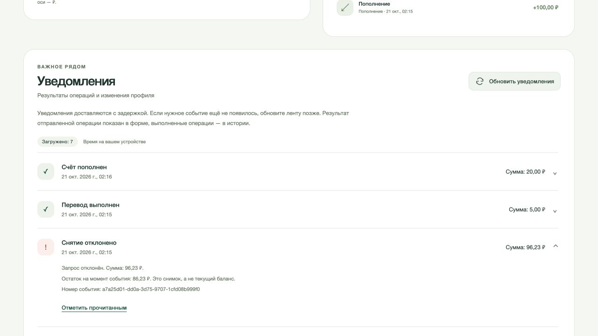

Список приходит из сохранённой проекции Kafka. Остаток в деталях отказа относится к моменту события и явно отделён от текущего баланса.

## Аналитика

> Решил дополнительно разобрать интеграцию аналитического контура с Java: от явного действия в кабинете и завершённой денежной операции до пользовательской проекции и отдельного BI-дашборда. Этот контур включается отдельно и не участвует в проведении платежа.

Два вида входных данных:

- **Серверные события:** завершённые денежные операции, изменение профиля, появление уведомления и первое прочтение. Владелец и финансовые значения определяются сервером.
- **События интерфейса:** фактическое открытие раздела или формы. Клиент передаёт UUID события и ограниченный тип действия; сервер добавляет владельца и время. Содержимое форм, токены и клиентские денежные суммы в эти события не попадают. Клиентские UUID преобразуются в отдельное пространство с учётом владельца и маршрута API: пользователь не может заранее занять идентификатор финансового события. Лимит просмотров и UI-действий — 1000 новых событий на владельца в месяц; идемпотентный повтор квоту не расходует.

Accounts сначала доставляет события в устойчивый inbox Analytics. Затем внутренний Kafka-поток независимо обновляет пользовательскую Cassandra-проекцию и финансовую витрину ClickHouse. Отказ одного хранилища не подтверждает доставку в другое.

### Два пути в ClickHouse

Финансовые факты Java записывает через HTTP `JSONEachRow` с `async_insert` и ожиданием подтверждения вставки. `ReplacingMergeTree` и чтение с `FINAL` позволяют повторить неизменяемое событие без повторного учёта операции.

Для витрин взаимодействий и уведомлений используется другой путь: после подтверждения Cassandra сохраняется версия снимка за месяц; Java читает две ограниченные партиции Cassandra `(owner, month)` и пакетно публикует снимок официальным ClickHouse client-v2. Снимки имеют монотонную версию; перед агрегацией выбирается актуальная версия. Это чтение конкретных партиций, без полного сканирования Cassandra.

> Оба пути используют HTTP `JSONEachRow`, но разные источники и правила подтверждения: неизменяемый финансовый факт и версионный снимок Cassandra. Пользовательская проекция и BI-витрина имеют разные задачи; дополнительный OLAP-движок поверх ClickHouse не нужен.

Личная аналитика в кабинете фильтруется по месяцу и типу операции; D3 показывает фактические поступления и списания с доступной табличной альтернативой.

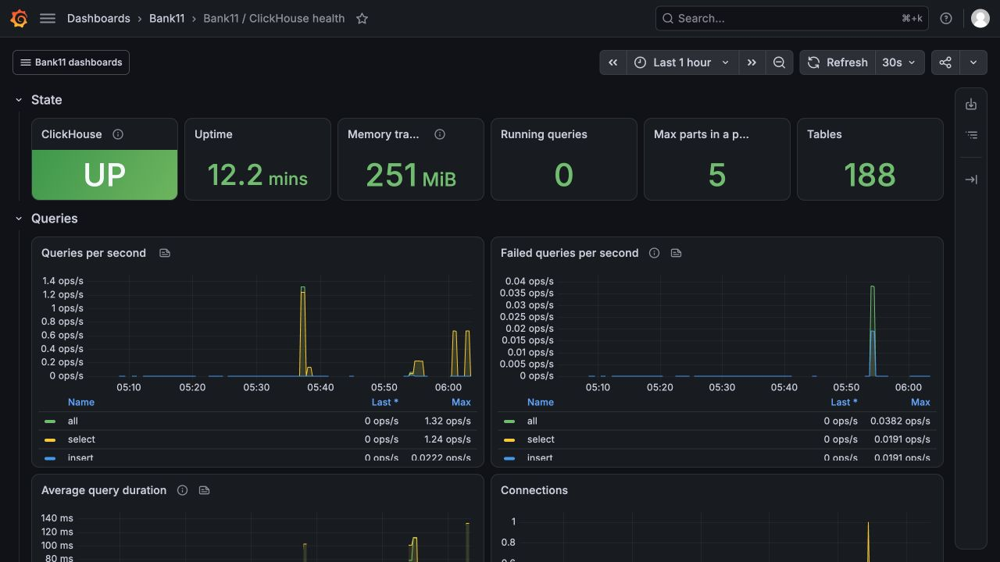

На графиках видны вставки Java-проекций и чтение BI. Проверки прав BI намеренно вызывают отказы доступа к исходным строкам и записи: они также учитываются в счётчиках ошибочных запросов.

### Superset

Отдельный адрес — `https://insights.valgrind-home.localhost:8460`. Вход проходит через существующий Keycloak и разрешён роли `analyst`. Обычный клиент банка не получает доступ к внутреннему BI.

OAuth backchannel использует HTTPS и внутренний CA. Для метастора Superset допустим простой транзакции до 120 с: FAB создаёт служебные права внутри транзакции при холодном старте. Банковские роли сохраняют лимит 10 с; запросы BI ограничены 15 с, ожидание блокировки — 3 с.

Java-модуль `bank-bi` импортирует два дашборда через HTTPS API Superset со стабильными UUID: общий обзор операций и взаимодействий и отдельный финансовый экран. Финансовые графики переиспользуются, поэтому остаются шесть уникальных графиков и три набора данных. Инициализация проверяет публикацию обоих дашбордов, связи графиков, права и реальные запросы; повторный запуск обновляет активы без копий. Python в образе Superset используется только для его штатной конфигурации и запуска; ETL остаётся в Java.

BI-пользователь ClickHouse читает только три месячных агрегатных представления: денежные операции, взаимодействия и уведомления. Идентификаторы владельцев в них не выдаются. Перевод считается по `TRANSFER_OUT`; зачисление получателю не удваивает число переводов или их объём. Денежный оборот не называется выручкой банка. Число активных счетов уникально внутри дня, поэтому дневные значения не суммируются в месячное число уникальных счетов.

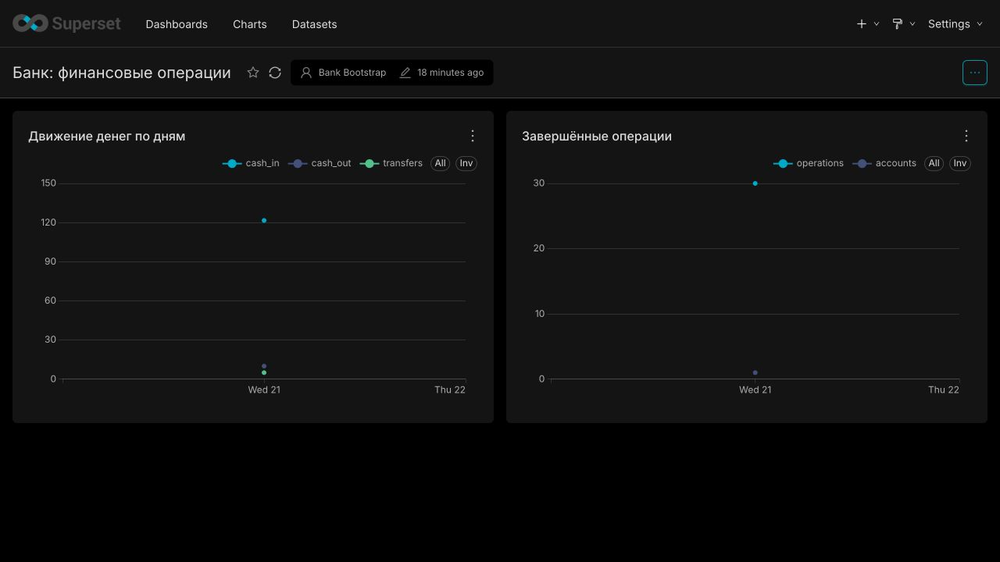

Суммы показаны в рублях; рядом — число завершённых операций и активных счетов за день. Данные получены из реальных проверочных операций. История пока содержит один день, поэтому на временных рядах видны отдельные маркеры.

<details>
<summary>UI-события, доставка и прочтение уведомлений</summary>

Открытие разделов приходит с фронта, изменение профиля и статусы уведомлений — с бэкенда. Два перехода по кабинету выполнены в браузере; для обоих событий проверены подтверждения Cassandra и ClickHouse.

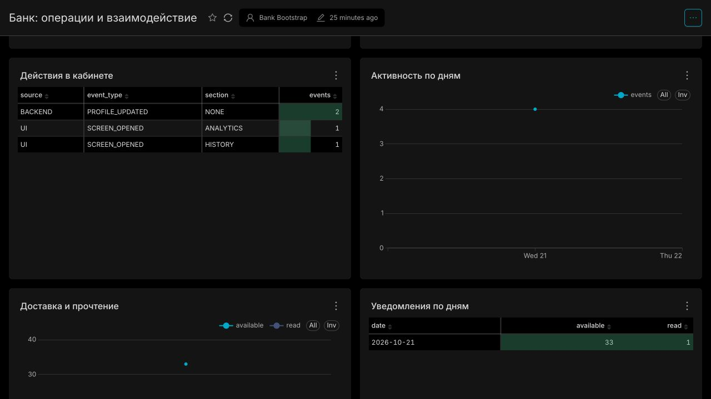

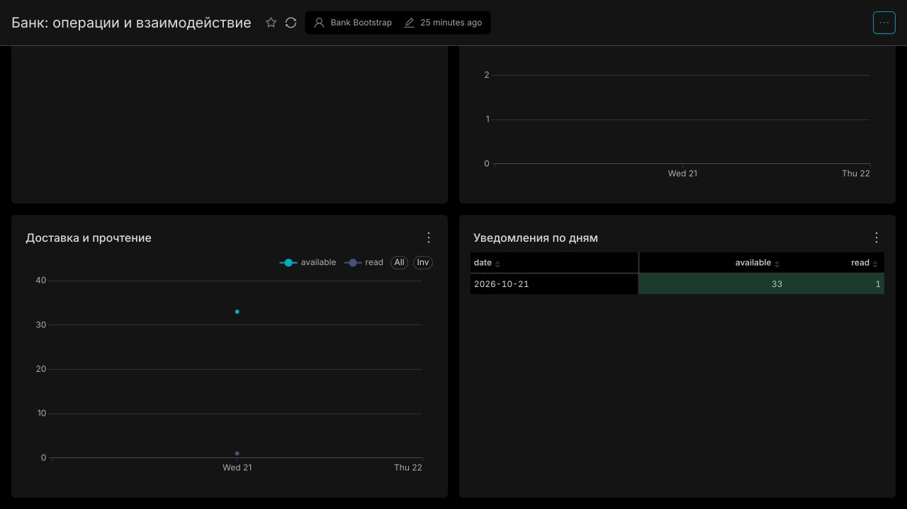

Показаны 33 доставленных уведомления и одно первое прочтение. Повторное открытие не создаёт ещё один факт прочтения; событие связано с сохранённой квитанцией, а не с сообщением формы платежа.

</details>

## Секреты OpenBao

Java-приложения получают секреты через Spring Cloud Vault / ConfigData по совместимому Vault API OpenBao. Каждому приложению назначены отдельные ServiceAccount, Kubernetes auth role и точный KV v2 путь `kv/<namespace>/<service>`. Проецируемый токен имеет audience `openbao` и срок 600 с; API Kubernetes проверяет его при входе. Роль другого сервиса, namespace или audience не даёт доступ. Общего root-токена в приложениях нет.

Для PostgreSQL, Kafka SCRAM, Keycloak, Grafana, ELK, TLS и остальных платформенных компонентов External Secrets Operator получает только явно перечисленные значения и создаёт файловые Kubernetes Secret. Java читает конфигурацию непосредственно из OpenBao; платформенные процессы используют свои файловые проекции. Значения не передаются Helm/OpenTofu и не попадают в state. Strimzi PKI, короткоживущие ServiceAccount-токены и клиентские OAuth-сессии остаются производными идентичностями соответствующих систем.

Первичный CA, recovery/unseal-материал и начальные значения хранятся вне Git в AES-256 томе macOS; пароль тома — в Keychain. Иначе хранилище секретов зависело бы от собственного закрытого recovery-ключа. OpenBao использует TLS, сохраняемый Raft и HMAC-аудит. Начальный импорт проверяет версию KV и отказывается незаметно перезаписывать существующее значение.

> Локальный OpenBao имеет одну реплику и ручной unseal. Продление и отзыв токена проверяются отдельно от ротации пароля БД: отзыв токена не отзывает уже прочитанный статический пароль. После изменения прикладных секретов нужен управляемый перезапуск. Автоматическая ротация DB credentials и HA самого OpenBao здесь не заявляются. Импорт Keycloak рассчитан на новую БД; существующий realm изменяется через IdP без сброса данных.

## Деплой

Основной путь — Kubernetes + Helm через [корневой OpenTofu](../../infra/kubernetes/). Java 21, Gradle 8.14.3, Spring Boot 3.5.16 и Spring Cloud 2025.0.3; образы закреплены digest, прикладные образы именуются по содержимому готовых JAR. Нужны Docker/OrbStack, Python 3/venv, kind, kubectl, Helm, OpenTofu, OpenSSL и доверенный локальный CA (`mkcert` на macOS).

Сборку и холодный запуск следует выполнять последовательно: память гостевой VM не заменяет память хоста. Особенно заметна конкуренция ELK, IDE и Docker на Mac с 16 ГБ. Порог 5 GiB свободного диска перед сборкой/загрузкой образов — только аварийный минимум; полный набор образов, PVC и отдельный Docker-демон Jenkins требуют дополнительного места.

### Подготовка

Из каталога проекта; `JAVA_HOME` ниже — путь Homebrew, на Linux укажите свой JDK 21:

```bash
export JAVA_HOME=/opt/homebrew/opt/openjdk@21/libexec/openjdk.jdk/Contents/Home
./gradlew --no-daemon --max-workers=2 check packageDeployment
python3 -m venv ~/.venvs/bank11-kubernetes
~/.venvs/bank11-kubernetes/bin/pip install -r deployment/kubernetes/requirements.txt
python3 deployment/scripts/init-secrets.py
python3 deployment/scripts/init-tls.py
python3 deployment/scripts/init-internal-tls.py
export BANK_ROOT="$(git rev-parse --show-toplevel)"
export BANK_PROJECT="$BANK_ROOT/projects/sprint11-observability"
export BANK_STATE="$HOME/Documents/study/java-runtime/sprint11-bank-single"
export BANK_SECRETS_DIR="$HOME/.config/java-engineering-course/sprint11"
export BANK_PYTHON="$HOME/.venvs/bank11-kubernetes/bin/python"
"$BANK_PYTHON" deployment/kubernetes/prepare.py --output-dir "$BANK_STATE" --profile single
"$BANK_PYTHON" deployment/kubernetes/runtime.py --state-dir "$BANK_STATE" create --secrets-dir "$BANK_SECRETS_DIR" --profile single
"$BANK_PYTHON" deployment/kubernetes/runtime.py --state-dir "$BANK_STATE" secrets --secrets-dir "$BANK_SECRETS_DIR"
"$BANK_PYTHON" deployment/kubernetes/bao.py --state-dir "$BANK_STATE" tls --secrets-dir "$BANK_SECRETS_DIR"
```

Добавьте `--analytics` к подготовке для Cassandra/ClickHouse; `--superset` включает также BI. Telegram выбирается независимо. По умолчанию эти дополнительные контуры выключены.

### Три фазы OpenTofu

Сначала Cilium/Strimzi, затем OpenBao/ESO, после инициализации секретов — приложения. Для каждой фазы создаётся сохранённый plan; перед apply проверяются его действия, хеши исходников/артефактов и UID кластера. Destroy и замена ресурсов этим путём запрещены.

```bash
for phase in --operator-only --secrets-only; do
  "$BANK_PYTHON" "$BANK_ROOT/infra/kubernetes/deploy.py" plan "$phase" --project-dir "$BANK_PROJECT" --state-dir "$BANK_STATE" --secrets-dir "$BANK_SECRETS_DIR"
  # Проверить план выбранной фазы перед apply.
  "$BANK_PYTHON" "$BANK_ROOT/infra/kubernetes/deploy.py" apply "$phase" --project-dir "$BANK_PROJECT" --state-dir "$BANK_STATE" --secrets-dir "$BANK_SECRETS_DIR"
done
for operation in bootstrap configure import; do
  "$BANK_PYTHON" deployment/kubernetes/bao.py --state-dir "$BANK_STATE" "$operation" --secrets-dir "$BANK_SECRETS_DIR"
done
"$BANK_PYTHON" deployment/kubernetes/runtime.py --state-dir "$BANK_STATE" load-images
"$BANK_PYTHON" "$BANK_ROOT/infra/kubernetes/deploy.py" plan --project-dir "$BANK_PROJECT" --state-dir "$BANK_STATE" --secrets-dir "$BANK_SECRETS_DIR"
# Проверить план приложения перед apply.
"$BANK_PYTHON" "$BANK_ROOT/infra/kubernetes/deploy.py" apply --project-dir "$BANK_PROJECT" --state-dir "$BANK_STATE" --secrets-dir "$BANK_SECRETS_DIR"
"$BANK_PYTHON" deployment/kubernetes/runtime.py --state-dir "$BANK_STATE" ready
```

`load-images` использует уже упакованные JAR и не запускает Gradle. Перед обновлением приложений OpenTofu проверяет, что OpenBao распечатан. Веб-сервисы используют одну реплику и `Recreate`: перед Flyway завершается прежний писатель, обновление требует окна обслуживания. HPA и одновременная работа старой/новой версий не поддерживаются.

### Сеть и TLS

Cilium исполняет NetworkPolicy в dual-stack kind. Сервисы имеют IPv4/IPv6; приложения слушают оба семейства. По умолчанию вход запрещён, исходящие соединения приложений ограничены DNS, OpenBao и явными зависимостями. Это ограничение прикладного контура, а не универсальная политика egress для всего кластера.

У Superset Gunicorn слушает `[::]:8088`: в Linux с `bindv6only=0` этот сокет принимает IPv4 и IPv6. Одного dual-stack Service недостаточно: при IPv4-only listener Java-клиент, предпочитающий AAAA, не мог подключиться. Оба пути проверены с TLS и проверкой имени сервиса.

Front/Gateway/Accounts/Cash/Transfer и Keycloak общаются по HTTPS с проверкой имени и внутреннего CA. Kubelet читает только health/Prometheus endpoints по внутреннему HTTP. Kafka использует TLS, SCRAM и отдельные ACL; appender Logstash также проверяет TLS/имя. Caddy публикует только loopback HTTPS; HTTP/1.1 и HTTP/2, без рекламы недоступного через TCP-проброс QUIC.

`probe.py network` проверяет успешный обмен по IPv4 и IPv6 с сохранением TLS SNI, запрещённые направления и отказ при неверном имени сертификата. HTTP-порт диагностики не является альтернативным незащищённым банковским API.

### Одна и несколько нод

| Параметр | `single` | `ha` |
| --- | --- | --- |
| Kubernetes | Одна kind-нода | Узел управления с рабочей ролью + два рабочих узла |
| Kafka | Совмещённый брокер/контроллер | Три брокера и три отдельных контроллера |
| Репликация / min ISR | `1 / 1` | `3 / 2` |
| Назначение | Локальная функциональная проверка | Проверка кворума и отказа одного рабочего узла |

Для HA нужны отдельные state, `--environment test --profile ha` и другой порт при одновременной работе. Смена топологии не переключает существующий кластер. Все kind-ноды остаются в одной VM: это проверка процессов/рабочей ноды, без независимых физических дисков и датацентров. OpenBao и прикладные сервисы от выбора HA Kafka многорепличными не становятся.

Kafka PVC — 2 GiB на Pod. Хранение событий семь дней не гарантирует вместимость такого диска: нужны расчёт потока, запас места и расширение. Контролируемая проверка `probe.py persistence` создаёт собственные топики/пользователей, проверяет запись при отказе брокера и возвращает рабочую ноду в `finally`, сохраняя PVC.

### Остановка и продолжение

```bash
"$BANK_PYTHON" deployment/kubernetes/runtime.py --state-dir "$BANK_STATE" stop
python3 deployment/scripts/init-secrets.py --lock
# Перед продолжением разблокировать тот же зашифрованный источник.
python3 deployment/scripts/init-secrets.py
"$BANK_PYTHON" deployment/kubernetes/runtime.py --state-dir "$BANK_STATE" resume
```

Останавливаются только собственные приложения, затем хранилища и kind-ноды. PVC, state, образы и идентичности сохраняются; ноды не запускаются сами после рестарта Docker. Resume восстанавливает прежнее планирование и распечатывает сохранённый OpenBao, не создавая новый Raft поверх прежнего.

## Проверки

```bash
./gradlew --no-daemon --max-workers=2 check packageDeployment
"$BANK_PYTHON" -m unittest discover -s deployment/scripts
"$BANK_PYTHON" -m unittest discover -s deployment/kubernetes -p 'test_*.py'
"$BANK_PYTHON" -m unittest discover -s deployment/jenkins -p 'test_*.py'
"$BANK_PYTHON" deployment/kubernetes/bao.py --state-dir "$BANK_STATE" verify --secrets-dir "$BANK_SECRETS_DIR" --exercise-seal
for probe in network security persistence lifecycle; do
  "$BANK_PYTHON" deployment/kubernetes/probe.py --state-dir "$BANK_STATE" "$probe"
done
"$BANK_PYTHON" deployment/scripts/verify-runtime.py --state-dir "$BANK_STATE" --secrets-dir "$BANK_SECRETS_DIR" --analytics --faults
"$BANK_PYTHON" deployment/scripts/verify-observability.py --state-dir "$BANK_STATE" --secrets-dir "$BANK_SECRETS_DIR"
"$BANK_PYTHON" "$BANK_ROOT/infra/kubernetes/deploy.py" noop --project-dir "$BANK_PROJECT" --state-dir "$BANK_STATE" --secrets-dir "$BANK_SECRETS_DIR"
```

`--analytics` в runtime-проверке выбирается только для стенда с включённой аналитикой. Проверка создаёт реальный трафик двух пользователей через HTTPS/OIDC, деньги/повторы/rollback, уведомления, изоляцию владельцев и конечную конкурентную нагрузку. Отказ хранилища восстанавливается после сценария. Логи, трассы и ответы API проверяются отдельно от статического разбора конфигураций.

Java-тесты сохраняют настоящие подписанные JWT и HTTP JWK Set, общие кешированные Spring TestContext без `@DirtiesContext`, PostgreSQL/Kafka и контрактные сообщения. Новые регрессии проверяют наследование trace context через outbox/перезапуск, отсутствие SQL/query-секретов, неверный TLS SAN, недоставку/восстановление аналитического факта и журналирование только зафиксированных денежных операций.

`verify-observability.py` обращается к настоящим Prometheus, Alertmanager, Grafana, Zipkin, Elasticsearch и Kibana. Проверяются scrape targets, значения графиков, связь parent/child HTTP/JDBC/Kafka spans, корреляция логов по traceId/spanId, операторские права и отсутствие секретов в экспортированных данных. Выключенные контуры и отсутствующие события перечисляются как пропуски, а не выдаются за успешные проверки. Закрытый отчёт остаётся вне Git; конфигурационные проверки используют официальные promtool/amtool.

### Жизненный цикл

У веб-приложений startup/liveness проверяют `/actuator/health/liveness`, readiness — `/actuator/health/readiness` на внутреннем порту 8080; банковский HTTPS — 8443. Startup допускает до десяти минут холодного запуска, liveness — минуту временной недоступности. БД/Kafka исключены из liveness: отказ общей зависимости не должен перезапускать все JVM. Notifications использует exec-маркеры `ApplicationAvailability`, удаляемые перед новой JVM; его метрики читаются отдельно по 9400.

PostgreSQL использует `pg_isready`, ZooKeeper — `ruok/srvr`, Keycloak — штатные health endpoints на 9000. Cassandra readiness проверяет ограниченный CQL `OPTIONS/SUPPORTED`, без второй JVM и пароля; авторизация/таблицы проверяются реальным сценарием. Kafka использует probes Strimzi. Конечные bootstrap/BI Jobs завершаются по результату и не получают бессмысленную liveness-пробу.

### Отдельный Jenkins-агент

[Jenkinsfile](Jenkinsfile) выполняет тот же полный цикл на агенте `bank-kubernetes` с одним executor. У контроллера нет executors; его HTTPS доступен на loopback. Агент Java 21 работает через inbound WebSocket и использует отдельный Docker daemon с TLS, без Docker socket хоста. Privileged требуется только изолированному DinD-демону для kind/Cilium.

```bash
export BANK_JENKINS_SECRETS_DIR="$BANK_SECRETS_DIR"
python3 deployment/jenkins/ci.py init
python3 deployment/jenkins/ci.py up
python3 deployment/jenkins/ci.py build
python3 deployment/jenkins/ci.py status
python3 deployment/jenkins/ci.py stop
```

Перед сборкой публикуется локальный снимок только чистого закоммиченного HEAD с историей; проверяются фактический SHA и имя агента. Pipeline собирает Gradle, проверяет конфигурации, создаёт собственный кластер, инициализирует OpenBao, проверяет реальный банк/телеметрию/отказы и пустой повторный plan. JUnit и JAR сохраняются; секреты, state и полные runtime-журналы не архивируются. Cleanup останавливает свой стенд даже после ошибки.

На macOS Jenkins TLS и пароль также находятся во внешнем AES-источнике; используется существующий доверенный CA. Изолированный Linux CI получает только собственные одноразовые seed/recovery-секреты и сертификаты. Промышленный агент требует отдельного доверенного хоста, защищённого хранилища, резервного копирования и ограниченной сетевой зоны. Проверка Declarative Linter в GitHub Actions дополняет запуск настоящего Jenkins pipeline, а не заменяет его.

## Границы стенда

- PostgreSQL и Kafka не образуют общей транзакции; доставка как минимум один раз, повтор защищён идемпотентными квитанциями.
- Деньги — целое число минимальных денежных единиц. Аналитика может отставать и не проводит операции; отклонённые суммы не смешиваются с оборотом.
- Trace sampling, ограниченная очередь логов и срок хранения — управляемые компромиссы. Наблюдаемость не заменяет финансовый журнал PostgreSQL.
- Месячные Cassandra-партиции ограничены 1000 событиями: при превышении показывается недоступность, а не неполная сумма. Для большего потока нужны более короткие разделы и инкрементальные агрегаты.
- ClickHouse hot/cold — каталоги одного PVC; hostPath, одна VM, локальный CA и однорепличные службы не обеспечивают физическую HA.
- PVC, Kafka retention и Raft snapshot OpenBao не заменяют политику резервного копирования и проверку восстановления всего банка.

## Источники

- [Spring Boot 3.5: наблюдаемость](https://docs.spring.io/spring-boot/3.5/reference/actuator/observability.html).
- [Spring Kafka: наблюдаемость Micrometer](https://docs.spring.io/spring-kafka/reference/kafka/micrometer.html).
- [OpenBao: Kubernetes auth](https://openbao.org/docs/auth/kubernetes/) и [External Secrets: OpenBao](https://external-secrets.io/latest/provider/openbao/).
- [Kubernetes: startup, readiness и liveness](https://kubernetes.io/docs/tasks/configure-pod-container/configure-liveness-readiness-startup-probes/).
- [Jenkins: проверка Declarative Pipeline](https://www.jenkins.io/doc/book/pipeline/development/#linter).
